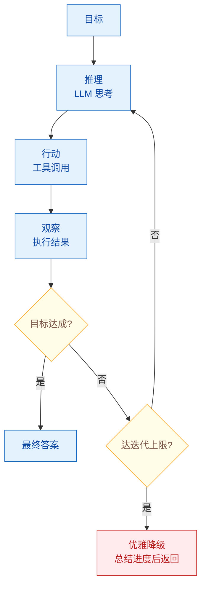
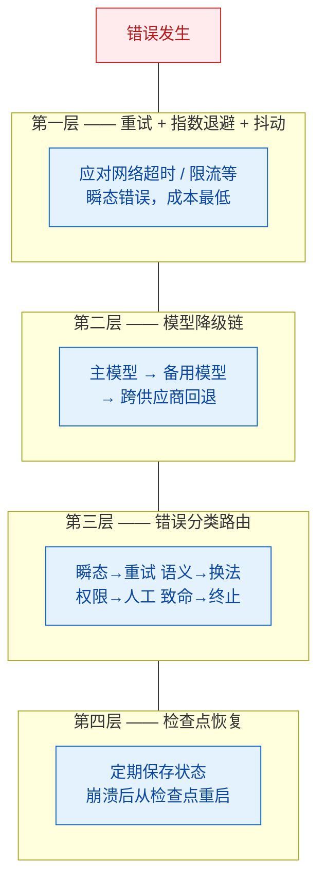

# Agent Loop 设计：循环控制、终止条件与错误恢复

> 难度：中级
> 分类：Agent 架构

## 简短回答

Agent Loop 是 Agent 与普通 LLM 调用的核心区别——Agent 通过"推理→行动→观察"的循环迭代完成任务。完整的 Agent Loop 设计包含两大关键维度：**正常流程的循环终止控制**和**异常情况的错误恢复机制**。

循环终止设计的核心原则是**外部强制（External Enforcement）**：由系统而非 Agent 自身保证终止。常用策略包括最大迭代次数限制、语义完成检测、重复输出检测、资源预算监控，以及达到上限后的优雅降级。

容错设计采用四层防御模型：带指数退避的重试机制（应对瞬态错误）→ 模型降级链（应对服务商故障）→ 错误分类路由（匹配正确的处理策略）→ 检查点恢复（应对崩溃）。正常终止与异常恢复共同构成生产级 Agent 的完整闭环。

## 详细解析

### 一、Agent Loop 的本质

Agent 的定义特征就是循环（Loop）。它使用 LLM 推理、执行工具、观察结果，然后重复，直到目标达成。这与单次 LLM 调用有本质区别：

```python
# 单次 LLM 调用
response = llm.generate(prompt)

# Agent Loop
while not done:
    thought = llm.reason(state)        # 推理
    action_result = execute(thought)    # 行动
    state = observe(action_result)      # 观察
    done = check_termination(state)     # 终止检查
```


*Agent Loop = 推理→行动→观察循环，终止由系统保证：目标达成即返回，达上限则优雅降级。*

### 二、为什么需要终止控制？

与传统代码中显而易见的死循环不同，Agent 的循环陷阱更加微妙：
- LLM 的概率性本质可能导致它**误解终止信号**
- 模糊的目标（如"研究 X"）没有明确的完成定义，会引发"无限好奇心"
- 工具调用失败后反复重试同一操作
- 工具过多或描述模糊导致选择混乱

### 三、五种终止策略

#### 1. 最大迭代次数（最基础也最关键）

```python
class AgentLoop:
    def __init__(self, max_iterations: int = 15):
        self.max_iterations = max_iterations

    def run(self, task: str) -> str:
        for i in range(self.max_iterations):
            result = self.step(task)
            if result.is_final:
                return result.answer
        # 达到上限：优雅降级
        return self.graceful_degradation()
```

不同框架的默认值：LangChain `AgentExecutor` 默认 15 次，Google ADK `LoopAgent` 可自定义上限。

#### 2. 语义完成检测

让 Agent 输出明确的终止标记：

```
"当你确信已回答问题时，以 'FINAL_ANSWER: ...' 结尾"
```

或通过结构化输出：
```python
class AgentResponse(BaseModel):
    thought: str
    action: Optional[ToolCall]
    final_answer: Optional[str]  # 非 None 时表示完成
```

#### 3. 重复输出检测

```python
def detect_loop(history: list[str], window: int = 3) -> bool:
    """检测 Agent 是否在重复相同的操作"""
    recent = history[-window:]
    return len(set(recent)) < len(recent)  # 有重复则判定为循环
```

#### 4. 资源预算监控

```python
class ResourceBudget:
    def __init__(self, max_tokens: int = 100_000, max_cost: float = 1.0):
        self.max_tokens = max_tokens
        self.max_cost = max_cost
        self.used_tokens = 0
        self.used_cost = 0.0

    def check(self) -> bool:
        return self.used_tokens < self.max_tokens and self.used_cost < self.max_cost
```

#### 5. 子 Agent 信号终止

在多 Agent 系统中，子 Agent 可以通过事件、标志或特定返回值向 Orchestrator 发出终止信号。

### 四、不同架构的终止机制对比

| 架构 | 终止方式 | 特点 |
|------|---------|------|
| **ReAct** | LLM 在 response 中生成终止 token（如 "Final Answer:"） | 默认继续，主动终止 |
| **MemGPT** | `request_heartbeat` 默认为 False | 默认终止，主动继续 |
| **Plan-and-Execute** | 计划中的所有步骤执行完毕 | 确定性终止 |
| **现代 Agent** | 多步工具调用 + 自导向终止条件 | 混合策略 |

"默认终止 vs 默认继续"是一个关键的设计决策。MemGPT 的设计哲学是默认终止更安全——Agent 必须显式请求继续执行，而非依赖 LLM 判断何时停止。

### 五、达到上限后的优雅降级

当 Agent 达到迭代上限时，不应简单地崩溃或返回空结果：

```python
def graceful_degradation(self):
    """优雅降级：总结已有进度，而非直接失败"""
    return self.llm.generate(
        f"你已达到最大步数限制。基于以下已完成的工作，"
        f"给出你目前能提供的最佳答案：\n{self.state.summary()}"
    )
```

关键策略：
- **进度总结**：汇报已完成和未完成的部分
- **状态检查点**：保存当前状态以便后续恢复
- **模型降级**：切换到更便宜的模型完成剩余工作
- **人工升级**：通知人类介入处理

### 六、根因分析：为什么反复达到上限？

迭代上限是**症状检测器，不是疾病本身**。如果 Agent 反复触及上限，真正的问题通常是：

1. **目标模糊**：缺少明确的完成标准
2. **工具签名不清**：工具描述有歧义，LLM 不知道选哪个
3. **停止条件弱**：没有教会 LLM 识别"已完成"
4. **Prompt 设计差**：没有在 System Prompt 中定义终止规则

### 七、完成判定也要外部化：verification-gated（2026-08）

终止控制回答"什么时候该停"，但外部强制还有第二个落点常被忽略：Agent 停下来之后声称"做完了"，这个"做完了"本身由谁裁定？多数实现默认 Agent 自评——输出 `FINAL_ANSWER` 就算任务完成，等于把终止权外部化了，**验收权**却还留在 Agent 手里。而语义错误（代码能编译、能跑、却干错事）恰恰在这一步无法自查。

SemaPLC（2026-08）在工业 PLC 代码生成（可编程逻辑控制器，改错会造成物理后果）这类高风险场景把它做成硬门禁——**verification-gated**（以验证为闸门）：Agent 不能自判完成，"我做完了"只是一个待验证的声明；必须由**日志化的外部检查**全通过才算完成——规格核对、编译、实机运行时行为，任一不过就回到循环继续修。检查是分层的，越往后越接近真实：前两层停留在静态与语法层面，第三层才触及语义正确性，只做前两层正好漏掉最危险的那类错误。

和第五节的优雅降级放在一起看，终止控制的完整形态是三段而非一段：

| 环节 | 谁说了算 | 对应机制 |
|------|---------|---------|
| 什么时候必须停 | 系统 | 迭代上限、资源预算、重复检测 |
| **算不算做完** | **外部验证** | **规格核对 + 编译 + 运行时行为，全程日志化** |
| 没做完怎么收场 | 系统 | 优雅降级、检查点、人工升级 |

中间这一格空着的系统，前后两格做得再好也只是"按时停下来了"，不代表"做对了"。任务风险越高（改生产代码、控制物理设备、动钱），越该把这一格补成硬门禁。

### 八、Agent 错误的特殊性

Agent 的错误比传统应用更难处理，因为：
- **级联放大**：一次工具调用失败会影响后续所有决策
- **语义错误**：LLM 生成的代码可能通过编译但执行错误操作（如删除而非更新）
- **状态失同步**：Agent 对环境的内部认知与实际状态不一致
- **概率性**：同样的输入可能产生不同的错误

### 九、四层容错模型


*容错四层防线由廉到贵：重试退避 → 模型降级链 → 错误分类路由 → 检查点恢复，逐层兜底。*

#### 第一层：重试 + 指数退避 + 抖动

处理最常见的瞬态错误（网络超时、API 限流）：

```python
import random
import time

class RetryWithBackoff:
    def __init__(self, max_retries=3, base_delay=1.0, max_delay=60.0):
        self.max_retries = max_retries
        self.base_delay = base_delay
        self.max_delay = max_delay

    def execute(self, func, *args):
        for attempt in range(self.max_retries):
            try:
                return func(*args)
            except TransientError as e:
                if attempt == self.max_retries - 1:
                    raise
                delay = min(
                    self.base_delay * (2 ** attempt) + random.uniform(0, 1),
                    self.max_delay
                )
                time.sleep(delay)
```

**关键设计决策**：重试中间件应放在降级中间件**之前**。先重试主模型几次，再降级到备用模型，避免主模型短暂不可用就过早降级。

#### 第二层：模型降级链

当主模型持续不可用时，切换到备用模型：

```python
class ModelFallbackChain:
    def __init__(self):
        self.chain = [
            {"provider": "anthropic", "model": "claude-sonnet-4-5-20250929"},
            {"provider": "anthropic", "model": "claude-haiku-4-5-20251001"},
            {"provider": "openai", "model": "gpt-4o-mini"},  # 跨供应商降级
        ]

    def call(self, prompt: str) -> str:
        for model_config in self.chain:
            try:
                return self._call_model(model_config, prompt)
            except (RateLimitError, ServiceUnavailableError):
                continue
        raise AllModelsFailedError("所有模型均不可用")
```

最佳实践：每个供应商至少定义一个备选模型，并设置跨供应商降级（如 Anthropic → OpenAI）。

#### 第三层：错误分类与路由

**不是所有错误都应该重试。** 正确分类错误是高效容错的关键：

```python
class ErrorClassifier:
    def classify(self, error: Exception) -> ErrorType:
        if isinstance(error, (TimeoutError, RateLimitError)):
            return ErrorType.TRANSIENT      # → 重试
        elif isinstance(error, ToolOutputError):
            return ErrorType.LLM_RECOVERABLE  # → 让 LLM 换个方式调用
        elif isinstance(error, AuthorizationError):
            return ErrorType.HUMAN_REQUIRED   # → 通知人类
        elif isinstance(error, InvalidToolInput):
            return ErrorType.PROMPT_FIXABLE   # → 重新格式化输入
        else:
            return ErrorType.FATAL            # → 终止并报告

class ErrorHandler:
    def handle(self, error: Exception, context: AgentState):
        error_type = self.classifier.classify(error)

        if error_type == ErrorType.TRANSIENT:
            return self.retry_with_backoff(context)
        elif error_type == ErrorType.LLM_RECOVERABLE:
            return self.ask_llm_to_reformulate(context)
        elif error_type == ErrorType.HUMAN_REQUIRED:
            return self.escalate_to_human(context)
        elif error_type == ErrorType.PROMPT_FIXABLE:
            return self.fix_and_retry(context)
        else:
            return self.abort_with_summary(context)
```

#### 第四层：检查点与状态恢复

对于长时间运行的 Agent 任务，定期保存状态：

```python
class CheckpointManager:
    def __init__(self, storage):
        self.storage = storage

    def save(self, thread_id: str, state: AgentState):
        """在每步完成后保存检查点"""
        self.storage.save({
            "thread_id": thread_id,
            "step": state.current_step,
            "completed_actions": state.history,
            "partial_results": state.results,
            "timestamp": time.time()
        })

    def restore(self, thread_id: str) -> AgentState:
        """从最近的检查点恢复"""
        checkpoint = self.storage.load(thread_id)
        return AgentState.from_checkpoint(checkpoint)
```

### 十、级联失败预防

Agent 系统中的单点故障不只影响一个功能——它会在每次工具调用、每次重试、每个 token 中放大。防止级联失败的核心原则：**假设 LLM、Agent 组件和外部数据源都可能不可用。**

**断路器模式（Circuit Breaker）**：

```python
class CircuitBreaker:
    def __init__(self, failure_threshold=5, recovery_timeout=60):
        self.failures = 0
        self.threshold = failure_threshold
        self.recovery_timeout = recovery_timeout
        self.state = "CLOSED"  # CLOSED → OPEN → HALF_OPEN
        self.last_failure_time = None

    def call(self, func, *args):
        if self.state == "OPEN":
            if time.time() - self.last_failure_time > self.recovery_timeout:
                self.state = "HALF_OPEN"
            else:
                raise CircuitOpenError("服务不可用，快速失败")

        try:
            result = func(*args)
            self._on_success()
            return result
        except Exception as e:
            self._on_failure()
            raise

    def _on_failure(self):
        self.failures += 1
        self.last_failure_time = time.time()
        if self.failures >= self.threshold:
            self.state = "OPEN"

    def _on_success(self):
        self.failures = 0
        self.state = "CLOSED"
```

### 十一、容错机制的推荐实施顺序

1. **重试策略先行**：用最少代码处理最常见的故障
2. **模型降级其次**：定义备选模型和跨供应商回退
3. **错误分类第三**：区分瞬态错误、LLM 可恢复错误、需人工错误
4. **检查点最后**：生产环境用持久化存储，通过 thread_id 支持恢复

## 常见误区 / 面试追问

### 循环终止相关

1. **误区："设大一点的 max_iterations 就行"** — 盲目增大上限只会增加成本和延迟。应该先分析为什么达到上限，修复根因（目标不清、工具不当、Prompt 不佳）。

2. **误区："让 LLM 自己决定什么时候停"** — LLM 可能无法可靠判断任务完成。必须在系统层面设置硬性终止条件作为兜底。

3. **追问："如何设定合理的 max_iterations？"** — 根据任务类型估算：简单问答 3-5 步，多步研究 10-15 步，复杂分析 20-30 步。建议从小值开始，通过观测实际使用情况逐步调整。

4. **追问："Agent 的两个循环（Inner Loop / Outer Loop）是什么？"** — Inner Loop 是单次任务内的"思考-行动-观察"循环。Outer Loop 是跨任务的"执行-评估-改进"循环（如 Reflexion 的自我反思机制）。

5. **追问："终止条件外部化了，为什么还需要外部验证完成？"** — 这是两件事：终止控制管"什么时候必须停"，完成判定管"算不算做完"。多数实现让 Agent 输出 `FINAL_ANSWER` 就自动认定完成，验收权还在 Agent 手里，而语义错误（代码能编译但干错事）恰恰无法自查。SemaPLC（2026-08）在工业 PLC 代码生成场景做成硬门禁：Agent 不能自判完成，必须由日志化的外部检查（规格核对、编译、实机运行时行为）全通过才算完成。风险越高的场景越该补上这道门禁。

### 错误恢复相关

6. **误区："所有错误都重试就行"** — 限流需要重试，但工具返回垃圾数据需要让 LLM 重新构造查询，权限错误需要人工介入。错误分类是高效容错的前提。

7. **误区："Agent 自己能处理所有错误"** — 语义错误（生成的代码逻辑错误）和状态失同步（Agent 的认知与实际不符）需要外部验证机制。不能完全依赖 Agent 自我纠错。

8. **追问："如何处理 Agent 的'幻觉式修复'？"** — Agent 可能声称修复了问题但实际没有。解决方案：(1) 工具调用结果做独立验证；(2) 关键操作后检查状态一致性；(3) Human-in-the-Loop 审核关键修复。

9. **追问："容错机制本身的成本如何控制？"** — 重试和降级会增加延迟和费用。设置总预算（token 上限 + 金额上限 + 时间上限），达到任一上限就优雅终止。

### 场景追问

10. **"你的 Agent 在调用工具时陷入无限循环，反复调用同一个工具参数略有不同但总是失败。如何修复？"** — 这是最危险的 Agent 故障模式。修复路径：(1) 立即设置 `max_tool_retries` 限制单工具重试次数；(2) 工具返回明确错误信息，说明为什么失败（而非模糊的"失败"）；(3) 错误分类：识别这是 TRANSIENT 错误还是需要 LLM 调整策略的错误；(4) 检查工具 Schema 是否清晰，LLM 是否理解了参数约束；(5) 加入重复检测模式，当检测到连续 N 次调用同一工具时强制停止或请求人类干预。

11. **"你的多 Agent 系统中 Agent A 和 Agent B 陷入死循环，反复互相传递任务而无法进展。如何修复？"** — 这是多 Agent 系统特有的故障。修复路径：(1) 限制 Handoff 次数，超过阈值强制终止或转给 Supervisor Agent；(2) 每次传递时要求携带"进展状态"，如果状态无变化则中断；(3) 加入超时机制，单次任务总时长超过限制则终止；(4) 在 Handoff 点记录完整 Trace，复现时检查是哪个 Agent 的决策导致死循环；(5) 设计"逃生路由"：遇到异常情况转给兜底 Agent 或直接返回用户友好错误。

12. **"你的 Agent 在生产环境突然开始频繁产生幻觉，输出中包含不存在的引用和数据。如何快速定位和修复？"** — 这是 prompt 漂移或模型更新的典型症状。修复路径：(1) 立即检查是否有模型/ prompt 版本最近更新 → 如有，紧急回滚；(2) 对比最近 24 小时和正常时期的 Trace，找出变化的模式（如新增了某类查询导致 prompt 触发不同分支）；(3) 检查检索系统的输出质量，可能是检索失效导致 Agent 只能依赖自身知识；(4) 加入幻觉检测护栏，对引用来源进行验证；(5) 启用人工审核通道，高风险输出转人工确认。

13. **"你的 RAG 系统检索结果与用户查询完全无关，检索指标显示 Recall 接近 0。如何修复？"** — 这是检索系统失效的典型场景。修复路径：(1) 检查 embedding 模型是否匹配语料语言（如用英文模型检索中文文档）→ 重新选择/训练适配的 embedding 模型；(2) 检查分块策略是否破坏了语义完整性（如按固定字符切分导致上下文丢失）→ 调整为语义分块或重叠分块；(3) 检查向量数据库索引是否损坏 → 重建索引；(4) 检查查询是否包含领域术语未在语料中出现 → 加入查询扩展或同义词映射；(5) 加入混合检索（BM25 + 向量）兜底。

## 参考资料

- [The Two Agentic Loops: How to Design and Scale Agentic Apps (Plano)](https://planoai.dev/blog/the-two-agentic-loops-how-to-design-and-scale-agentic-apps)
- [Agent Loop Definition: How AI Agents Use Iterative Processes (Glean)](https://www.glean.com/ai-glossary/agent-loop)
- [Cap the Max Number of Iterations (LangChain)](https://python.langchain.com/v0.1/docs/modules/agents/how_to/max_iterations/)
- [Rearchitecting Letta's Agent Loop: Lessons from ReAct, MemGPT, & Claude Code (Letta)](https://www.letta.com/blog/letta-v1-agent)
- [Loop Agents (Google ADK)](https://google.github.io/adk-docs/agents/workflow-agents/loop-agents/)
- [4 Fault Tolerance Patterns Every AI Agent Needs in Production (DEV Community)](https://dev.to/klement_gunndu/4-fault-tolerance-patterns-every-ai-agent-needs-in-production-jih)
- [Error Recovery and Fallback Strategies in AI Agent Development (GoCodeo)](https://www.gocodeo.com/post/error-recovery-and-fallback-strategies-in-ai-agent-development)
- [Preventing Cascading Failures in AI Agents (Will Velida)](https://www.willvelida.com/posts/preventing-cascading-failures-ai-agents)
- [Mastering Retry Logic Agents: 2025 Best Practices (SparkCo)](https://sparkco.ai/blog/mastering-retry-logic-agents-a-deep-dive-into-2025-best-practices)
- [Error Handling in Distributed Systems (Temporal)](https://temporal.io/blog/error-handling-in-distributed-systems)
- [SemaPLC: Project-Grounded, Verification-Gated Agent Harness for PLC Code (arXiv)](https://arxiv.org/abs/2608.18565)
