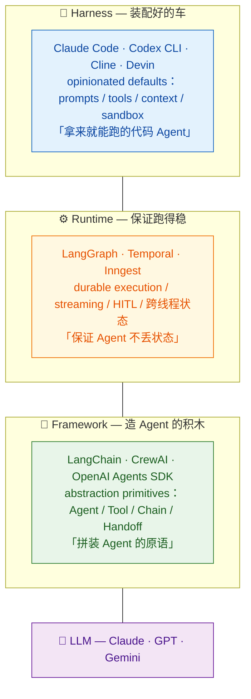
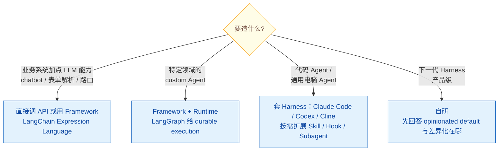

# 什么是 Agent Harness？与 Framework / Runtime 三层抽象有何区别？

> **难度**: 中级
> 🆕 2026 新增（Harness 主题）

## 简短回答

Agent Harness 是 2025-2026 年新晋的行业术语，指**"模型之外的一切"**——围绕固定 LLM 构建的、有强意见的运行壳：默认 system prompt、Tool Registry、Context 工程、Hook 生命周期、沙箱与权限模型全套打包。LangChain 官方在 2025-10 提出的三层抽象很好地厘清了边界：**Framework**（LangChain / CrewAI / OpenAI Agents SDK）给你"积木"；**Runtime**（LangGraph / Temporal / Inngest）给你"durable execution"；**Harness**（Claude Code / Codex CLI / Cline / Devin）给你"一辆装配好的车"。Parallel.ai 的实证数据点出 harness 大约决定 Agent 70% 的实战表现，Terminal Bench 2.0 上同一个 Claude Opus 4.6 换 harness 可从 #33 跳到 ~#5——这就是为什么 Devin 和 Claude Code 都不用 LangGraph 而要自研。

**Cheat sheet**：
- **三层抽象（自下而上）**：LLM → Framework（积木） → Runtime（持久化执行） → Harness（装配好的代码 Agent）
- **Harness ≠ Framework**：opinionated vs unopinionated；前者只让你 customize 四件事（system prompt / tools / context / subagents）
- **Harness 最小抽象 6+1**：Loop / State / Tool / Memory / Hook / Skill +（Observability）
- **核心数据点**：Terminal Bench 2.0「harness > 模型」杠杆 —— 同模型不同 harness 排名差异 28 位
- **Post-training Coupling**：Codex 模型权重已绑定 `apply_patch` 工具签名，换 harness 等于丢能力

## 详细解析

### 一、三层抽象：从 LangChain 官方说起

LangChain 官方博文（2025-10）首次系统化提出 Agent 软件栈的三层分类，迅速成为 2026 业界共识：


*三层抽象自下而上：LLM → Framework（积木）→ Runtime（持久化执行）→ Harness（装配好的车）。*

**一句话区分**：
- Framework 教你"如何拼装 Agent"
- Runtime 让你"Agent 拼装好后跑得稳"
- Harness 直接给你"拼装好且调好性格的 Agent"

### 二、Harness 的最小完整抽象（6+1）

社区收敛出的 Harness 通用抽象（Addy Osmani、HumanLayer、atalupadhyay 三方一致）：

| 模块 | 职责 | Claude Code 中的实现 |
|------|------|---------------------|
| **Loop** | ReAct 主循环：reason → tool call → observe → repeat；终止条件 / 超时 / 用户中断 | 内置 agent loop，max_turns 可配 |
| **State / Context** | 消息历史 + token 预算 + compaction 策略 | 75% 自动 compact + Memory tool |
| **Tool** | 工具注册表 + schema + 执行沙箱 | 内置工具 + MCP server + Skill bash |
| **Memory** | 会话/项目级 append-only 日志 + flush/replay | CLAUDE.md + `~/.claude/projects/<id>/memory/` |
| **Hook** | 生命周期事件 pre/post 拦截 → 策略执行 | 12+ 事件，5 种 handler，PreToolUse 可硬拦 |
| **Skill** | Progressive disclosure 的领域知识包 | 三级懒加载（metadata / body / resources） |
| **Observability** | trace / replay / cost-latency 度量 | trace JSON + Anthropic Console |

**关键判断**：MCP 不是 Harness 的核心抽象（它是 Tool 层的一个 *实现* 选项），Slash Command 也不是（它是 Skill 的简化形式）。Harness 设计要回答的本质问题是：**用户能扩展什么、不能扩展什么？**

### 三、为什么 Devin / Claude Code 不用 LangGraph 而自研？

这是 2026 年最常被问的"反框架"问题，背后有四个硬约束：

#### 1. Post-training Coupling（模型权重绑死工具签名）

OpenCode 团队在适配 Codex 模型时发现一个关键事实：**Codex 模型在 post-training 阶段已经被 *绑定* 到 `apply_patch` 工具的语法**（HumanLayer / Cline 同步证实）。要让 Codex 在自家 harness 里发挥水平，必须 *模仿* Codex 的 `apply_patch` 签名。换句话说——**模型对 harness 工具签名的"偏好"会被冻进权重**。这就是"harness 不可随便换"的根本原因。

#### 2. 延迟敏感（每步 < 100ms 是产品底线）

ReAct 主循环每步开销 < 100ms 是代码 Agent 体验的硬标准。LangGraph 的多层抽象（state graph 序列化 / checkpointer 写盘 / event bus）很难压到这个水位，对话感会变"卡"。

#### 3. Hook / Sandbox 不可让渡

生产 Agent 必须：
- 拦截 `rm -rf` / `git push --force` 这类 destructive command（Hook）
- 隔离 `apply_patch` 执行避免污染主机（Sandbox）

这两类能力是"开箱即用"还是"自己写"，直接决定 Agent 能不能上生产。框架很难做到 opinionated 的 lifecycle hook + 多平台 sandbox。

#### 4. Trace 数据是核心 IP

Harness 厂商把 trace 数据用来 fine-tune 自家模型（Claude Code 之于 Anthropic、Codex CLI 之于 OpenAI、Cline 之于 Cline.bot）。这些数据是"模型与 harness 协同进化"的飞轮，没人愿意走第三方框架把数据让出去。

#### 实证数据：Terminal Bench 2.0 的「harness > 模型」杠杆

| 配置 | 排名 |
|------|------|
| Claude Opus 4.6 + 通用框架 | #33 |
| Claude Opus 4.6 + Claude Code | ~#5 |
| Claude Opus 4.7 + Cline CLI | 74.2%（超过 Claude Code 同模型 69.4%） |

**HumanLayer 金句**："**It's not a model problem. It's a configuration problem.**"

### 四、Framework vs Harness 的可视化对照

| 维度 | Framework（LangChain / CrewAI / Agents SDK） | Harness（Claude Code / Codex / Cline） |
|------|---------------------------------------------|----------------------------------------|
| 给什么 | abstraction primitives | opinionated runtime |
| 你要做的 | 自己写 loop / memory / hook / sandbox | 只 customize 4 件事：system prompt、tools、context（CLAUDE.md / AGENTS.md）、subagents |
| 学习曲线 | "如何用框架 API" | "如何调 harness" |
| 适合 | custom 工作流编排 | 通用 Agent 任务 |
| 模型耦合 | 模型无关（理论上） | 模型耦合（post-training coupling） |
| 输出 | SDK 代码 | CLI / IDE 扩展 |

### 五、何时该用 Framework、Runtime、Harness？


*按要造的东西选层：加 LLM 能力用 Framework，领域 Agent 加 Runtime，代码 Agent 直接套 Harness，做下一代 Harness 才自研。*

### 六、代码示例：感受 Harness 与 Framework 的"opinionated"差异

```python
# Framework 风格（LangGraph）：自己拼装一切
from langgraph.graph import StateGraph, END
from langgraph.checkpoint.sqlite import SqliteSaver
from typing import TypedDict

class AgentState(TypedDict):
    messages: list
    next_step: str

def reason_node(state):
    # 自己决定怎么调 LLM、怎么解析输出、怎么决定下一步
    ...
    return {"messages": state["messages"] + [...], "next_step": "tool"}

def tool_node(state):
    # 自己实现工具调度、参数解析、错误处理
    ...

graph = StateGraph(AgentState)
graph.add_node("reason", reason_node)
graph.add_node("tool", tool_node)
graph.add_conditional_edges("reason", lambda s: s["next_step"])
# ... 你还要自己写: compaction / hook / sandbox / memory / observability


# Harness 风格（Claude Code，伪代码视角）：只配置 + 启动
# 用户视角：在项目根放一个 CLAUDE.md + .claude/ 目录
#
# .claude/
# ├── settings.json        # permission allowlist / hooks
# ├── hooks/
# │   └── pre-commit.sh    # 必须每次跑的 lint
# ├── skills/
# │   └── testing/SKILL.md # 写测试时按需加载
# └── agents/
#     └── reviewer.md      # subagent 定义
#
# 然后:
#   $ claude
# 即得到一个"懂你 repo、懂你工具、懂你流程"的代码 Agent
# loop / memory / sandbox / observability 全部 opinionated 内置
```

**核心洞察**：Framework 让你"造 Agent"；Harness 让你"开 Agent"。Harness 的"opinionated default"反过来是约束，但也是让你少写 80% 基建代码的捷径。

### 七、前沿动向：Harness 本身成为优化对象（2026-08）

前面六节讲的都是"人怎么设计 harness"。2026-08 集中出现的一批论文把 harness 推到了另一个位置：**它不再只是人工设计的对象，而是可被搜索、演化、甚至在线训练的优化对象**。这是在原结论（harness 决定约七成实战表现）之上新增的一个维度，不是对它的推翻——恰恰相反，正因为杠杆在 harness 上，把优化力气花在这一层才划算。

**以下均为社区单次实验、尚无独立复现**，引用时务必连出处与日期一起标注，不要当成已确立的结论。

#### 1. 量化：不动模型权重，只加厚 harness 能拿多少分

*StateM: 95.3% on Terminal-Bench 2.1 via Harness Scaling*（[arXiv 2608.15089](https://arxiv.org/abs/2608.15089)，2026-08-15）提出 **harness scaling**（harness 扩展：不增参数、不改权重，只把模型外面那层运行时做厚）。该文的做法是用 agent 原生运行时把执行重新组织成五件事：持久状态、阶段局部上下文（每个阶段只看该阶段需要的那部分上下文）、受检状态转移（状态跳转前先校验前置条件）、可恢复 runbook（中断后能接着跑的操作手册）、带版本的过程性实践（沉淀下来的做法本身带版本号）。

据其实验，Terminal-Bench 2.1 上同一个 GPT-5.5 xhigh 从 **83.1% 提升到 92.1%**（+9.0pp），论文标题给出的最好成绩为 **95.3%**。模型是常量，涨的分全部来自 harness——这是本节最硬的一条量化实证，也是对第三节 Terminal Bench 2.0「harness > 模型」杠杆的直接补强。

#### 2. 方法：谁来改 harness

- *DarwinX: Evolving Agent Harnesses Through Natural Selection*（[arXiv 2608.07545](https://arxiv.org/abs/2608.07545)）冻结模型权重，只演化 prompt / 工具 / 技能 / 控制流这四样东西。两个设计值得记：一是 **preserve-and-extend 契约**（新变体必须保住老能力才准入，凡导致回归的一律拒绝），二是适应度直接由 benchmark 自带的 **verifier**（判定通过与否的校验器）给出，**不需要标准答案**——这让演化循环可以脱离人工标注跑下去。
- *AutoDesign: Meta-Harness Optimization for Long-Horizon Agentic Design*（[arXiv 2608.13560](https://arxiv.org/abs/2608.13560)）走的是另一条路：用一个 **meta-optimizer**（管优化器的优化器）指导 code agent 依据 **rollout**（跑完一整轮任务留下的完整轨迹）反馈，递归改写自己的 harness。据其报告，被优化的对象和执行优化的对象是同一套代码。

一句话概括这条线：DarwinX 是"自然选择"，AutoDesign 是"自我改写"，共同点是**把工程师从 harness 调参循环里换了出去**。

#### 3. 边界扩展：harness 这个概念在往外长

- *EnvHarness: Awakening Static Worlds for Agent Learning*（[arXiv 2608.19880](https://arxiv.org/abs/2608.19880)，2026-08-20）提出**环境 harness**：用一层可插拔、可编程的组件包住静态环境，不改底层逻辑就能重塑其行为。相当于把 harness 的思路从"包住模型"搬到了"包住环境"。
- *Zetta ζ: An Efficient Closed-Loop Embodied Harness*（[arXiv 2608.16590](https://arxiv.org/abs/2608.16590)）冻结基座策略，在线演化"代码化运行时 critic（用代码写成的实时评判器）+ 恢复技能"，并做三重时间尺度分离（执行、评判、技能沉淀各跑各的节奏）。该文报告其关键差异是**不再依赖 episode 结束后的事后反思**——问题在跑的过程中就被接住。

#### 4. 失效条件：harness 组件不是加了就有用

*Demystifying Agent Skills: Why They Work—Until They Don't*（[arXiv 2608.14036](https://arxiv.org/abs/2608.14036)）对 Agent Skills 做了归因拆解，分离出四个因素：表示形式、结果标注、检索难度、跨框架鲁棒性。该文据此回答"技能什么时候有用、在哪里失效"。对照第二节的 6+1 抽象读这篇的价值在于：**Skill 这一格填上了不等于收益到手**，检索不到、跨 harness 迁不动的技能等于没有。

#### 分叉：两种 harness 演进路线

| 维度 | 手工设计 harness（当前主流） | 自动搜索 / 演化 harness（本期方向） |
|------|------------------------------|--------------------------------------|
| 谁来改 | 人：读 trace、改 prompt、加工具 | 演化循环 / meta-optimizer 按 rollout 反馈自动改写 |
| 优化信号 | 工程师判断 + 离线跑分 | benchmark 自带 verifier 的通过/失败信号，不需标准答案 |
| 迭代周期 | 天到周 | 小时级（DarwinX / AutoDesign）到在线（Zetta 在 episode 内） |
| 防退步机制 | 人工回归测试 + code review | preserve-and-extend 契约：导致回归的变体直接拒绝 |
| 可解释性 | 高，改动都是人写的 | 低，搜出来的 harness 未必讲得清为什么有效 |
| 成熟度 | 生产在跑（Claude Code / Codex / Cline） | 论文阶段，单次实验、未经复现 |

**怎么看这条分叉**：短期内生产系统仍然是手工设计 harness 的天下——可解释性和可回滚性在生产环境不可让渡。但 StateM 那 9 个百分点说明 harness 这一层还有大量未被人工榨干的空间，而 DarwinX / AutoDesign 给出的是"让机器去榨"的可行路径。面试里被问到"harness 的未来"，这条线比"再加个工具"更值得讲。

## 常见误区 / 面试追问

- **误区 1：「Harness 就是另一种框架」** — 表面上都是"模型外面的代码"，但本质完全不同。Framework 是"unopinionated 积木箱"，需要你自己拼装 loop / memory / hook；Harness 是"opinionated 装配好的车"，loop / memory / hook 全部内置，你只能在框架预留的扩展点（CLAUDE.md / Hook / Skill / Subagent）做定制。换言之，**Framework 给自由 + 责任，Harness 给约束 + 默认值**。

- **误区 2：「自研 Harness 是过度设计，直接用 LangGraph 就行」** — 对一般业务系统确实是过度设计，但对"代码 Agent / 通用电脑 Agent"这类需要 opinionated default + post-training coupling 的产品，框架抽象层会成为天花板。Devin / Claude Code / Codex / Cline 这些 SOTA 产品全部自研 harness 不是偶然。

- **误区 3：「换模型不需要换 harness」** — Post-training coupling 让模型与 harness 形成深度绑定。Codex 模型脱离 `apply_patch` 签名性能会掉，Claude Sonnet 在 Claude Code 与在通用 chat 中表现是两个性格。**模型与 harness 是一对深度耦合的系统**。

- **追问 1：「LangChain / OpenAI Agents SDK 算 Framework 还是 Harness？」** → 答：都是 Framework（LangChain 自家文档明确）。判断标准：是否给出 opinionated 默认 prompt + tool + sandbox + hook 全套？是否拿来就能跑出一个"有性格的 Agent"？LangChain / Agents SDK 不给默认 prompt 与默认 tool，所以是 Framework。DeepAgents（LangChain 2025-11 推出的 harness）才算 Harness。

- **追问 2：「Harness 与 SDK 是什么关系？」** → 答：SDK 是"客户端库"层面的概念（OpenAI Agents SDK、Claude Agent SDK），描述的是"如何调用 API 的 Python/TS 类库"；Harness 是"应用形态"层面的概念，描述的是"装配好的 Agent 产品"。Claude Code = harness，但底层用 Claude Agent SDK；Cursor = harness，底层有自家 Composer SDK。SDK 是 harness 的实现砖块之一。

- **追问 3：「『Harness > 模型』杠杆数据点出自哪里？怎么验证？」** → 答：出自 Terminal Bench 2.0（2026-Q1）。同一个 Claude Opus 4.6 在不同 harness 中跑分差距 28 个排名位次。可参考 Artificial Analysis 的 Coding Agents Leaderboard 持续追踪。这背后的机制是：harness 的 system prompt + tool 选择 + context 工程 + retry 策略 + sandbox 隔离五者协同作用，对单步 ReAct 的正确率有乘法效应。

- **追问 4：「Cline SDK 2026-05 为什么把 runtime 从 IDE 剥离？这意味着什么？」** → 答：意味着 Harness 进入"runtime 独立化"阶段。`@cline/sdk` 把 agent loop 从 VS Code 插件里彻底拆出，可在 CLI / Web / CI 任意 surface 上调用。这预示 2026-2027 行业方向：**Harness 从"单一产品形态"演化为"runtime + 多 surface 适配器"**——同一份 agent runtime 跑 IDE、跑终端、跑 CI、跑 Kanban。

- **追问 5：「harness 既然决定七成表现，能不能干脆自动搜出最优 harness？」** → 答：2026-08 这个方向刚出现第一批工作，可以答"路径已经跑通，但离生产还有距离"。方法侧：DarwinX（[arXiv 2608.07545](https://arxiv.org/abs/2608.07545)）冻结权重只演化 prompt / 工具 / 技能 / 控制流，用 benchmark 自带 verifier 当适应度、用 preserve-and-extend 契约拒绝导致回归的变体；AutoDesign（[arXiv 2608.13560](https://arxiv.org/abs/2608.13560)）让 meta-optimizer 指导 code agent 按 rollout 反馈递归改写自身 harness。效果侧：StateM（[arXiv 2608.15089](https://arxiv.org/abs/2608.15089)，2026-08-15）据其实验在 Terminal-Bench 2.1 上把 GPT-5.5 xhigh 从 83.1% 推到 92.1%，证明这一层确实还有空间。**答题时务必补两句限定**：一是这些都是社区单次实验、尚无独立复现；二是自动搜出的 harness 可解释性差、难回滚，生产环境短期内仍会是手工设计为主。

## 参考资料

- [LangChain Blog — Agent Frameworks, Runtimes, and Harnesses](https://www.langchain.com/blog/agent-frameworks-runtimes-and-harnesses-oh-my) — 三层抽象的官方定义出处
- [Parallel.ai — What Is an Agent Harness?](https://parallel.ai/articles/what-is-an-agent-harness) — "everything except the LLM itself" 经典定义 + 70% 性能数据点
- [HumanLayer — Skill Issue: Harness Engineering for Coding Agents](https://www.humanlayer.dev/blog/skill-issue-harness-engineering-for-coding-agents) — "It's not a model problem. It's a configuration problem." 出处 + Post-training coupling 详解
- [Addy Osmani — Agent Harness Engineering](https://addyosmani.com/blog/agent-harness-engineering/) — Harness 6+1 抽象 + Ralph Loop / Sprint Contracts 高级模式
- [Cline Blog — Introducing the Cline SDK](https://cline.bot/blog/introducing-cline-sdk-the-upgraded-agent-runtime) — 2026-05 Runtime 与 IDE 解耦范式
- [atalupadhyay — The Agent Harness: What It Is, Why It Matters](https://atalupadhyay.wordpress.com/2026/05/02/the-agent-harness-what-it-is-why-it-matters-and-how-to-build-one-from-scratch/) — 从零构建 harness 的工程视角
- [Anthropic — Equipping Agents for the Real World with Agent Skills](https://www.anthropic.com/engineering/equipping-agents-for-the-real-world-with-agent-skills) — Progressive Disclosure 与 Harness 中 Skill 抽象的关系
- [Artificial Analysis — Coding Agents Leaderboard](https://artificialanalysis.ai/agents/coding) — Terminal Bench 实时排行，「Harness > 模型」杠杆的持续证据
- [arXiv 2609.01437 — HarnessDev: Can LLMs Create and Evolve Their Own Agent Harness?](https://arxiv.org/abs/2609.01437) — 学术侧把 harness 当作可自动优化对象的系统研究（HF Daily Papers 238 upvotes，2026-09；更多同向工作见 docs/pending/118 立题草稿）

**前沿动向（2026-08，社区单次实验、未经独立复现）**：

- [StateM: 95.3% on Terminal-Bench 2.1 via Harness Scaling（arXiv 2608.15089，2026-08-15）](https://arxiv.org/abs/2608.15089) — harness scaling 提出，同模型 83.1% → 92.1% 的量化实证
- [DarwinX: Evolving Agent Harnesses Through Natural Selection（arXiv 2608.07545）](https://arxiv.org/abs/2608.07545) — 冻结权重演化 harness，preserve-and-extend 契约 + verifier 适应度
- [AutoDesign: Meta-Harness Optimization for Long-Horizon Agentic Design（arXiv 2608.13560）](https://arxiv.org/abs/2608.13560) — meta-optimizer 指导 code agent 按 rollout 反馈递归改写自身 harness
- [EnvHarness: Awakening Static Worlds for Agent Learning（arXiv 2608.19880，2026-08-20）](https://arxiv.org/abs/2608.19880) — 把 harness 思路从"包住模型"扩到"包住环境"
- [Zetta ζ: An Efficient Closed-Loop Embodied Harness（arXiv 2608.16590）](https://arxiv.org/abs/2608.16590) — 冻结基座策略，在线演化运行时 critic 与恢复技能，三重时间尺度分离
- [Demystifying Agent Skills: Why They Work—Until They Don't（arXiv 2608.14036）](https://arxiv.org/abs/2608.14036) — Skill 收益的四因素归因：表示形式 / 结果标注 / 检索难度 / 跨框架鲁棒性

## 相关阅读

- [007 — Workflow vs Agent](007-workflow-vs-agent.md)：Harness 是"光谱右端"的高自主性方案，需要工作流配合
- [098 — 框架 vs 自研](../11-frameworks/098-framework-vs-custom.md)：Harness 是"自研 vs 框架"之外的**第三种选择**
- [099 — OpenAI Agents SDK vs Claude Agent SDK](../11-frameworks/099-assistants-api-vs-claude-sdk.md)：两家 SDK 是构建 Harness 的"砖块"层
- [110 — Coding Agent Harness 横评](../11-frameworks/110-coding-agent-harness-comparison.md)：Harness 的产品级横向对比（深入篇）
