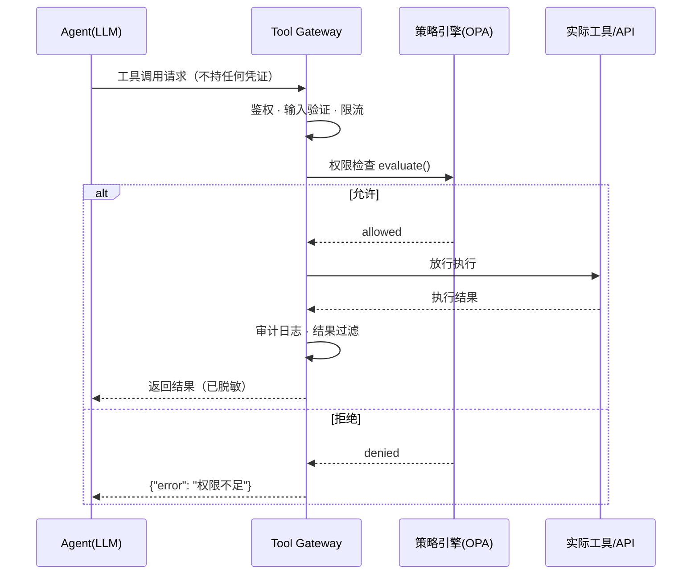

# 如何设计 Tool Gateway 和工具权限管理？

> 难度：中级
> 分类：Tool Use

## 简短回答

Tool Gateway 是 Agent 与工具之间的安全中间层——Agent 不直接调用工具，所有请求都经过 Gateway 做身份验证、权限检查、速率限制和审计日志。核心设计原则是**最小权限（Least Privilege）**和**将 Agent 视为不可信请求者**。权限管理采用 Policy-as-Code（如 OPA/Cedar）将授权逻辑外部化，配合 RBAC/ABAC 做细粒度控制。

## 详细解析

### 为什么需要 Tool Gateway？

没有 Gateway 的架构中，Agent 直接持有 API 密钥并调用外部服务。风险包括：
- Agent 被 Prompt Injection 操纵，调用不该调用的工具
- Agent 无意中执行破坏性操作（删除数据、发送未经审核的消息）
- 无法追踪和审计 Agent 的行为
- 凭证暴露在 Agent 的上下文中

### Gateway 架构


*Agent 不持有任何凭证：每次调用都被 Gateway 逐层拦截——鉴权、权限、校验、限流、审计、过滤。*

关键原则：**Agent 永远不直接与基础设施 API 通信。** Gateway 拦截每个请求，做验证、授权、执行。Agent 不持有任何凭证。

```python
class ToolGateway:
    def __init__(self, policy_engine, rate_limiter, audit_logger):
        self.policy = policy_engine      # OPA / Cedar
        self.limiter = rate_limiter
        self.logger = audit_logger
        self.tools = {}                  # 注册的工具

    async def execute(self, agent_id: str, tool_name: str, params: dict) -> dict:
        # 1. 身份验证
        agent = await self.authenticate(agent_id)

        # 2. 权限检查
        decision = self.policy.evaluate({
            "agent": agent,
            "tool": tool_name,
            "params": params,
            "context": {"time": now(), "user": agent.delegated_user}
        })
        if not decision.allowed:
            self.logger.log_denied(agent_id, tool_name, decision.reason)
            return {"error": f"权限不足: {decision.reason}"}

        # 3. 输入验证
        validated = self.validate_input(tool_name, params)

        # 4. 速率限制
        if not self.limiter.allow(agent_id, tool_name):
            return {"error": "请求过于频繁，请稍后重试"}

        # 5. 执行工具
        result = await self.tools[tool_name].execute(validated)

        # 6. 审计日志
        self.logger.log_execution(agent_id, tool_name, params, result)

        # 7. 结果过滤（去除敏感信息）
        return self.filter_sensitive(result, agent.permission_level)
```

### 权限模型

#### RBAC（基于角色的访问控制）

```python
# 角色定义
roles = {
    "reader_agent": {
        "allowed_tools": ["search_docs", "get_weather", "calculate"],
        "denied_tools": ["send_email", "delete_record", "execute_sql"],
    },
    "support_agent": {
        "allowed_tools": ["search_docs", "get_order", "create_ticket"],
        "denied_tools": ["delete_record", "modify_pricing"],
    },
    "admin_agent": {
        "allowed_tools": ["*"],  # 全部权限
        "requires_approval": ["delete_*", "modify_*"],  # 高危操作需审批
    },
}
```

#### ABAC（基于属性的访问控制）

更细粒度——基于请求的上下文属性做决策：

```python
# OPA Policy (Rego 语言)
# policy.rego
"""
package tool_access
import rego.v1  # OPA 1.0+ 必需；老版本用 import future.keywords.in

default allow = false

# 工作时间内允许发送邮件
allow {
    input.tool == "send_email"
    input.context.hour >= 9
    input.context.hour <= 18
    input.agent.role == "support_agent"
}

# 只允许查询自己负责的客户数据
allow {
    input.tool == "get_customer_data"
    input.params.customer_id in input.agent.assigned_customers
}

# 高危操作需要人工审批
allow {
    input.tool == "delete_record"
    input.context.human_approved == true
}
"""
```

### 委托授权（Delegated Authorization）

Agent 的权限不应超过委托它的用户的权限：

```python
class DelegatedAuth:
    def check(self, agent: Agent, tool: str, params: dict) -> bool:
        # Agent 的权限 = min(Agent 角色权限, 委托用户权限)
        agent_allowed = self.check_agent_role(agent.role, tool)
        user_allowed = self.check_user_permission(agent.delegated_user, tool)

        # 两者都允许才放行
        return agent_allowed and user_allowed
```

关键原则：人类用户常常被过度授权，Agent 的权限应该独立审查，不能简单继承用户的全部权限。

### Human-in-the-Loop 审批

```python
class ApprovalGateway:
    HIGH_RISK_TOOLS = ["send_email", "delete_record", "transfer_funds"]

    async def execute_with_approval(self, agent_id, tool, params):
        if tool in self.HIGH_RISK_TOOLS:
            # 暂停执行，等待人工审批
            approval_request = await self.request_human_approval(
                agent_id=agent_id,
                tool=tool,
                params=params,
                timeout=300  # 5 分钟超时
            )
            if not approval_request.approved:
                return {"error": "操作被人工拒绝", "reason": approval_request.reason}

        return await self.gateway.execute(agent_id, tool, params)
```

### 多 Agent 场景的权限挑战

多 Agent 工作流中，权限管理更复杂：
- Agent A 可能把任务委托给 Agent B
- Agent B 的权限不应超过 Agent A
- 需要追踪完整的委托链

```python
# 委托链追踪
class DelegationChain:
    def validate_delegation(self, from_agent, to_agent, tool):
        # to_agent 的权限不能超过 from_agent
        if not self.is_subset(to_agent.permissions, from_agent.permissions):
            raise PermissionError("被委托 Agent 权限不能超过委托者")
```

### 运行时护栏

除了权限控制，还需要内容级别的护栏：

```
输入护栏：扫描用户输入是否有恶意意图、越狱尝试、PII
    ↓
Agent 处理
    ↓
输出护栏：验证 Agent 输出是否有幻觉、毒性内容、敏感数据
```

### 治理流水线模式

将策略更新像软件发布一样管理：
1. 安全/法律团队编写策略 → 翻译为机器可读代码
2. 对历史日志做影响分析（模拟部署）
3. 确认无误后自动部署到全部 Agent

### 新动向：权限决策的上下文外包给宿主（Agent SDK，2026-08）

2026 年 8 月 Claude Agent SDK 的几次发布，把上面的两条原则——「Agent 视为不可信」和「最小权限」——直接落进了 SDK 的默认行为里。三条官方变更指向同一个方向：**权限决策所需的上下文由宿主（host，即运行 Agent 的那个应用进程）供给，默认可用的工具面同时收窄**。

**1）`classifierContext`：宿主向权限分类器注入断言（v0.3.236，2026-08-19）**

`PostToolUse` hook（工具执行完成后触发的回调）现在可以返回 `hookSpecificOutput.classifierContext`——一段简短的工具结果注释。auto 模式下的权限分类器（决定后续动作是否需要询问用户的那个判定组件）会连同工具结果一起读取这段注释。

```typescript
// PostToolUse hook：宿主基于自己掌握的事实，给权限分类器补一句注释
async function postToolUse(input) {
  const isProdTarget = await hostSideCheck(input.tool_input);  // 宿主自己查，不问 Agent
  return {
    hookSpecificOutput: {
      hookEventName: "PostToolUse",
      // 这段注释由宿主断言，权限分类器会连同工具结果一起读
      classifierContext: isProdTarget
        ? "该操作命中生产环境资源，后续同类调用应视为高危"
        : "该操作仅涉及本地临时目录",
    },
  };
}
```

关键在于**这段注释是宿主断言的，不是 Agent 自述的**。Agent 可以被 Prompt Injection 操纵去声称「我这个操作是安全的」，但它无法伪造 hook 的返回值——hook 跑在宿主进程里，读的是宿主自己掌握的事实。信任根（trust root，即整条信任链最终锚定的那个可信主体）仍然留在宿主侧，Agent 依旧是不可信请求者。这与本文 Gateway 的思路是同构的：判定权不在 Agent 手里，只是判定所需的上下文从「Gateway 自己查」扩展为「宿主主动喂」。

**2）Todo/任务追踪工具移出默认工具面（v0.3.233，2026-08-14，BREAKING）**

在 Opus 4.8、Sonnet 5、Fable 5、Mythos 5 及更新的模型上，任务追踪类工具（`TaskCreate` / `TaskGet` / `TaskUpdate` / `TaskList`，以及 `TodoWrite`）不再默认可用。要保留必须显式声明：

```python
# 方式一：显式写进工具白名单
options = ClaudeAgentOptions(
    model="claude-opus-4-8",
    allowed_tools=["Read", "Write", "TodoWrite", "TaskCreate", "TaskList"],
)

# 方式二：环境变量整体开启
# export CLAUDE_CODE_ENABLE_TODO_TOOLS=1
```

这是一次 breaking change（破坏性变更，升级后原有行为会直接改变），依赖这些工具的现有代码升级后会静默失去能力。但从权限设计角度看，方向和最小权限完全一致：**能力按需显式开启，而不是默认全给**。默认工具面越小，Gateway 需要防守的攻击面就越小——一个从没被授予的工具，不存在被 Prompt Injection 诱导调用的可能。

**3）peer `origin` 可声明发送方权限等级（v0.3.234，2026-08-17）**

宿主注入的 peer `origin`（对端来源标识，用于说明一条消息是谁发来的）可以携带 `fromMode` 字段声明发送方的权限等级。同等级的消息投递给免询问运行的接收方，不再逐条打断。这正是本文「委托授权」小节的工程化形态——委托链上的权限等级需要显式携带并校验，而不是靠接收方猜测。

三条变更放在一起看，趋势很清楚：Agent 运行时正在把「谁有权做什么」的决策权和上下文供给权，系统性地推给宿主应用。这对应到 Gateway 设计上意味着，宿主侧的 hook 逻辑本身成了安全边界的一部分——它和 Gateway 一样需要被审计、版本控制和影响分析，不能当成随手写的业务回调。

## 常见误区 / 面试追问

1. **误区："在 Agent 代码里做权限检查就够了"** — Agent 代码可能被 Prompt Injection 绕过。权限检查必须在 Agent 外部（Gateway 层）执行，作为独立的安全边界。

2. **误区："给 Agent 和用户一样的权限"** — 用户常常被过度授权。Agent 应该只获得完成当前任务所需的最小权限集。

3. **追问："Policy-as-Code 有什么好处？"** — (1) 授权逻辑与应用代码分离，安全团队可以独立管理；(2) 策略可以版本控制和审计；(3) 策略变更不需要重新部署应用代码。

4. **追问："AWS Bedrock 的 Policy 和自建 Gateway 有什么区别？"** — 云服务商的方案（如 Bedrock AgentCore Policy）在 Agent 代码外部执行安全控制，开箱即用但绑定生态。自建 Gateway 更灵活但需要维护，适合多云或自托管场景。

5. **追问："Claude Agent SDK 的 `classifierContext` 让宿主给权限决策注入上下文，这会不会削弱『Agent 不可信』的假设？"** — 恰恰相反，它强化了这个假设。要点是区分**谁在断言**：`classifierContext` 由 `PostToolUse` hook 返回，hook 运行在宿主进程里，Agent 无法伪造其内容；分类器读到的是宿主基于自身事实做出的断言，而不是 Agent 对自己行为的自述。信任根仍然锚在宿主侧，Agent 只是被评估的对象。同期 v0.3.233 把 Todo/任务追踪工具移出默认工具面（需显式列入 `allowedTools` 或设 `CLAUDE_CODE_ENABLE_TODO_TOOLS=1`），走的也是同一条最小权限路线——默认工具面收窄，能力按需显式开启。**追问延伸**：既然 hook 成了安全判定的输入源，它自己就变成了新的攻击面，需要按 Gateway 同等标准做代码审计和变更管控——如果 hook 里拼接了 Agent 可控的字符串再塞进 `classifierContext`，等于给注入开了后门。

6. **追问："MCP Server 场景下工具级权限怎么做？"** — Claude Agent SDK（TS）v0.3.301（2026-10）起，sdk-type MCP server 配置支持 per-tool `permission_policy`（`always_ask` / `always_deny`，initialize 与 setMcpServers 均生效）——工具级准入原则下沉为 MCP server 的原生配置面，宿主无需在调用层逐一拦截。

## 参考资料

- [Building a Least-Privilege AI Agent Gateway (InfoQ)](https://www.infoq.com/articles/building-ai-agent-gateway-mcp/)
- [AI Agent Access Control: How to Handle Permissions (Noma Security)](https://noma.security/resources/access-control-for-ai-agents/)
- [Best Practices of Authorizing AI Agents (Oso)](https://www.osohq.com/learn/best-practices-of-authorizing-ai-agents)
- [Access Control and Permission Management for AI Agents (Cerbos)](https://www.cerbos.dev/blog/permission-management-for-ai-agents)
- [Agent Governance Patterns: Policy-as-Code for Live Systems (a21.ai)](https://a21.ai/agent-governance-patterns-policy-as-code-for-live-systems/)
- [claude-agent-sdk-typescript v0.3.236 —— PostToolUse hook 返回 `classifierContext`（2026-08-19）](https://github.com/anthropics/claude-agent-sdk-typescript/releases/tag/v0.3.236)
- [claude-agent-sdk-typescript v0.3.234 —— peer `origin` 声明 `fromMode` 权限等级（2026-08-17）](https://github.com/anthropics/claude-agent-sdk-typescript/releases/tag/v0.3.234)
- [claude-agent-sdk-typescript v0.3.233 —— Todo/任务追踪工具移出默认工具面（BREAKING，2026-08-14）](https://github.com/anthropics/claude-agent-sdk-typescript/releases/tag/v0.3.233)
- [Claude Agent SDK (TypeScript) Releases](https://github.com/anthropics/claude-agent-sdk-typescript/releases) — v0.3.301：sdk-type MCP server 支持 per-tool permission_policy（always_ask/always_deny，2026-10）
