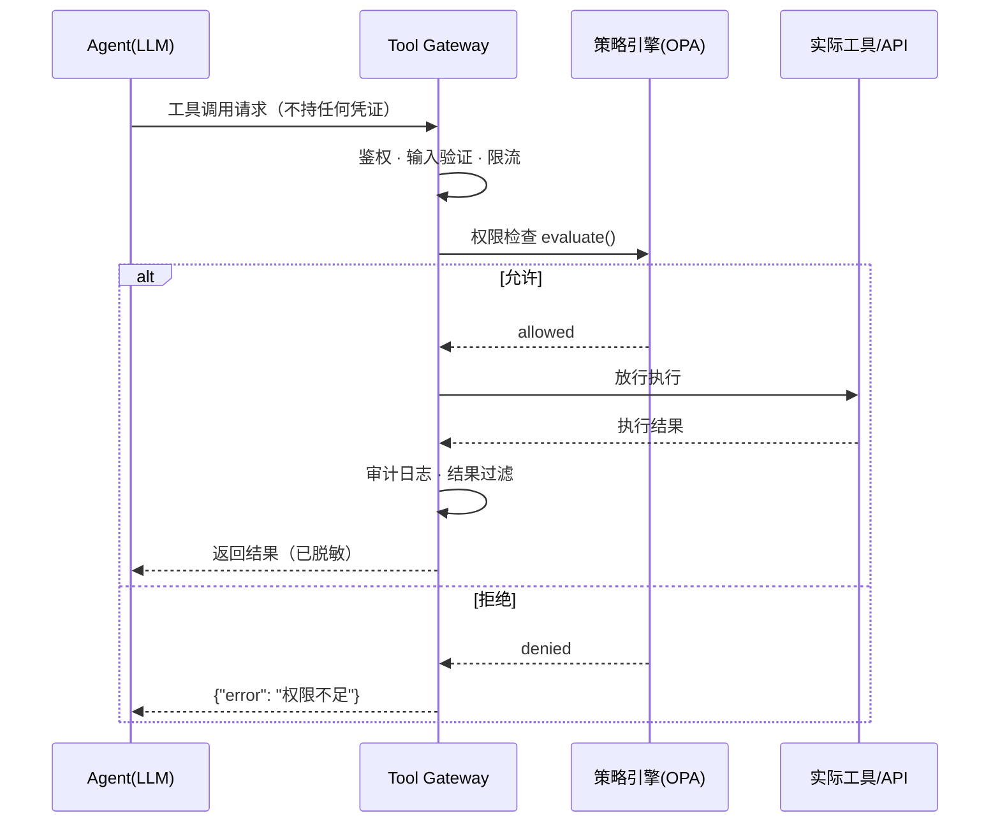

# 如何设计 Tool Gateway 和工具权限管理？

> 难度：中级
> 分类：Tool Use

## 简短回答

Tool Gateway 是 Agent 与工具之间的安全中间层——Agent 不直接调用工具，所有请求都经过 Gateway 做身份验证、权限检查、速率限制和审计日志。核心设计原则是**最小权限（Least Privilege）**和**将 Agent 视为不可信请求者**。权限管理采用 Policy-as-Code（如 OPA/Cedar）将授权逻辑外部化，配合 RBAC/ABAC 做细粒度控制。

## 详细解析

### 为什么需要 Tool Gateway？

没有 Gateway 的架构中，Agent 直接持有 API 密钥并调用外部服务。风险包括：
- Agent 被 Prompt Injection 操纵，调用不该调用的工具
- Agent 无意中执行破坏性操作（删除数据、发送未经审核的消息）
- 无法追踪和审计 Agent 的行为
- 凭证暴露在 Agent 的上下文中

### Gateway 架构


*Agent 不持有任何凭证：每次调用都被 Gateway 逐层拦截——鉴权、权限、校验、限流、审计、过滤。*

关键原则：**Agent 永远不直接与基础设施 API 通信。** Gateway 拦截每个请求，做验证、授权、执行。Agent 不持有任何凭证。

```python
class ToolGateway:
    def __init__(self, policy_engine, rate_limiter, audit_logger):
        self.policy = policy_engine      # OPA / Cedar
        self.limiter = rate_limiter
        self.logger = audit_logger
        self.tools = {}                  # 注册的工具

    async def execute(self, agent_id: str, tool_name: str, params: dict) -> dict:
        # 1. 身份验证
        agent = await self.authenticate(agent_id)

        # 2. 权限检查
        decision = self.policy.evaluate({
            "agent": agent,
            "tool": tool_name,
            "params": params,
            "context": {"time": now(), "user": agent.delegated_user}
        })
        if not decision.allowed:
            self.logger.log_denied(agent_id, tool_name, decision.reason)
            return {"error": f"权限不足: {decision.reason}"}

        # 3. 输入验证
        validated = self.validate_input(tool_name, params)

        # 4. 速率限制
        if not self.limiter.allow(agent_id, tool_name):
            return {"error": "请求过于频繁，请稍后重试"}

        # 5. 执行工具
        result = await self.tools[tool_name].execute(validated)

        # 6. 审计日志
        self.logger.log_execution(agent_id, tool_name, params, result)

        # 7. 结果过滤（去除敏感信息）
        return self.filter_sensitive(result, agent.permission_level)
```

### 参数校验的两级实现

流水线第 3 步 `validate_input` 要挡两类问题：结构不对（缺字段、类型错、多出未声明的字段）和语义不对（结构合法但值危险）。JSON Schema 只管第一类，第二类要单独写规则。

第一级 schema 校验。tool_call 的 `arguments` 是 JSON 字符串，不是对象，先 `json.loads`。解析失败本身就是一类错误，要和校验失败一样回灌给模型，不能抛异常打断循环。用 `jsonschema` 按工具声明的 schema 逐字段检查，错误写清哪个字段、期望什么、实际是什么。模型拿到这种错误能直接改对；只回一句 "argument validation failed" 等于让它猜。schema 里加 `additionalProperties: false`，把模型编造出来的字段也拦下。

```python
import json

import jsonschema


def validate_arguments(tool_schema: dict, raw_args: str) -> list[dict]:
    """返回字段级错误列表，空列表表示通过"""
    try:
        args = json.loads(raw_args)      # arguments 是 JSON 字符串
    except json.JSONDecodeError as e:
        return [{
            "field": "<arguments>",
            "expected": "合法的 JSON 对象",
            "actual": raw_args[:80],
            "message": f"arguments 解析失败：{e.msg}（第 {e.pos} 个字符）",
        }]

    validator = jsonschema.Draft202012Validator(tool_schema)
    errors = []
    for err in validator.iter_errors(args):
        if err.validator == "required":
            missing = [k for k in err.validator_value if k not in err.instance]
            field, expected = ",".join(missing), "必填字段"
        else:
            field = ".".join(map(str, err.absolute_path)) or "<root>"
            expected = f"{err.validator} 约束: {err.validator_value!r}"
        errors.append({
            "field": field,
            "expected": expected,
            "actual": repr(err.instance)[:120],
            "message": err.message,
        })
    return errors
```

第二级语义校验。schema 表达不了"这个路径在不在允许目录内""这个 URL 指向哪里"。三类高频规则：路径先 `os.path.realpath` 解析，再用 `os.path.commonpath` 判断是否落在允许根目录内，`../` 和符号链接都会被展开；URL 解析出主机名再解析成 IP，拒绝内网、回环、链路本地和云元数据地址 `169.254.169.254`；SQL 只放行单条只读语句。校验和实际连接是两次解析，中间存在 DNS rebinding 空窗；重定向后的目标要重新走同一套校验。真正的出口控制要放在网络代理层，这一层负责快速拒绝。SQL 关键字匹配会误伤字符串字面量，生产上再配只读数据库账号兜底。

```python
import ipaddress
import os
import re
import socket
from urllib.parse import urlparse


class SemanticError(Exception):
    """语义校验失败，回灌时映射为 INVALID_ARGUMENT"""


class SemanticValidator:
    """schema 管结构，这里管 schema 表达不了的语义规则"""

    WRITE_SQL = re.compile(
        r"\b(INSERT|UPDATE|DELETE|REPLACE|DROP|ALTER|CREATE|TRUNCATE"
        r"|GRANT|REVOKE|ATTACH|PRAGMA|VACUUM)\b",
        re.IGNORECASE,
    )

    def __init__(self, allowed_roots: list[str]):
        self.allowed_roots = [os.path.realpath(r) for r in allowed_roots]

    def check_path(self, path: str) -> str:
        resolved = os.path.realpath(path)   # 展开 ../ 和符号链接
        for root in self.allowed_roots:
            try:
                if os.path.commonpath([root, resolved]) == root:
                    return resolved
            except ValueError:              # Windows 上不同盘符
                continue
        raise SemanticError(f"路径越界：{resolved}")

    def check_url(self, url: str) -> str:
        parsed = urlparse(url)
        if parsed.scheme not in ("http", "https"):
            raise SemanticError(f"协议不允许：{parsed.scheme}")
        if not parsed.hostname:
            raise SemanticError("URL 缺少主机名")
        try:
            infos = socket.getaddrinfo(parsed.hostname, None)
        except socket.gaierror as e:
            raise SemanticError(f"域名解析失败：{parsed.hostname}") from e
        for *_, sockaddr in infos:
            ip = ipaddress.ip_address(sockaddr[0].split("%")[0])
            if (ip.is_private or ip.is_loopback or ip.is_link_local
                    or ip.is_reserved or ip.is_multicast):
                raise SemanticError(f"目标地址不允许：{parsed.hostname} -> {ip}")
        return url

    def check_sql(self, sql: str) -> str:
        body = sql.strip().rstrip(";")
        if ";" in body:
            raise SemanticError("只允许单条 SQL 语句")
        if not re.match(r"^(SELECT|WITH|EXPLAIN)\b", body, re.IGNORECASE):
            raise SemanticError("只允许只读查询（SELECT / WITH / EXPLAIN）")
        if self.WRITE_SQL.search(body):
            raise SemanticError("检测到写操作关键字，拒绝执行")
        return body
```

### 结果回灌协议

工具结果以 `role="tool"` 的消息回到模型上下文。这条消息的结构决定模型能不能看懂失败原因、会不会做无效重试。

统一六个字段：`status` 标记成功或失败；`data` 放成功结果；`error_code` 是稳定的机器可读码；`message` 是给人看的一句话；`hint` 是给模型的下一步建议；`retryable` 告诉 harness 重试有没有意义。模型主要读 `hint` 决定下一步怎么改，harness 主要读 `retryable` 决定要不要自动重试。

`tool_call_id` 必须原样回填。并行调用时结果按 id 对齐，不能按返回顺序：顺序错位会让模型把 A 的结果当成 B 的，后续推理全错。

| 错误类型 | 典型 error_code | 模型该做什么 | retryable |
|---------|----------------|-------------|-----------|
| 参数错误 | INVALID_ARGUMENT | 按 hint 改参数后重试 | true |
| 权限错误 | PERMISSION_DENIED | 换路径或上报，不要原样重试 | false |
| 执行错误 | TOOL_TIMEOUT / INTERNAL | 瞬态错误可重试，否则换方法 | 视情况 |

```python
import json
from dataclasses import dataclass


@dataclass
class ToolResult:
    tool_call_id: str
    status: str                      # "ok" | "error"
    data: dict | None = None
    error_code: str | None = None
    message: str | None = None
    hint: str | None = None
    retryable: bool = False

    def to_message(self) -> dict:
        """构造回灌给模型的 tool 消息"""
        payload = {"status": self.status, "data": self.data}
        if self.status == "error":
            payload.update({
                "error_code": self.error_code,
                "message": self.message,
                "hint": self.hint,
                "retryable": self.retryable,
            })
        return {
            "role": "tool",
            "tool_call_id": self.tool_call_id,   # 与请求一一对应
            "content": json.dumps(payload, ensure_ascii=False),
        }


# 参数错误：模型读 hint 后改参数重试
ToolResult(
    tool_call_id="call_abc",
    status="error",
    error_code="INVALID_ARGUMENT",
    message="字段 start_date 格式不合法",
    hint="start_date 需要 YYYY-MM-DD，例如 2026-10-01",
    retryable=True,
)

# 权限错误：重试没有意义，换路径或上报
ToolResult(
    tool_call_id="call_def",
    status="error",
    error_code="PERMISSION_DENIED",
    message="agent 无权读取 /etc/secrets",
    hint="改用允许目录内的路径；确需该文件请联系管理员",
    retryable=False,
)
```

大结果不要直接塞回上下文。超过阈值（经验值几千字符，按模型上下文预算调整）就存到外部，只回引用 id 加一句话摘要；模型需要细节时再调 `fetch_result` 取。这样单次工具输出不会把窗口挤爆。

```python
MAX_INLINE_CHARS = 8_000  # 经验值，按模型上下文预算调整


class ResultPacker:
    def __init__(self, store):
        self.store = store

    async def pack(self, tool_call_id: str, raw: str) -> ToolResult:
        if len(raw) <= MAX_INLINE_CHARS:
            return ToolResult(tool_call_id, "ok", data={"content": raw})

        ref_id = await self.store.put(raw)
        return ToolResult(
            tool_call_id,
            "ok",
            data={"ref_id": ref_id, "preview": raw[:500]},
            hint=f"结果过长已存为 {ref_id}，需要细节时调用 fetch_result(ref_id)",
        )
```

### 权限模型

#### RBAC（基于角色的访问控制）

```python
# 角色定义
roles = {
    "reader_agent": {
        "allowed_tools": ["search_docs", "get_weather", "calculate"],
        "denied_tools": ["send_email", "delete_record", "execute_sql"],
    },
    "support_agent": {
        "allowed_tools": ["search_docs", "get_order", "create_ticket"],
        "denied_tools": ["delete_record", "modify_pricing"],
    },
    "admin_agent": {
        "allowed_tools": ["*"],  # 全部权限
        "requires_approval": ["delete_*", "modify_*"],  # 高危操作需审批
    },
}
```

#### ABAC（基于属性的访问控制）

更细粒度——基于请求的上下文属性做决策：

```python
# OPA Policy (Rego 语言)
# policy.rego
"""
package tool_access
import rego.v1  # OPA 1.0+ 必需；老版本用 import future.keywords.in

default allow = false

# 工作时间内允许发送邮件
allow {
    input.tool == "send_email"
    input.context.hour >= 9
    input.context.hour <= 18
    input.agent.role == "support_agent"
}

# 只允许查询自己负责的客户数据
allow {
    input.tool == "get_customer_data"
    input.params.customer_id in input.agent.assigned_customers
}

# 高危操作需要人工审批
allow {
    input.tool == "delete_record"
    input.context.human_approved == true
}
"""
```

### 委托授权（Delegated Authorization）

Agent 的权限不应超过委托它的用户的权限：

```python
class DelegatedAuth:
    def check(self, agent: Agent, tool: str, params: dict) -> bool:
        # Agent 的权限 = min(Agent 角色权限, 委托用户权限)
        agent_allowed = self.check_agent_role(agent.role, tool)
        user_allowed = self.check_user_permission(agent.delegated_user, tool)

        # 两者都允许才放行
        return agent_allowed and user_allowed
```

关键原则：人类用户常常被过度授权，Agent 的权限应该独立审查，不能简单继承用户的全部权限。

### Human-in-the-Loop 审批

```python
class ApprovalGateway:
    HIGH_RISK_TOOLS = ["send_email", "delete_record", "transfer_funds"]

    async def execute_with_approval(self, agent_id, tool, params):
        if tool in self.HIGH_RISK_TOOLS:
            # 暂停执行，等待人工审批
            approval_request = await self.request_human_approval(
                agent_id=agent_id,
                tool=tool,
                params=params,
                timeout=300  # 5 分钟超时
            )
            if not approval_request.approved:
                return {"error": "操作被人工拒绝", "reason": approval_request.reason}

        return await self.gateway.execute(agent_id, tool, params)
```

### 多 Agent 场景的权限挑战

多 Agent 工作流中，权限管理更复杂：
- Agent A 可能把任务委托给 Agent B
- Agent B 的权限不应超过 Agent A
- 需要追踪完整的委托链

```python
# 委托链追踪
class DelegationChain:
    def validate_delegation(self, from_agent, to_agent, tool):
        # to_agent 的权限不能超过 from_agent
        if not self.is_subset(to_agent.permissions, from_agent.permissions):
            raise PermissionError("被委托 Agent 权限不能超过委托者")
```

### 运行时护栏

除了权限控制，还需要内容级别的护栏：

```
输入护栏：扫描用户输入是否有恶意意图、越狱尝试、PII
    ↓
Agent 处理
    ↓
输出护栏：验证 Agent 输出是否有幻觉、毒性内容、敏感数据
```

### 治理流水线模式

将策略更新像软件发布一样管理：
1. 安全/法律团队编写策略 → 翻译为机器可读代码
2. 对历史日志做影响分析（模拟部署）
3. 确认无误后自动部署到全部 Agent

### 新动向：权限决策的上下文外包给宿主（Agent SDK，2026-08）

2026-08 Claude Agent SDK 的几次发布把「Agent 视为不可信」和「最小权限」直接落进了默认行为，三条官方变更指向同一方向：**权限决策所需的上下文由宿主（host，运行 Agent 的应用进程）供给，默认可用的工具面同时收窄**。

- **`classifierContext`（v0.3.236，2026-08-19）**：`PostToolUse` hook（工具执行完成后触发的回调）可返回一段工具结果注释，auto 模式下的权限分类器（决定后续动作是否询问用户的判定组件）会连同工具结果一起读取。关键在**谁在断言**：Agent 可以被 Prompt Injection 操纵去声称「操作是安全的」，但无法伪造 hook 的返回值——hook 跑在宿主进程里，读的是宿主自己掌握的事实。信任根（整条信任链最终锚定的可信主体）仍在宿主侧，与本文 Gateway 思路同构：判定权不在 Agent 手里，判定上下文从「Gateway 自己查」扩展为「宿主主动喂」。
- **Todo/任务追踪工具移出默认工具面（v0.3.233，2026-08-14，BREAKING）**：Opus 4.8、Sonnet 5、Fable 5、Mythos 5 及更新模型上，`TaskCreate` / `TodoWrite` 等工具不再默认可用，须显式列入 `allowedTools` 或设 `CLAUDE_CODE_ENABLE_TODO_TOOLS=1`。方向与最小权限一致：默认工具面越小，Gateway 要防的攻击面越小——从没被授予的工具，不存在被诱导调用的可能。
- **peer `origin` 声明权限等级（v0.3.234，2026-08-17）**：宿主注入的对端来源标识可携带 `fromMode` 字段声明发送方权限等级，同等级消息投递给免询问运行的接收方不再逐条打断——「委托授权」小节的工程化形态：权限等级显式携带并校验，而不是靠接收方猜测。

三条放在一起：Agent 运行时正把「谁有权做什么」的决策权和上下文供给权系统性推给宿主。落到 Gateway 设计上，宿主侧 hook 逻辑本身成了安全边界的一部分——它和 Gateway 一样需要审计、版本控制和影响分析，不能当成随手写的业务回调。

## 常见误区 / 面试追问

1. **误区："在 Agent 代码里做权限检查就够了"** — Agent 代码可能被 Prompt Injection 绕过。权限检查必须在 Agent 外部（Gateway 层）执行，作为独立的安全边界。

2. **误区："给 Agent 和用户一样的权限"** — 用户常常被过度授权。Agent 应该只获得完成当前任务所需的最小权限集。

3. **追问："Policy-as-Code 有什么好处？"** — (1) 授权逻辑与应用代码分离，安全团队可以独立管理；(2) 策略可以版本控制和审计；(3) 策略变更不需要重新部署应用代码。

4. **追问："AWS Bedrock 的 Policy 和自建 Gateway 有什么区别？"** — 云服务商的方案（如 Bedrock AgentCore Policy）在 Agent 代码外部执行安全控制，开箱即用但绑定生态。自建 Gateway 更灵活但需要维护，适合多云或自托管场景。

5. **追问："Claude Agent SDK 的 `classifierContext` 让宿主给权限决策注入上下文，这会不会削弱『Agent 不可信』的假设？"** — 恰恰相反。要点是区分**谁在断言**：`classifierContext` 由 `PostToolUse` hook 返回，hook 运行在宿主进程里，Agent 无法伪造；分类器读到的是宿主基于自身事实的断言，不是 Agent 的自述，信任根仍在宿主侧。同期 v0.3.233 把 Todo/任务追踪工具移出默认工具面，走的也是同一条最小权限路线。**追问延伸**：hook 成了安全判定的输入源，它自己就变成新攻击面，需按 Gateway 同等标准做审计和变更管控——若 hook 里拼接 Agent 可控的字符串塞进 `classifierContext`，等于给注入开后门。

6. **追问："MCP Server 场景下工具级权限怎么做？"** — Claude Agent SDK（TS）v0.3.301（2026-10）起，sdk-type MCP server 配置支持 per-tool `permission_policy`（`always_ask` / `always_deny`，initialize 与 setMcpServers 均生效）——工具级准入原则下沉为 MCP server 的原生配置面，宿主无需在调用层逐一拦截。

7. **追问："JSON Schema 校验通过，参数就一定安全吗？"** — 不一定。schema 只约束结构和类型，管不了值的语义：`/data/../etc/passwd` 满足 `type: string`，`http://169.254.169.254/latest/meta-data/` 满足 `format: uri`。路径、URL、SQL 这类规则必须单独写语义校验，schema 通过只是第一级。

## 参考资料

- [Building a Least-Privilege AI Agent Gateway (InfoQ)](https://www.infoq.com/articles/building-ai-agent-gateway-mcp/)
- [AI Agent Access Control: How to Handle Permissions (Noma Security)](https://noma.security/resources/access-control-for-ai-agents/)
- [Best Practices of Authorizing AI Agents (Oso)](https://www.osohq.com/learn/best-practices-of-authorizing-ai-agents)
- [Access Control and Permission Management for AI Agents (Cerbos)](https://www.cerbos.dev/blog/permission-management-for-ai-agents)
- [Agent Governance Patterns: Policy-as-Code for Live Systems (a21.ai)](https://a21.ai/agent-governance-patterns-policy-as-code-for-live-systems/)
- [claude-agent-sdk-typescript v0.3.236 —— PostToolUse hook 返回 `classifierContext`（2026-08-19）](https://github.com/anthropics/claude-agent-sdk-typescript/releases/tag/v0.3.236)
- [claude-agent-sdk-typescript v0.3.234 —— peer `origin` 声明 `fromMode` 权限等级（2026-08-17）](https://github.com/anthropics/claude-agent-sdk-typescript/releases/tag/v0.3.234)
- [claude-agent-sdk-typescript v0.3.233 —— Todo/任务追踪工具移出默认工具面（BREAKING，2026-08-14）](https://github.com/anthropics/claude-agent-sdk-typescript/releases/tag/v0.3.233)
- [Claude Agent SDK (TypeScript) Releases](https://github.com/anthropics/claude-agent-sdk-typescript/releases) — v0.3.301：sdk-type MCP server 支持 per-tool permission_policy（always_ask/always_deny，2026-10）
