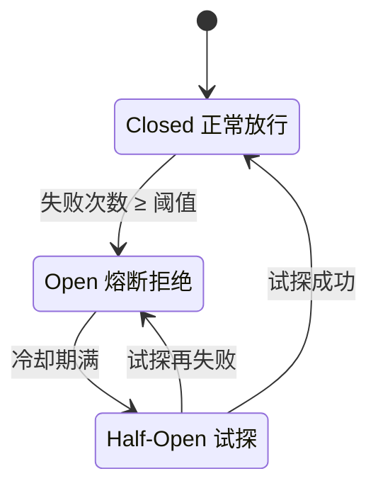
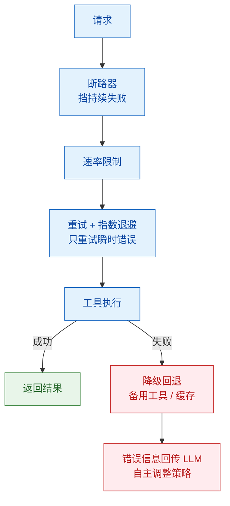

# 如何处理工具调用失败和超时？

> 难度：中级
> 分类：Tool Use

## 简短回答

工具调用失败在生产环境中不可避免——网络超时、API 限流、参数错误、服务宕机都会发生。核心处理策略是**分层防御**：首先对每个工具调用设置超时，然后用**指数退避重试**处理瞬时错误，用**断路器模式**防止持续请求失败的服务，用**降级回退**在主工具不可用时切换备选方案，最后通过**错误信息回传 LLM** 让 Agent 自主调整策略。关键原则：永远不要让 Agent 无限等待或无限重试。

## 详细解析

### 工具调用的常见失败模式

```
失败来源分类：
├── 网络层：超时、DNS 解析失败、连接拒绝
├── 服务层：HTTP 4xx（参数错误/未授权）、HTTP 5xx（服务端错误）、429（限流）
├── 输入层：LLM 生成的参数不符合 Schema、类型错误、值越界
├── 执行层：工具内部逻辑 bug、未处理的边界条件
└── Agent 层：无限循环调用、重复调用同一个失败工具
```

### 策略 1：超时控制

每个外部调用都必须设置超时。如果服务无响应，工具不应无限挂起。

```python
import httpx
import asyncio

async def call_external_api(url: str, params: dict, timeout: float = 10.0):
    try:
        async with httpx.AsyncClient() as client:
            response = await client.get(url, params=params, timeout=timeout)
            response.raise_for_status()
            return {"status": "success", "data": response.json()}
    except httpx.TimeoutException:
        return {"status": "error", "error": "请求超时，服务可能暂时不可用"}
    except httpx.HTTPStatusError as e:
        return {"status": "error", "error": f"HTTP {e.response.status_code}"}
```

Agent 级别的超时同样重要：

```python
# Agent Loop 级别的防护
agent_config = {
    "max_iterations": 10,        # 最大步数，防止无限循环
    "max_execution_time": 120,   # 整体超时（秒）
    "single_tool_timeout": 30,   # 单次工具调用超时
}
```

### 策略 2：指数退避重试（Exponential Backoff）

瞬时错误（网络抖动、临时过载）适合重试，但不能立即重试——这会加剧服务压力。

```python
import asyncio
import random

async def retry_with_backoff(func, max_retries=3, base_delay=1.0):
    for attempt in range(max_retries):
        try:
            return await func()
        except TransientError as e:
            if attempt == max_retries - 1:
                raise  # 最后一次仍失败，抛出异常
            delay = base_delay * (2 ** attempt) + random.uniform(0, 1)  # 加 jitter
            await asyncio.sleep(delay)
            # attempt=0,1,2 → 等待 ~1-2s, ~2-3s, ~4-5s
            # 更稳健的写法是 AWS Full Jitter：delay = random.uniform(0, base * 2**attempt)
```

**重试决策矩阵：**

| 错误类型 | 是否重试 | 原因 |
|---------|---------|------|
| 网络超时 | 是 | 瞬时问题 |
| HTTP 429 (限流) | 是（按 Retry-After） | 等待后可恢复 |
| HTTP 500 | 是（有限次） | 服务可能临时异常 |
| HTTP 400 (参数错误) | 否 | 重试不会改变结果 |
| HTTP 401/403 | 否 | 权限问题，重试无意义 |
| Schema 验证失败 | 否（但可让 LLM 重新生成参数） | 需要修正输入 |

### 策略 3：断路器模式（Circuit Breaker）

对持续失败的服务，不断重试会浪费资源和 LLM 上下文。断路器提供更结构化的保护：

```python
class CircuitBreaker:
    def __init__(self, failure_threshold=5, recovery_timeout=60):
        self.failures = 0
        self.threshold = failure_threshold
        self.recovery_timeout = recovery_timeout
        self.state = "closed"       # closed → open → half_open
        self.last_failure_time = None

    async def call(self, func):
        if self.state == "open":
            if time.time() - self.last_failure_time > self.recovery_timeout:
                self.state = "half_open"  # 尝试恢复
            else:
                return {"error": "服务暂时不可用（断路器打开）"}

        try:
            result = await func()
            if self.state == "half_open":
                self.state = "closed"  # 恢复成功
                self.failures = 0
            return result
        except Exception as e:
            self.failures += 1
            self.last_failure_time = time.time()
            if self.failures >= self.threshold:
                self.state = "open"    # 触发熔断
            raise
```

三种状态的含义：
- **Closed（正常）**：请求正常通过，记录失败次数
- **Open（熔断）**：所有请求立即拒绝，进入冷却期
- **Half-Open（试探）**：允许少量请求通过，测试服务是否恢复


*重试管偶发故障，断路器管持续故障：失败达阈值熔断，冷却期满试探，成败决定回到正常或再次熔断。*

### 策略 4：降级回退（Fallback）

当主工具不可用时，切换到备选方案：

```python
class ToolWithFallback:
    def __init__(self, primary_tool, fallback_tool):
        self.primary = primary_tool
        self.fallback = fallback_tool

    async def execute(self, params):
        try:
            return await self.primary.execute(params)
        except ToolError:
            # 主工具失败，尝试降级
            return await self.fallback.execute(params)

# 示例：主用 Google Search API，降级用 Bing Search API
search_tool = ToolWithFallback(
    primary_tool=GoogleSearchTool(),
    fallback_tool=BingSearchTool()
)
```

### 策略 5：错误信息回传 LLM

最重要的策略——将有意义的错误信息返回给 Agent，让它自主调整：

```python
# 差的做法：吞掉错误
except Exception:
    return None  # Agent 不知道发生了什么

# 好的做法：返回可操作的错误信息
except Exception as e:
    return {
        "status": "error",
        "error_type": "timeout",
        "message": "天气 API 超时，可能是服务暂时不可用",
        "suggestion": "可以尝试使用 search_web 工具搜索天气信息作为替代"
    }
```

Agent 收到错误后可以：生成修正后的参数重试、选择替代工具、直接告知用户工具不可用。

### 防止 Agent 无限循环

```python
class AgentExecutor:
    def __init__(self, max_iterations=10, max_tool_retries=3):
        self.max_iterations = max_iterations
        self.tool_call_counts = {}  # 每个工具的调用计数

    def should_continue(self, tool_name):
        count = self.tool_call_counts.get(tool_name, 0)
        if count >= self.max_tool_retries:
            return False, f"工具 {tool_name} 已连续失败 {count} 次，停止重试"
        self.tool_call_counts[tool_name] = count + 1
        return True, None
```

### 生产级分层防御架构


*分层防御：请求先过断路器、限流、重试三道闸再执行；失败不硬重试，而是降级回退并把错误回传 LLM。*

### 工具编排的延迟放大问题

多工具串联时，延迟线性叠加是生产环境的核心挑战：

```
单步延迟构成：
LLM 推理（选工具）:  0.5-2s
工具执行:           0.1-5s（取决于外部系统）
LLM 推理（看结果）:  0.5-2s
                      ──────────
总计:               1.1-9s / 步

3 步串联的总延迟：3.3-27s（线性放大）
```

**并行化**是收益最大的优化——如果工具间无数据依赖，将串行的 N 步变为并行，延迟从 N×T 降至 max(T)。OpenAI 和 Anthropic 都支持一次返回多个 tool_call，让 Agent 在一步内并行调用多个独立工具。

**流式中间结果**可以改善用户感知延迟：不等全部工具执行完，边执行边返回部分结果。

```python
# 流式中间结果示例
async def orchestrate_with_streaming(query):
    quick_result = await quick_search(query)
    yield {"type": "partial", "data": quick_result}  # 快速返回初步结果

    deep_result = await deep_search(query)
    yield {"type": "enriched", "data": deep_result}  # 后台继续深度搜索
```

### 死循环的深度防护

前文介绍了基础的 `max_iterations` 限制。生产环境需要更精细的检测：

```python
class LoopDetector:
    """三级死循环检测"""

    def __init__(self, max_steps=15, max_same_tool=3, max_same_params=2):
        self.max_steps = max_steps
        self.max_same_tool = max_same_tool     # 同一工具最大连续调用次数
        self.max_same_params = max_same_params # 相同参数最大调用次数
        self.history = []

    def check(self, tool_call) -> tuple[bool, str]:
        self.history.append(tool_call)

        # 检测 1：总步数超限
        if len(self.history) >= self.max_steps:
            return False, f"已达到最大步数限制 ({self.max_steps})"

        # 检测 2：同一工具连续调用过多
        recent = [c for c in self.history[-5:] if c.name == tool_call.name]
        if len(recent) >= self.max_same_tool:
            return False, f"工具 {tool_call.name} 连续调用 {self.max_same_tool} 次"

        # 检测 3：完全相同的参数重复调用
        same = [c for c in self.history if c.name == tool_call.name and c.params == tool_call.params]
        if len(same) >= self.max_same_params:
            return False, f"工具 {tool_call.name} 使用相同参数调用了 {self.max_same_params} 次，请更换策略"

        return True, ""
```

关键原则：检测到循环后不是直接报错，而是**注入"请换一种方式"的提示**，给 LLM 一次纠正机会。

### 重复检测：从参数哈希到状态指纹

上一节的 `max_same_params` 直接用 `params` 相等比较，不可靠：dict 不可哈希，不能进 set；`0.1` 和 `0.10` 被判成两次调用；`./data/a.csv` 和 `data//a.csv` 指向同一文件却算不同参数。先把参数规范化——JSON key 排序、去空白、路径标准化——再对 `(tool_name, normalized_args)` 做哈希。

参数哈希抓不到"参数变了但没进展"：Agent 反复改查询词、反复重读同一文件，每轮参数都不同。用**状态指纹**：`hash(已完成子目标 + 工作区文件哈希 + 最近 K 条结果摘要)`。相邻两轮指纹相同，判定无进展。

**周期检测**解决 A→B→A→B：在最近 N 步的 `(tool_name, args_hash)` 序列里找 n-gram 重复。单步看都不重复，只有整段序列在绕圈。

三种检测合成一个类，统一走 `observe` 记录、`verdict` 取结论：

```python
import hashlib
import json
from collections import deque
from pathlib import Path


def normalize(obj):
    """递归规范化：路径标准化、浮点统一精度、key 排序由 json.dumps 负责"""
    if isinstance(obj, dict):
        return {k: normalize(v) for k, v in obj.items()}
    if isinstance(obj, list):
        return [normalize(v) for v in obj]
    if isinstance(obj, float):
        return round(obj, 6)
    if isinstance(obj, str) and not obj.startswith(("http://", "https://")):
        if "/" in obj or obj.startswith("."):
            return str(Path(obj).resolve())
    return obj


def args_hash(tool_name: str, params: dict) -> str:
    payload = json.dumps(
        {"tool": tool_name, "args": normalize(params)},
        sort_keys=True, ensure_ascii=False, separators=(",", ":"),
    )
    return hashlib.sha256(payload.encode()).hexdigest()[:16]


class LoopGuard:
    """参数哈希 + 状态指纹 + 周期检测，三路判定重复"""

    def __init__(self, window=8, repeat_limit=3, cycle_len=2):
        self.window = deque(maxlen=window)   # 滑动窗口内的 (tool, hash)
        self.repeat_limit = repeat_limit     # 经验值：同一调用出现 3 次判重复
        self.cycle_len = cycle_len
        self.history = []                    # 最近 K 条结果摘要
        self.last_fingerprint = None
        self.fingerprint_hits = 0

    def _fingerprint(self, done_goals: list[str], workspace_files: list[Path]) -> str:
        file_digest = hashlib.sha256()
        for path in sorted(workspace_files, key=str):
            if path.exists():
                file_digest.update(path.read_bytes())
        parts = [
            "|".join(sorted(done_goals)),
            file_digest.hexdigest(),
            "|".join(self.history[-5:]),     # 最近 5 条结果摘要
        ]
        return hashlib.sha256("\n".join(parts).encode()).hexdigest()[:16]

    def observe(self, tool_call, result, done_goals=(), workspace_files=()):
        key = (tool_call.name, args_hash(tool_call.name, tool_call.params))
        self.window.append(key)
        self.history.append(str(result)[:300])

        fp = self._fingerprint(list(done_goals), list(workspace_files))
        self.fingerprint_hits = self.fingerprint_hits + 1 if fp == self.last_fingerprint else 0
        self.last_fingerprint = fp

    def _cycle_detected(self) -> bool:
        seq = list(self.window)
        n = self.cycle_len
        if len(seq) < n * 2:
            return False
        return any(seq[i:i + n] == seq[i + n:i + 2 * n]
                   for i in range(len(seq) - 2 * n + 1))

    def verdict(self) -> tuple[str, str]:
        if not self.window:
            return "ok", ""
        key = self.window[-1]
        if self.window.count(key) >= self.repeat_limit:
            return "repeat", f"同一调用重复 {self.repeat_limit} 次"
        if self._cycle_detected():
            return "cycle", f"检测到 {'→'.join(c[0] for c in list(self.window)[-2 * self.cycle_len:])} 循环"
        if self.fingerprint_hits >= 1:
            return "no_progress", "相邻两轮状态指纹相同，工作区无变化"
        return "ok", ""
```

每轮工具结果返回后调用 `observe`，下一轮请求模型前调用 `verdict`。命中后不要直接终止，先走下一节的升级流程。

### 检测到重复后的分级处理

检测和计数必须放在 harness（Agent 外层执行框架）里，跨轮持久化。工具函数执行完就销毁，计数器跟着没了；模型也不会记住"我已经试过三次"。每轮重置计数等于没做。

处理分四级，逐次升级：

| 级别 | 动作 | 目的 |
|------|------|------|
| 第 1 次 | 注入提示，附上上次结果 | 省一次调用，提示模型"已试过" |
| 第 2 次 | 本轮禁用该工具，要求解释重复原因 | 强迫换路径 |
| 第 3 次 | 终止，返回已完成部分和卡点 | 止损，交给人 |
| 错误累积 | 回退到 checkpoint 换方案 | 通常人工决定 |

第一级的关键是**把上次结果再贴一遍**。模型重复调用常因为上下文里只有"已调用"没有"结果"，它以为没拿到数据。把结果附在提示后面，往往一轮就跳出循环。第三级返回已完成部分、卡住的子目标和最后几条结果摘要，比一句"超出重试上限"有用。回退 checkpoint 只用于错误已累积污染上下文的场景，默认人工决定。

```python
class EscalationPolicy:
    """把 LoopGuard 的检测结果映射成四级动作"""

    NUDGE, DISABLE_TOOL, ABORT, ROLLBACK = "NUDGE", "DISABLE_TOOL", "ABORT", "ROLLBACK"

    def __init__(self):
        self.levels = {}          # (tool, hash) -> 已升级次数，跨轮持久化

    OK = "OK"

    def decide(self, verdict: str, tool_name: str, key: str,
               errors_accumulated: bool = False):
        if verdict == "ok":
            self.levels.pop(key, None)          # 有进展就清零，避免误伤
            return self.OK, ""

        level = self.levels.get(key, 0) + 1
        self.levels[key] = level

        if level == 1:
            return self.NUDGE, "该调用刚刚执行过，结果见附加上下文，请基于已有结果继续"
        if level == 2:
            return self.DISABLE_TOOL, f"本轮禁用 {tool_name}，请说明为何重复调用并换用其他工具"
        if errors_accumulated:
            return self.ROLLBACK, "错误已累积，建议回退到最近 checkpoint 重规划"
        return self.ABORT, f"重复 {level} 次仍未推进，终止任务并上报卡点"
```

计数键用 `(tool_name, args_hash)`，不同工具的重复互不干扰。`DISABLE_TOOL` 只在本轮移除该工具，下一轮恢复；`ABORT` 时把已完成目标、最后几条结果和检测原因一起返回。

### 大结果治理与重试的幂等前提

大结果会挤占上下文，也让重试更贵。三条截断规则：

- **头尾都保留**：错误信息和结论常在尾部，只截头会丢关键信息。中间标 `... 省略 X 行 ...`。
- **JSON 按结构截**：长数组留前 10 项，同时给出总数，模型才知道数据不完整。
- **日志按级别过滤**：默认只留 WARN/ERROR，需要时按关键字回查。

单条结果控制在上下文窗口 15% 以内是经验值。超限的完整结果外置对象存储，回灌引用 id 加摘要，需要细节时再按 id 读取。

```python
import json


class ResultTruncator:
    """按上下文窗口比例截断工具结果，超大结果外置"""

    def __init__(self, context_limit: int, object_store, max_ratio=0.15):
        self.limit = int(context_limit * max_ratio)  # 经验值：15%
        self.object_store = object_store

    def truncate(self, result, head=40, tail=20) -> dict:
        text = result if isinstance(result, str) else json.dumps(result, ensure_ascii=False)
        if len(text) <= self.limit:
            return {"inline": text}

        if isinstance(result, list):                  # 长数组按结构截
            return {
                "inline": json.dumps(result[:10], ensure_ascii=False),
                "total": len(result),
                "note": f"共 {len(result)} 项，仅展示前 10 项",
            }

        lines = text.splitlines()
        omitted = max(0, len(lines) - head - tail)
        body = "\n".join(
            lines[:head] + [f"... 省略 {omitted} 行 ..."] + lines[-tail:]
        )
        if len(body) <= self.limit:
            return {"inline": body}
        return {                                       # 仍超限则外置
            "external_ref": self.object_store.put(text),
            "summary": body[: self.limit],
            "chars": len(text),
        }
```

写操作重发会产生重复副作用。幂等键用 `run_id + tool_name + 参数哈希`，传给支持幂等的下游去重。写操作按可控程度分三类：

1. **能设计成幂等的直接改造**：写文件用内容哈希做版本，创建资源先查后建。
2. **可补偿的带幂等键并事后查询确认**：下游支持就带上，不支持就在重试前查状态。
3. **外部接口不可控的用"先查后写"**：目标状态未达成才发写请求。

**重试前先查状态**比盲目重发更通用，因为很多外部系统不支持幂等键，查询接口却几乎都有。骨架如下：

```python
async def safe_write(run_id: str, tool_name: str, params: dict):
    key = f"{run_id}:{tool_name}:{args_hash(tool_name, params)}"
    state = await tool_registry.execute(f"{tool_name}_get", params)
    if state.get("done") and state.get("idem_key") == key:
        return state["result"]                    # 上次已成功，直接复用

    try:
        return await tool_registry.execute(tool_name, {**params, "idem_key": key})
    except TransientError:
        # 结果未知（写入可能已生效），不盲目重发
        return {"status": "unknown", "idem_key": key,
                "suggestion": "重试前先查询该操作是否已完成"}
```

超时不等于没写成功。捕获 `TransientError` 后返回 unknown 让上层先查，比直接重发安全。

### 降级链（Fallback Chain）

比简单的双工具降级更完善的方案：

```python
async def execute_with_fallback(tool_name, params):
    # 尝试主工具
    try:
        return await tool_registry.execute(tool_name, params)
    except Exception:
        pass

    # 降级 1：简化版工具
    try:
        return await tool_registry.execute(f"{tool_name}_lite", simplify_params(params))
    except Exception:
        pass

    # 降级 2：缓存数据
    cached = cache.get(f"{tool_name}:{hash(str(params))}")
    if cached:
        return {**cached, "warning": "使用缓存数据，可能不是最新"}

    # 降级 3：让 LLM 向用户解释
    return {"error": f"工具 {tool_name} 暂时不可用", "suggestion": "请稍后重试，或尝试换一种方式描述需求"}
```

## 常见误区 / 面试追问

1. **误区："所有错误都应该重试"** — 只有瞬时错误（超时、429、5xx）才值得重试。参数错误（400）、权限错误（401/403）重试不会改变结果，反而浪费资源和上下文窗口。

2. **误区："重试应该立即执行"** — 立即重试会加剧服务压力。使用指数退避 + 随机 jitter 分散请求。对 429 错误，应遵循 `Retry-After` 头。

3. **追问："如何防止 Agent 在工具失败时陷入无限循环？"** — 三层防护：最大步数硬限制、相同参数重复检测（LLM 用相同参数反复调用同一工具）、全局超时。关键是在检测到循环后不是直接报错，而是注入"请换一种方式"的提示，给 LLM 一次纠正机会。

4. **追问："工具编排的延迟优化，哪个策略收益最大？"** — 并行化。如果能将串行的 3 步工具调用变为并行，延迟从 3T 降至 max(T)。其次是缓存（对重复查询有效）和流式中间结果（改善用户感知延迟）。

5. **追问："断路器和重试有什么区别？"** — 重试是在单次失败后立即的短期策略；断路器是在多次失败后的长期保护。重试处理偶发故障，断路器处理持续故障。两者应组合使用：断路器内部包含重试逻辑。

6. **场景追问："你的 Agent 反复调用 search_web 工具但每次结果都不满足需求，Token 消耗不断增加。如何修复？"** — 这是"搜索无果死循环"问题。修复路径：(1) 限制 search_web 调用次数，超过后强制切换策略；(2) 优化工具返回格式 → 明确告知 Agent"已搜索 X 次，无相关结果，建议更换查询策略"；(3) 加入查询反思 → 让 Agent 分析为什么搜索失败，是查询太宽泛还是太狭窄；(4) 设计降级策略 → 搜索失败后转而使用知识库检索或直接询问用户更多细节；(5) 加入人工介入点 → 多次失败后主动询问用户是否需要调整查询方向。

7. **场景追问："你的工具调用成功但返回数据格式与 LLM 期望不符，导致解析错误并重试。如何解决？"** — 这是"成功但失败"的问题。解决路径：(1) 工具 Schema 必须明确定义输出格式；（2）工具内部加入输出验证，确保返回数据符合 Schema；（3）在工具返回时附带示例格式，帮助 LLM 理解；（4）LLM 端加入容错解析，处理边界情况；（5）对不稳定的外部 API 加入 Wrapper 层，标准化输出格式。

8. **场景追问："你的数据库查询工具因参数注入攻击而被封禁，Agent 无法再访问数据。如何防范和恢复？"** — 这是安全故障场景。防范路径：(1) 实施严格的参数验证和转义；（2）限制工具权限，遵循最小权限原则；（3）加入查询模板机制，禁止动态构造完整 SQL；（4）实施速率限制，防止单一 Agent 过度请求；（5）监控异常查询模式，提前识别攻击行为。恢复路径：(1) 紧急启用备用数据库连接；（2) 暂时切换到只读模式；（3）与数据库厂商沟通解封；（4）事后分析攻击来源，加强防护。

9. **追问："相同参数检测为什么不能直接用 dict 相等比较？"** — 三个原因：dict 不可哈希，无法进 set 或当缓存键；浮点数 `0.1` 和 `0.10` 会被判成不同值；同一路径的不同写法（`./data/a.csv` 与 `data//a.csv`）也会被当成不同参数。要先规范化（JSON key 排序、去空白、路径标准化）再哈希。另外参数哈希抓不到"参数变了但没进展"的循环，需要状态指纹补充。

10. **追问："写操作重试时如何避免重复执行？"** — 优先"先查后写"：重试前查一次目标状态，已完成就直接复用结果。下游支持幂等键时，用 `run_id + tool_name + 参数哈希` 作为键交给下游去重。超时返回"结果未知"时不要盲目重发，先把状态标成 unknown 交给上层确认。

## 参考资料

- [Retries, Fallbacks, and Circuit Breakers in LLM Apps (Portkey)](https://portkey.ai/blog/retries-fallbacks-and-circuit-breakers-in-llm-apps/)
- [Error Handling for LLM Agent Tools (APXML)](https://apxml.com/courses/building-advanced-llm-agent-tools/chapter-1-llm-agent-tooling-foundations/tool-error-handling)
- [Error Recovery and Fallback Strategies in AI Agent Development (GoCodeo)](https://www.gocodeo.com/post/error-recovery-and-fallback-strategies-in-ai-agent-development)
- [LLM Tool-Calling in Production: Rate Limits, Retries, and the "Infinite Loop" Failure Mode (Medium)](https://medium.com/@komalbaparmar007/llm-tool-calling-in-production-rate-limits-retries-and-the-infinite-loop-failure-mode-you-must-2a1e2a1e84c8)
- [Handling Tool Errors and Agent Recovery (APXML)](https://apxml.com/courses/langchain-production-llm/chapter-2-sophisticated-agents-tools/agent-error-handling)
