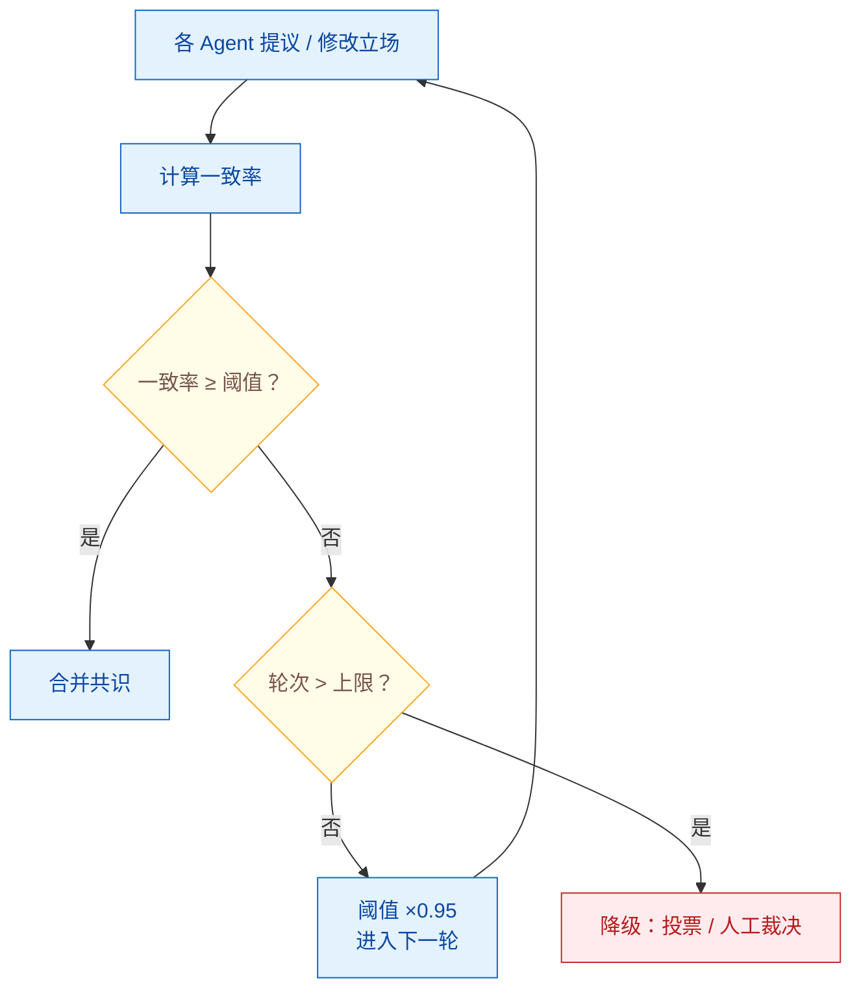

# 多 Agent 系统中的冲突解决机制

> 难度：中级
> 分类：Multi-Agent

## 简短回答

当多个 Agent 对同一问题产生不同结论或竞争同一资源时，就产生了冲突。冲突解决机制主要分为三类：**投票机制**（Binary/Ranked/Weighted Voting，多数决或加权投票）、**共识协议**（多轮辩论迭代直到达成一致，支持动态调整共识阈值）、**中介仲裁**（指定协调 Agent 或人类做最终裁决）。研究表明，适当的冲突解决可将对抗攻击成功率从 46% 降低到 19%，提升系统安全性。但要警惕**趋同效应（Sycophancy）**——LLM Agent 倾向于迎合对方观点而非坚持正确判断。

## 详细解析

### 多 Agent 冲突的类型

```
冲突类型：
├── 结论冲突：Agent A 说"买入"，Agent B 说"卖出"
├── 资源冲突：两个 Agent 同时要修改同一数据库记录
├── 优先级冲突：安全 Agent 说"阻止"，效率 Agent 说"放行"
├── 方案冲突：Agent 对解决同一问题提出不同方案
└── 事实冲突：Agent 引用了互相矛盾的数据源
```

### 机制 1：投票（Voting）

最直观的冲突解决方式——让多个 Agent 投票表决：

```python
class VotingResolver:
    """投票式冲突解决"""

    async def resolve_binary(self, agents, question) -> str:
        """二元投票：是/否"""
        votes = await asyncio.gather(
            *[agent.vote(question) for agent in agents]
        )
        yes_count = sum(1 for v in votes if v == "yes")
        return "yes" if yes_count > len(agents) / 2 else "no"

    async def resolve_weighted(self, agents, question) -> str:
        """加权投票：按 Agent 专业度加权"""
        weighted_votes = {}
        for agent in agents:
            vote = await agent.vote(question)
            weight = agent.expertise_score  # 专家权重更高
            weighted_votes[vote] = weighted_votes.get(vote, 0) + weight

        return max(weighted_votes, key=weighted_votes.get)

    async def resolve_ranked(self, agents, options) -> str:
        """排序投票：Agent 提交偏好排序"""
        rankings = await asyncio.gather(
            *[agent.rank(options) for agent in agents]
        )
        # Borda 计分法：排名越高得分越多
        scores = {opt: 0 for opt in options}
        for ranking in rankings:
            for i, opt in enumerate(ranking):
                scores[opt] += len(options) - i
        return max(scores, key=scores.get)
```

**投票方式选择：**

| 投票类型 | 适用场景 | 示例 |
|---------|---------|------|
| 多数决 | 二元决策 | "是否发布该版本？" |
| 加权投票 | 专业度不均等 | 安全专家在安全问题上权重更高 |
| 排序投票 | 多选一 | 从 5 个方案中选择最优 |
| 一票否决 | 高风险操作 | 任何安全 Agent 可阻止操作 |

### 机制 2：共识协议（Consensus Protocol）

多轮辩论，逐步达成一致：

```python
class ConsensusProtocol:
    """多轮共识协议"""

    def __init__(self, agents, max_rounds=5, threshold=0.8):
        self.agents = agents
        self.max_rounds = max_rounds
        self.threshold = threshold  # 80% 一致才算共识

    async def reach_consensus(self, topic):
        proposals = {}

        for round_num in range(self.max_rounds):
            # 每个 Agent 提出或修改自己的立场
            for agent in self.agents:
                context = {
                    "topic": topic,
                    "round": round_num,
                    "other_proposals": {
                        a.id: p for a, p in proposals.items() if a != agent
                    }
                }
                proposals[agent] = await agent.propose(context)

            # 检查是否达成共识
            agreement_rate = self.calculate_agreement(proposals)
            if agreement_rate >= self.threshold:
                return self.merge_proposals(proposals)

            # 动态调整阈值（任务越紧急，越容易通过）
            self.threshold *= 0.95

        # 达到最大轮次仍未共识 → 降级到投票或人工裁决
        return await self.fallback_to_voting(proposals)

    def calculate_agreement(self, proposals):
        """计算 Agent 间立场的一致程度"""
        conclusions = [p["conclusion"] for p in proposals.values()]
        most_common = max(set(conclusions), key=conclusions.count)
        return conclusions.count(most_common) / len(conclusions)
```


*共识是有降级的迭代辩论：每轮提议并计算一致率，达标即合并；阈值逐轮放宽，超最大轮次降级为投票或人工裁决。*

**关键设计点：**
- 动态共识阈值：根据任务紧急度和轮次调整
- 最大轮次限制：防止无限辩论
- 降级机制：共识失败时自动切换到投票或人工裁决

### 机制 3：中介仲裁（Mediated Agreement）

指定一个权威 Agent 做最终裁决：

```python
class MediatorResolver:
    def __init__(self, mediator_agent):
        self.mediator = mediator_agent  # 仲裁者

    async def resolve(self, conflicting_outputs: dict):
        """仲裁者分析冲突并做出裁决"""
        prompt = f"""
        以下是不同 Agent 对同一问题的分析结果，它们存在冲突：

        {self._format_conflicts(conflicting_outputs)}

        请分析每个 Agent 的推理过程，指出各自的优缺点，
        然后给出你的最终裁决和理由。
        """
        decision = await self.mediator.generate(prompt)
        return decision
```

### 防止趋同效应（Sycophancy）

LLM Agent 在辩论中容易出现趋同——Agent 倾向于迎合对方观点而非坚持自己的正确判断：

```python
# CONSENSAGENT 的方法：抗趋同共识
class AntiSycophancyProtocol:
    async def debate(self, agents, topic):
        for round in range(self.max_rounds):
            for agent in agents:
                # 强制要求 Agent 先独立推理，再考虑他人观点
                response = await agent.generate(f"""
                第一步：独立分析（忽略其他 Agent 的观点）
                {topic}

                第二步：考虑其他观点后，明确说明你是否改变立场
                如果改变，解释具体哪个论据说服了你
                如果不改变，解释为什么你认为自己的分析更正确

                其他 Agent 的观点：{other_views}
                """)
```

### 资源冲突解决

> 注：资源冲突（多个 Agent 竞争同一外部资源 / 锁 / 配额）本质上属于"任务分配与协调"范畴，更系统的处理见第 034 题。本节仅给出与冲突解决机制对齐的最小示例。

```python
class ResourceConflictResolver:
    """处理多个 Agent 竞争同一资源的冲突"""

    def __init__(self):
        self.locks = {}  # 资源锁

    async def request_resource(self, agent_id, resource_id):
        if resource_id in self.locks:
            # 资源已被占用
            holder = self.locks[resource_id]
            if self.priority(agent_id) > self.priority(holder):
                # 高优先级 Agent 可以抢占
                await self.preempt(holder, resource_id)
                self.locks[resource_id] = agent_id
                return True
            else:
                # 排队等待
                await self.wait_queue(resource_id, agent_id)
                return False
        else:
            self.locks[resource_id] = agent_id
            return True
```

### 并发写控制：锁粒度、乐观并发与 fencing token

上面的锁字典只解决"谁先拿"，没解决"拿到后怎么写"。多 Agent 共享工作区时，写冲突按代价从低到高分三层处理。

| 层次 | 做法 | 代价与适用 |
|------|------|-----------|
| 避免冲突 | 任务拆分时文件集不重叠 | 无等待、无死锁，首选 |
| 加锁 | 文件锁 / 版本号 / 分布式锁 | 有等待和死锁风险 |
| 合并 | 三方合并、测试兜底 | 冲突已经发生，只能补救 |

**避免为什么最好**：不需要锁服务，不会死锁，也不会有 Agent 排队等锁时白白消耗时间。任务拆分阶段就让每个 Agent 写不同的文件；需要新建文件的场景天然不冲突，各写各的文件，最后统一汇总。只有无法拆开时才退到加锁。

**锁粒度**：默认文件级。目录级适合批量操作，例如整体替换一个包；行级锁实现复杂、收益低，一般不做。关键原则是**缩小临界区，而不是放大粒度**。模型调用、计算、内容生成都放在锁外，只在写盘的那一瞬间持锁。

```python
from pathlib import Path
from filelock import FileLock, Timeout


class FileWriter:
    """文件级锁：模型调用在锁外，只在写入瞬间加锁"""

    def __init__(self, root: str, lock_timeout: float = 5.0):
        self.root = Path(root)
        self.lock_timeout = lock_timeout

    async def write(self, rel_path: str, producer):
        path = self.root / rel_path
        content = await producer(path)          # 生成内容，不持锁

        lock = FileLock(str(path) + ".lock", timeout=self.lock_timeout)
        try:
            with lock:                          # 只包住写盘
                path.parent.mkdir(parents=True, exist_ok=True)
                path.write_text(content, encoding="utf-8")
        except Timeout:
            raise RuntimeError(f"{rel_path} 被占用，稍后重试或换文件")
        return path
```

**乐观并发**：读的时候记下版本号，写的时候带上版本号比对。版本没变就写入并递增，变了就失败，调用方重新读取再试。适合读多写少的场景，不需要提前加锁。

```python
class VersionConflict(Exception):
    pass


class VersionedStore:
    """CAS：dict 模拟，生产用 Redis WATCH 或数据库行版本号"""

    def __init__(self):
        self._data = {}                         # key -> (value, version)

    def read(self, key):
        value, version = self._data.get(key, (None, 0))
        return value, version

    def compare_and_set(self, key, expected_version, new_value) -> int:
        _, current = self._data.get(key, (None, 0))
        if current != expected_version:
            raise VersionConflict(f"{key} 版本已变为 {current}")
        self._data[key] = (new_value, current + 1)
        return current + 1

    async def update(self, key, mutate, max_retries=3):
        for _ in range(max_retries):
            value, version = self.read(key)
            try:
                return self.compare_and_set(key, version, mutate(value))
            except VersionConflict:
                continue                        # 重新读取后再试
        raise VersionConflict(f"{key} 连续 {max_retries} 次冲突")
```

**死锁预防**有两条规则：需要多把锁时，全局按路径字典序获取；拿不到锁就超时释放已持有的锁，不做无限等待。顺序一致就不会形成环路，超时保证不会永久阻塞。

```python
class OrderedLocks:
    """按字典序批量加锁，失败时释放已持有的锁"""

    def __init__(self, root: str, timeout: float = 5.0):
        self.root = Path(root)
        self.timeout = timeout

    async def acquire_all(self, rel_paths):
        handles = []
        try:
            for rel in sorted(set(rel_paths)):  # 全局锁顺序：字典序
                lock = FileLock(str(self.root / rel) + ".lock",
                                timeout=self.timeout)
                lock.acquire()
                handles.append(lock)
            return handles
        except Timeout:
            for handle in handles:              # 失败则回滚已持有的锁
                handle.release()
            raise
```

**fencing token** 解决租约过期的残留写入：锁的租约到期后，原持有者可能还以为自己持锁，继续往存储里写。做法是锁服务每次授予锁时发一个单调递增的编号，写请求必须带上编号，存储端拒绝比已记录编号更小的写入。

```python
class FencingLockService:
    """分布式锁服务：每次授予返回单调递增 token"""

    def __init__(self):
        self._counter = 0

    def grant(self, resource: str) -> int:
        self._counter += 1
        return self._counter


class FencedStore:
    """存储端拒绝旧 token，防止过期持有者覆盖新写入"""

    def __init__(self):
        self._last_token = {}
        self._data = {}

    def write(self, resource: str, token: int, value):
        if token <= self._last_token.get(resource, 0):
            raise PermissionError(f"token {token} 已过期，拒绝写入")
        self._last_token[resource] = token      # 生产环境需原子完成
        self._data[resource] = value
```

生产实现里，token 比较和写入要在同一个原子操作里完成（Redis Lua 脚本或数据库条件更新），否则检查和写入之间仍有竞态。

**合并**是最后手段：不同文件直接合；同一文件用三方合并（diff3 / `git merge-file`），冲突块交模型或人工处理；语义冲突例如 A 删了函数、B 还在调用它，文本上可能毫无冲突，只能靠编译和测试发现。所以合并之后必须跑一遍构建和测试，不能只看 diff 干净。

### 安全性提升

研究表明，正式的共识协议可以显著提升多 Agent 系统的安全性：

```
无共识机制：对抗攻击成功率 46.34%
有共识机制：对抗攻击成功率 19.37%（降低 > 50%）
```

原因：单个 Agent 被注入攻击后，其他 Agent 通过投票或共识可以否决异常行为。

### 冲突解决策略选择

| 场景 | 推荐机制 | 原因 |
|------|---------|------|
| 快速决策、Agent 同质 | 多数投票 | 简单高效 |
| Agent 专业度不同 | 加权投票 | 尊重专业判断 |
| 需要深度讨论 | 共识协议 | 多轮精化 |
| 高风险决策 | 仲裁 + HITL | 人类把关 |
| 安全关键操作 | 一票否决 | 宁可误拒 |

## 常见误区 / 面试追问

1. **误区："多数投票总是对的"** — 如果大多数 Agent 都基于同一个错误数据源推理，多数投票会放大错误。级联幻觉（Cascading Hallucination）——一个 Agent 的错误输出导致其他 Agent 连锁出错——是多 Agent 系统中的重要风险。

2. **误区："共识轮次越多越好"** — 过多的辩论轮次增加延迟和成本。更重要的是，LLM 的趋同效应意味着更多轮次不一定提高质量——Agent 可能只是学会了迎合对方。设置合理的最大轮次和降级机制。

3. **追问："拜占庭容错在 LLM 多 Agent 中有用吗？"** — 有用。当一个 Agent 被 Prompt Injection 操控产生恶意输出时，它实际上就是一个"拜占庭节点"。BFT 共识机制可以在部分 Agent 被攻陷的情况下维持系统正确性。

4. **追问："如何检测冲突而不只是解决冲突？"** — 实现冲突检测器：比较各 Agent 输出的语义相似度，当相似度低于阈值时触发冲突解决流程。对于结构化输出（如 JSON），可以做字段级别的差异比较。

5. **追问："多个 Agent 写同一工作区，只加文件锁够吗？"** — 不够。文件锁只防同时写，防不了租约过期后旧持有者继续写，这时需要 fencing token，让存储层拒绝旧编号的写入。另外锁的临界区要尽量小，模型调用和计算都放在锁外。能从任务拆分上避免文件重叠，就不要用锁。

## 参考资料

- [Voting or Consensus? Decision-Making in Multi-Agent Debate (ACL 2025)](https://aclanthology.org/2025.findings-acl.606.pdf)
- [CONSENSAGENT: Efficient Consensus in Multi-Agent LLM Interactions (Virginia Tech)](https://people.cs.vt.edu/naren/papers/CONSENSAGENT.pdf)
- [Coordination Mechanisms in Multi-Agent Systems (APXML)](https://apxml.com/courses/agentic-llm-memory-architectures/chapter-5-multi-agent-systems/coordination-mechanisms-mas)
- [Multi-Agent Coordination Strategies (Galileo)](https://galileo.ai/blog/multi-agent-coordination-strategies)
- [Multi-Agent Collaboration Mechanisms: A Survey (arXiv)](https://arxiv.org/html/2501.06322v1)
