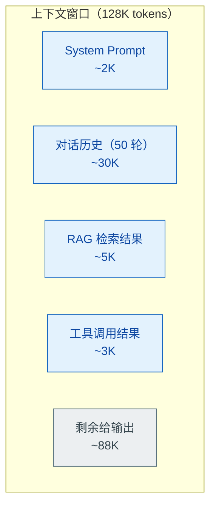

# 对话上下文窗口管理与压缩策略

> 难度：基础
> 分类：Memory & State

## 简短回答

上下文窗口是 LLM 的"工作记忆"——所有输入（System Prompt、对话历史、检索内容、工具结果）和输出都必须装进这个固定大小的 token 空间（4K 到百万级 tokens，如 Claude 标准为 200K，Sonnet 4.6+ / Opus 4.6+ / Mythos 已支持 1M；Gemini 2.5 Pro 也支持 1M+）。随着对话增长，上下文窗口的管理与压缩成为核心挑战。管理策略从简到繁包括：**截断（Truncation）**——直接裁剪最早的消息；**滑动窗口（Sliding Window）**——只保留最近 N 轮对话；**观察掩码（Observation Masking）**——用占位符替代旧内容；**LLM 摘要（Summarization）**——用模型将旧对话压缩为摘要；**分层摘要（Hierarchical）**——越旧的信息压缩越激进；**结构化提取**——提取实体和事实到结构化格式。研究表明，简单策略（掩码、截断）在总效率上往往不逊于复杂的 LLM 摘要。生产最佳实践是将上下文控制在窗口的 75% 以内（用 ACON 等自适应压缩框架做触发式压缩），并注意"中间丢失"效应。

## 详细解析

### 一、为什么需要管理上下文窗口？

```
上下文窗口 = LLM 能"看到"的全部信息
```



*上下文窗口是固定 token 预算：System Prompt、对话历史、RAG、工具结果四类内容争抢同一空间，输出只能用剩下的部分。*

```
对话增长曲线：
轮次  1: 500 tokens    ✅ 轻松
轮次 10: 5,000 tokens  ✅ 正常
轮次 50: 25,000 tokens ⚠️ 开始吃力
轮次 100: 50,000 tokens ❌ 超窗口 / 成本过高 / 注意力下降

核心问题：
1. 对话持续增长 → 总有一天超出窗口限制
2. 上下文越长 → 成本越高（按 token 计费）
3. 上下文越长 → 注意力分散（"中间丢失"效应）
4. 上下文越长 → 延迟越大
```

### 二、基础策略：截断与滑动窗口

#### 策略 1：截断（最简单）

```python
def truncate_messages(messages, max_tokens):
    """保留最新消息，截断最旧的"""
    total = 0
    kept = []
    # 从后往前保留
    for msg in reversed(messages):
        msg_tokens = count_tokens(msg)
        if total + msg_tokens > max_tokens:
            break
        kept.insert(0, msg)
        total += msg_tokens
    return kept
```

**改进版——优先级截断：**
```python
def smart_truncate(messages, max_tokens):
    """区分必须保留和可选内容"""
    must_keep = [m for m in messages if m["priority"] == "high"]
    # 系统消息 + 最新用户消息 = 必须保留
    optional = [m for m in messages if m["priority"] == "normal"]

    remaining = max_tokens - count_tokens(must_keep)
    middle = []

    for msg in reversed(optional):
        if count_tokens(msg) <= remaining:
            middle.insert(0, msg)
            remaining -= count_tokens(msg)

    return middle + must_keep
```

#### 策略 2：滑动窗口

```python
def sliding_window(messages, window_size=10):
    """只保留最近 N 轮对话"""
    system_messages = [m for m in messages if m["role"] == "system"]
    conversation = [m for m in messages if m["role"] != "system"]
    return system_messages + conversation[-window_size * 2:]  # 每轮 = user + assistant
```

**优势：** 零额外成本、可预测的 token 用量
**劣势：** 丢失所有旧上下文，Agent 会"遗忘"早期对话

#### 策略 3：观察掩码（Observation Masking）

```python
def observation_masking(messages, window=5):
    """用占位符替代旧的工具结果和长回复"""
    result = []
    for i, msg in enumerate(messages):
        if i < len(messages) - window:
            if msg["role"] == "tool" or len(msg["content"]) > 500:
                result.append({
                    "role": msg["role"],
                    "content": "[内容已省略——如需详情请重新查询]"
                })
            else:
                result.append(msg)
        else:
            result.append(msg)  # 最近 N 条保持原样
    return result
```

研究表明，掩码策略在**总效率（性能/成本比）**上与 LLM 摘要相当甚至更优。

### 三、进阶策略：LLM 摘要、分层摘要与结构化提取

#### 策略 4：LLM 摘要

```python
class IncrementalSummarizer:
    """增量式对话摘要"""

    def __init__(self):
        self.running_summary = ""

    def update(self, new_messages):
        prompt = f"""
        已有摘要：
        {self.running_summary}

        新的对话内容：
        {self.format_messages(new_messages)}

        请更新摘要。保留以下信息：
        - 用户的核心意图和需求
        - 已做出的重要决定
        - 关键数据和数字
        - 待解决的问题
        删除：
        - 寒暄和重复内容
        - 已解决的中间步骤细节
        """
        self.running_summary = llm.invoke(prompt)
        return self.running_summary
```

**优势：** 保留语义完整性，不丢失关键信息
**劣势：** 每次压缩需要一次 LLM 调用（成本 + 延迟），可能丢失细节

#### 策略 5：分层压缩（Hierarchical）

> 以下为概念示意代码，实际实现需处理边界情况（如消息不足、批次重叠等）。

```python
class HierarchicalCompression:
    """越旧的信息压缩越激进"""

    def compress(self, messages):
        total = len(messages)
        result = []

        for i, msg in enumerate(messages):
            age = total - i  # 消息的"年龄"

            if age <= 5:
                # 最近 5 轮：保留原文
                result.append(msg)
            elif age <= 20:
                # 5-20 轮前：压缩为摘要
                if i % 4 == 0:  # 每 4 条做一次摘要
                    batch = messages[i:i+4]
                    result.append(self.summarize_batch(batch))
            else:
                # 20 轮以前：只保留关键事实
                pass  # 已在更早的压缩周期中处理

        return result
```

#### 策略 6：结构化提取

```python
class StructuredExtractor:
    """从对话中提取结构化信息"""

    def extract(self, conversation):
        prompt = f"""
        从以下对话中提取关键信息，以结构化格式输出：

        {conversation}

        输出格式：
        CONTEXT: 当前在做什么
        ENTITIES: 提到的关键实体（人名、产品、订单号等）
        DECISIONS: 已做出的决定
        PENDING: 待解决的问题
        USER_PREFERENCES: 用户表达的偏好
        """
        return llm.invoke(prompt)
```

**优势：** 信息密度最高，不丢失关键事实
**劣势：** 提取质量依赖 LLM，可能遗漏隐式信息

### 四、生产实践方案

#### ACON 框架：自然语言指引优化 + 小模型蒸馏

ACON 原论文（"Optimizing Context Compression for Long-Horizon LLM Agents", arXiv:2510.00615）实际由两个核心机制构成，**并不是按 40%/60%/95% 三阈值切换**——这是常见误传，请勿在面试中引用：

1. **Natural-Language Compression Guideline Optimization**：把"该压缩什么/保留什么"显式化为一段可优化的自然语言指引，通过对比成功/失败轨迹的反馈不断 refine（类似 OPRO/PromptBreeder 风格的 prompt 优化）。
2. **Compressor Distillation**：把大模型生成的高质量压缩样本蒸馏到一个小模型（如 Qwen2.5-7B），作为生产环境的廉价 compressor。

```python
class ACONCompressor:
    """ACON: Optimizing Context Compression for Long-Horizon LLM Agents

    实际工作流（简化）：
      1) 给定任务、当前 trace、已优化的 guideline
      2) compressor LLM 按 guideline 输出"保留 + 丢弃"决策
      3) 失败案例反向优化 guideline；成功 trace 蒸馏到小 compressor
    """

    def __init__(self, compressor_llm, guideline: str):
        self.compressor = compressor_llm   # 可以是大模型；生产用蒸馏后的小模型
        self.guideline  = guideline        # 通过对比反馈持续优化的自然语言指引

    def compress(self, task: str, trace: list[dict]) -> list[dict]:
        prompt = f"""
        任务：{task}
        当前轨迹：{trace}
        压缩指引（请严格遵守）：
        {self.guideline}
        请输出保留后的轨迹，丢弃对当前任务无价值的工具结果/对话片段。
        """
        return self.compressor.invoke(prompt)
```

ACON 论文报告：在 AppWorld / OfficeBench / TravelPlanner 等长视野 Agent 任务上显著降低峰值 token 使用，同时维持甚至提升任务成功率；蒸馏后的小 compressor 兼具低成本和接近大模型的压缩质量。具体数字以论文为准——避免引用未经核实的 40%/60%/95% 阈值。

#### 混合策略（生产推荐）

```python
class ProductionContextManager:
    """组合多种策略的生产级上下文管理"""

    def __init__(self, config):
        self.max_context = config.max_tokens * 0.75  # 预留 25% 给输出
        self.buffer_size = config.buffer_turns        # 保留最近 N 轮原文
        self.vector_store = config.vector_store        # 语义检索历史

    def build_context(self, current_query, full_history):
        context = []
        budget = self.max_context

        # 1. System Prompt（必须保留）
        context.append(self.system_prompt)
        budget -= count_tokens(self.system_prompt)

        # 2. 最近 N 轮原文（高保真）
        recent = full_history[-self.buffer_size * 2:]
        context.extend(recent)
        budget -= count_tokens(recent)

        # 3. 语义检索相关历史（按需补充）
        if budget > 1000:
            relevant = self.vector_store.search(current_query, top_k=3)
            for doc in relevant:
                if count_tokens(doc) < budget:
                    context.insert(1, {"role": "system",
                                      "content": f"相关历史：{doc}"})
                    budget -= count_tokens(doc)

        # 4. 旧对话摘要（兜底）
        if len(full_history) > self.buffer_size * 2:
            old = full_history[:-self.buffer_size * 2]
            summary = self.summarize(old)
            context.insert(1, {"role": "system",
                              "content": f"历史摘要：{summary}"})

        return context
```

#### 注意"中间丢失"效应

```
LLM 对上下文中不同位置的注意力：

高 ██████░░░░░░░░░░░░░░░░░██████  高
   开头                        结尾
         ░░░░░░░░░░░░░░░░
              中间（容易被忽略）

实践建议：
- 最重要的指令放在开头（System Prompt）
- 当前用户消息放在结尾
- 中间放参考资料和历史上下文
```

#### 策略选择指南

| 策略 | 成本 | 信息保留 | 实现复杂度 | 适用场景 |
|------|------|---------|-----------|---------|
| 截断 | 零 | 低 | 极简 | 短对话、快速原型 |
| 滑动窗口 | 零 | 低 | 极简 | 简单聊天 |
| 观察掩码 | 零 | 中 | 简单 | 工具密集型 Agent |
| LLM 摘要 | 高（+7%） | 高 | 中 | 长对话助手 |
| 分层压缩 | 中 | 高 | 中 | 长时运行的 Agent |
| 结构化提取 | 中 | 最高 | 高 | 客服/销售场景 |
| ACON（指引+蒸馏） | 自适应 | 高 | 高 | 生产级长视野 Agent |

#### 关键洞察

```python
insights = {
    "简单未必差": "掩码和截断将成本减半，且可靠性往往优于摘要",
    "摘要≠万能": "通用摘要捕获'发生了什么'但丢失'进展到哪了'",
    "场景决定策略": "工具密集型用掩码，对话密集型用摘要",
    "组合优于单一": "最佳实践是组合多种策略：最近原文 + 中期摘要 + 远期结构化提取",
}
```

### 五、锚点保留：哪些信息永远不压缩

摘要是有损压缩。丢一句寒暄没关系，丢掉"用户要求不能删除线上数据"就可能让整个任务跑偏。更麻烦的是，模型通常不会主动问"你最初的需求是什么"——它默认当前上下文就是全部事实。

以下内容应视为锚点，永远不进入摘要器：

- 用户最初的需求原文，不是转述
- 明确的约束和禁止项，例如"不要改数据库 schema""输出必须是 JSON"
- 已经确认的决策，例如"用方案 B，不用方案 A"
- 当前子目标（随进度更新，但始终显式存在）
- 关键标识：文件路径、订单号、变量名、接口名

实现上，锚点用独立的结构化字段保存，不混进摘要文本。拼上下文时把它渲染成单独的 system 区块，放在历史摘要之后、最近消息之前。这个位置不会被摘要改写，也比混在历史摘要里更容易被模型注意到。锚点要小，只放不可丢的事实；长文档仍走摘要或检索。

```python
from dataclasses import dataclass, field


@dataclass
class AnchorState:
    """任务锚点：独立持久化，任何压缩策略都不得修改它"""

    original_request: str
    constraints: list[str] = field(default_factory=list)   # 约束与禁止项
    decisions: list[str] = field(default_factory=list)      # 已确认决策
    current_subgoal: str = ""
    identifiers: dict[str, str] = field(default_factory=dict)  # 路径、单号、变量名

    def render(self) -> str:
        parts = [
            f"原始需求：{self.original_request}",
            f"当前子目标：{self.current_subgoal}",
        ]
        if self.constraints:
            parts.append("约束与禁止项：\n" + "\n".join(f"- {c}" for c in self.constraints))
        if self.decisions:
            parts.append("已确认决策：\n" + "\n".join(f"- {d}" for d in self.decisions))
        if self.identifiers:
            pairs = "；".join(f"{k}={v}" for k, v in self.identifiers.items())
            parts.append(f"关键标识：{pairs}")
        return "\n".join(parts)


class ContextAssembler:
    """拼上下文：锚点单独成块，放在历史摘要之后、最近消息之前"""

    def __init__(self, max_tokens: int):
        self.max_tokens = max_tokens

    def build(self, system_prompt: str, anchors: AnchorState,
              history_summary: str, recent_messages: list[dict]) -> list[dict]:
        head = [{"role": "system", "content": system_prompt}]
        if history_summary:
            head.append({"role": "system", "content": f"历史摘要：\n{history_summary}"})
        head.append({
            "role": "system",
            "content": f"任务锚点（不可违背）：\n{anchors.render()}",
        })

        # 预算不够时从最旧的最近消息开始丢；锚点区块永不裁剪
        recent = list(recent_messages)
        while count_tokens(head + recent) > self.max_tokens and recent:
            recent.pop(0)
        return head + recent
```

### 六、摘要丢失关键信息怎么补

自由文本摘要是黑盒：模型写什么你就得到什么，漏了关键决策也看不出来。补救从三处下手。

第一，强制结构化输出。摘要必须回答固定字段：目标、已完成、未完成、关键决策、关键数据、待确认。字段缺失比文字啰嗦更容易被发现。

第二，摘要里留指针。提到文件、工具调用、外部单据时保留归档 id。原文不删除，只是移出上下文；模型需要细节时按 id 回查。压缩的是对话，不是知识。

第三，压缩后做一致性检查。只给模型看压缩后的上下文，让它复述当前目标和约束，再和锚点比对。对不上说明这次压缩压坏了关键信息，应回退或重新压缩；对得上也不能证明一点没丢，但能拦住大部分硬伤。

```python
from pydantic import BaseModel, Field


class StructuredSummary(BaseModel):
    """摘要必须覆盖的字段，缺字段会直接暴露，而不是藏在段落里"""

    goal: str
    done: list[str] = Field(default_factory=list)
    pending: list[str] = Field(default_factory=list)
    decisions: list[str] = Field(default_factory=list)
    key_data: list[str] = Field(default_factory=list)
    open_questions: list[str] = Field(default_factory=list)
    refs: list[str] = Field(default_factory=list)  # 原文归档 id，可回查


class SummaryCompressor:
    def __init__(self, llm, archive):
        self.llm = llm
        self.archive = archive  # put(messages) -> id, get(id) -> messages

    async def compress(self, messages: list[dict]) -> StructuredSummary:
        archive_id = await self.archive.put(messages)  # 原文先归档，永不删除
        prompt = f"""把以下对话压缩为 JSON 摘要。
只能使用对话中出现的信息；拿不准的内容放进 open_questions。
字段：goal, done, pending, decisions, key_data, open_questions。
对话：
{messages}
"""
        raw = await self.llm.invoke(prompt, response_format="json")
        summary = StructuredSummary.model_validate_json(raw)
        summary.refs.append(archive_id)
        return summary

    async def check(self, summary: StructuredSummary, anchors) -> bool:
        """压缩后复述目标与约束，对不上说明压坏了"""
        answer = await self.llm.invoke(f"""只根据下面的摘要回答，不要补充：
1. 当前任务目标是什么？
2. 有哪些不能违反的约束和已确认的决策？
摘要：
{summary.model_dump_json()}
""")
        verdict = await self.llm.invoke(f"""锚点：
{anchors.render()}

复述：
{answer}

复述与锚点是否一致？只回答 yes 或 no。
""")
        return verdict.strip().lower().startswith("yes")
```

### 七、跨块关联：靠结构不靠记忆

按时间切摘要，会把同一个子任务的信息切散：第 3 轮定下的接口约定，第 40 轮才用到，中间隔着几十条无关消息。等模型需要它时，摘要里早没有位置了。

解法是给结构，不给模型增加记忆负担。

- 每条消息带 `turn_id` 和 `subtask_id`，摘要按子任务聚合，而不是按固定时间窗切。
- 维护任务状态表：子任务 → 状态 → 产出 → 依赖。这张表全量保留、永不压缩，跨块的因果关系都挂在它上面。
- 需要历史细节时，用当前 query 检索历史消息：关键词和向量混合召回，取 top-k 拼回上下文。

纯向量检索对编号类信息不敏感：订单号 `A123` 和 `A124` 在向量空间里往往非常接近，通常要靠关键词精确匹配才能可靠区分。所以混合检索里两路都要留。

```python
from dataclasses import dataclass, field
from enum import Enum
from typing import Optional


class TaskStatus(str, Enum):
    TODO = "todo"
    RUNNING = "running"
    DONE = "done"
    BLOCKED = "blocked"


@dataclass
class SubtaskNode:
    subtask_id: str
    title: str
    status: TaskStatus = TaskStatus.TODO
    output_ref: Optional[str] = None          # 产出归档 id，不存正文
    depends_on: list[str] = field(default_factory=list)


class TaskStateTable:
    """任务状态表：全量注入、永不压缩，跨块因果都挂在这里"""

    def __init__(self):
        self.nodes: dict[str, SubtaskNode] = {}

    def add(self, node: SubtaskNode) -> None:
        self.nodes[node.subtask_id] = node

    def ready(self) -> list[SubtaskNode]:
        """依赖已全部完成、自己还没开始的子任务"""
        return [
            n for n in self.nodes.values()
            if n.status == TaskStatus.TODO
            and all(d in self.nodes and self.nodes[d].status == TaskStatus.DONE
                    for d in n.depends_on)
        ]

    def render(self) -> str:
        lines = []
        for n in self.nodes.values():
            deps = ",".join(n.depends_on) or "-"
            lines.append(
                f"[{n.subtask_id}] {n.title} | {n.status.value} "
                f"| 依赖:{deps} | 产出:{n.output_ref or '-'}"
            )
        return "\n".join(lines)

    def messages_of(self, subtask_id: str, history: list[dict]) -> list[dict]:
        """按子任务聚合消息，摘要器以它为输入，而不是按时间窗切"""
        return [m for m in history if m.get("subtask_id") == subtask_id]


class HybridHistorySearch:
    """关键词 + 向量混合召回：编号靠关键词，语义靠向量"""

    def __init__(self, keyword_index, vector_index):
        self.keyword_index = keyword_index
        self.vector_index = vector_index

    def search(self, query: str, top_k: int = 5) -> list[dict]:
        kw = self.keyword_index.search(query, top_k)
        vec = self.vector_index.search(query, top_k)
        return self._rrf_merge(kw, vec)[:top_k]

    def _rrf_merge(self, *ranked_lists: list[dict]) -> list[dict]:
        """Reciprocal Rank Fusion：按名次融合，不要求两路分数量纲一致"""
        scores: dict[str, float] = {}
        docs: dict[str, dict] = {}
        for ranked in ranked_lists:
            for rank, doc in enumerate(ranked, start=1):
                doc_id = doc["id"]
                scores[doc_id] = scores.get(doc_id, 0.0) + 1.0 / (60 + rank)
                docs[doc_id] = doc
        return [docs[i] for i in sorted(scores, key=lambda i: scores[i], reverse=True)]
```

## 常见误区 / 面试追问

1. **误区："上下文窗口越大越好 / 越大就不需要压缩"** — 更大的窗口意味着更高的成本（按 token 计费）、更大的延迟、以及更严重的"中间丢失"效应。即使 200K 窗口，长对话仍会导致成本线性增长和注意力质量下降。压缩不仅省钱，还能提高模型注意力的质量。最佳实践是精心管理上下文内容，而非依赖大窗口。

2. **误区："只要不超过上下文限制就没问题"** — 即使不超限，上下文中的噪声信息也会降低模型的准确率（"上下文腐化"）。精简的、高相关性的上下文优于冗长的完整历史。

3. **误区："LLM 摘要是最佳策略"** — 研究表明简单的观察掩码在总效率上不逊于 LLM 摘要。摘要额外消耗约 7%+ 成本（经验估算值，实际因场景而异），且不总是能保留正确信息。应该根据场景选择，而非默认使用最复杂的方案。

4. **追问："摘要压缩的成本问题怎么解决？"** — 每次摘要需要一次额外 LLM 调用，可能占总成本的 7%+。优化方案：(1) 只在 token 超阈值时才触发摘要；(2) 用小模型做摘要；(3) 用观察掩码（Observation Masking）替代 LLM 摘要。

5. **追问："如何评估压缩策略的质量？"** — 两个维度：(1) 信息保留率——压缩后 Agent 能否正确回答依赖历史信息的问题；(2) 成本效率——总 token 消耗（含压缩调用本身的开销）。LoCoBench-Agent 是专门评估长上下文压缩的基准测试。

6. **追问："增量摘要 vs 全量重新摘要？"** — 增量摘要（每次只处理新消息）更快更便宜，但可能累积误差。全量重新摘要更准确但成本高。实践中用增量摘要 + 定期全量校正的混合方式。

7. **追问："Claude 的 Server-Side Compaction 是什么？"** — Anthropic 在 Claude **Sonnet 4.6+ / Opus 4.6+** 上提供服务端自动压缩（context editing / compaction）能力——当对话接近上限时，由服务端策略性删除/折叠旧的 tool_result 与思考块，让长对话可以"无限延续"。早期 Sonnet 4 / Opus 4 不带这套原语，需要客户端自己实现。此外它和 Memory Tool（memory_20250818）配合使用尤其强大：被压缩掉的内容可以通过 Memory Tool 显式落盘后再被检索回来，相当于 Anthropic 把"长寿命 Agent 的上下文虚拟内存"做成了官方原语组合。

8. **追问："锚点保留和摘要是什么关系？"** — 互补，不是替代。摘要压缩历史对话，锚点保存不可丢的事实，单独存储、不经过摘要器。每次拼上下文时锚点作为独立 system 区块全量注入。锚点要小，只放需求、约束、决策、子目标和关键标识；长文档仍走摘要或检索。

## 参考资料

- [Context Window Management Strategies (APXML)](https://apxml.com/courses/langchain-production-llm/chapter-3-advanced-memory-management/context-window-management)
- [Top Techniques to Manage Context Length in LLMs (Agenta)](https://agenta.ai/blog/top-6-techniques-to-manage-context-length-in-llms)
- [Context Window Management for AI Agents (Maxim AI)](https://www.getmaxim.ai/articles/context-window-management-strategies-for-long-context-ai-agents-and-chatbots/)
- [Context Windows (Claude API Docs)](https://platform.claude.com/docs/en/build-with-claude/context-windows)
- [LLM Context Windows: What They Are & How They Work (Redis)](https://redis.io/blog/llm-context-windows/)
- [LLM Chat History Summarization Guide (Mem0)](https://mem0.ai/blog/llm-chat-history-summarization-guide-2025)
- [Smarter Context Management for LLM-Powered Agents (JetBrains Research)](https://blog.jetbrains.com/research/2025/12/efficient-context-management/)
- [Evaluating Context Compression for AI Agents (Factory.ai)](https://factory.ai/news/evaluating-compression)
- [ACON: Optimizing Context Compression for Long-Horizon LLM Agents (arXiv)](https://arxiv.org/html/2510.00615v1)
