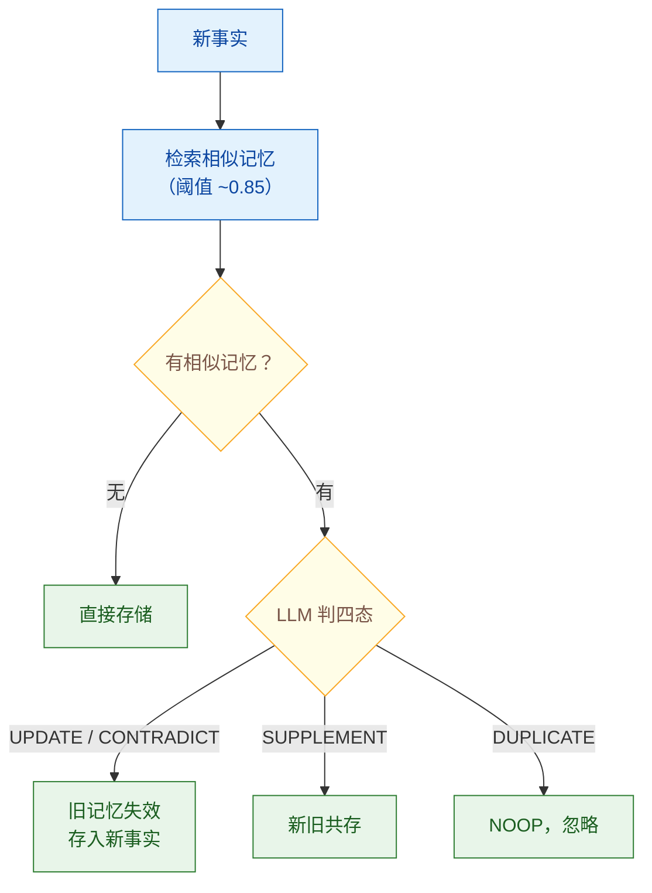

# 记忆的遗忘与更新机制：如何处理过时信息？

> 难度：高级
> 分类：Memory & State

## 简短回答

Agent 记忆系统不仅要能"记住"，更要能"忘记"和"更新"。没有遗忘机制的记忆系统会导致：存储膨胀、检索噪声增加、过时信息误导决策。核心机制包括：**时间衰减**（越老的记忆权重越低）、**基于检索频率的淘汰**（从未被访问的记忆优先删除）、**冲突检测与更新**（新事实覆盖旧事实）、**显式删除**（用户或系统触发删除）。前沿研究 **A-MAC（自适应记忆准入控制）** 将记忆存储视为结构化决策问题，从五个维度评估记忆价值：未来效用、事实置信度、语义新颖性、时间新近性和内容类型。实验表明，基于效用的删除策略比朴素策略性能提升 10%。

## 详细解析

### 为什么需要遗忘？

```
无遗忘的记忆系统：
第 1 天: "用户喜欢 React"       → 存储 ✓
第 30 天: "用户开始学 Vue"      → 存储 ✓
第 90 天: "用户现在全部用 Vue"   → 存储 ✓

查询"推荐前端框架"：
→ 检索到 3 条记忆，其中 2 条指向 React（旧信息）
→ Agent 推荐 React（错误！）

问题：LLM 无法判断哪条检索结果是最新的
它把所有记忆同等对待
```

### 遗忘策略

#### 1. 时间衰减（Time-based Decay）

```python
class TimeDecayMemory:
    """基于 Ebbinghaus 遗忘曲线的记忆衰减"""

    def compute_strength(self, memory):
        age_hours = (datetime.now() - memory.created_at).total_seconds() / 3600
        # 遗忘曲线：R = e^(-t/S)
        # S = 稳定性因子（被访问越多越稳定）
        stability = 1.0 + memory.access_count * 0.5
        strength = math.exp(-age_hours / (stability * 24))
        return strength

    def decay_and_prune(self, user_id):
        """定期衰减并清理低强度记忆"""
        memories = self.get_all(user_id)
        for mem in memories:
            mem.strength = self.compute_strength(mem)
            if mem.strength < 0.05:  # 强度低于阈值
                self.archive_or_delete(mem)
```

#### 2. 基于检索频率的淘汰（LRU/LFU）

```python
class FrequencyBasedForgetting:
    """基于访问频率的记忆淘汰"""

    def should_forget(self, memory) -> bool:
        # 存在时间长但从未被检索 → 说明价值低
        age_days = (datetime.now() - memory.created_at).days
        if age_days > 30 and memory.access_count == 0:
            return True
        # 最近 30 天未被访问且总访问次数低
        if memory.last_accessed and \
           (datetime.now() - memory.last_accessed).days > 30 and \
           memory.access_count < 3:
            return True
        return False
```

#### 3. 容量限制淘汰

```python
class CapacityBoundedMemory:
    """有容量上限的记忆，满时淘汰最低价值的"""

    def __init__(self, max_memories=1000):
        self.max = max_memories

    def add(self, memory):
        if len(self.memories) >= self.max:
            # 找到价值最低的记忆淘汰
            lowest = min(self.memories, key=lambda m: self.compute_value(m))
            self.delete(lowest)
        self.memories.append(memory)

    def compute_value(self, memory):
        return (
            0.4 * memory.access_count / max(1, self.max_access) +
            0.3 * memory.strength +
            0.3 * memory.confidence
        )
```

#### 4. TTL 的实现陷阱：配了过期 ≠ 记忆真的消失

工程上最常见的遗忘实现是给记忆行加 TTL，但 TTL 通常由后台清扫任务（sweeper）周期性删除，**两次清扫之间存在窗口期**：这段时间里已过期的记忆仍然躺在库里，检索照样能命中；更糟的是，很多实现带 `refresh_ttl`（访问即续期），一次检索命中就把本该死掉的行"复活"，过期记忆因此永远不过期。

LangGraph 在 checkpoint v4.2.0（2026-08）给 `TTLConfig` 加了 `omit_expired`（默认 `False`）正是补这个洞：

```python
from langgraph.store.base import TTLConfig

ttl_config = TTLConfig(
    default_ttl=60,        # 分钟
    refresh_on_read=True,
    omit_expired=True,     # v4.2.0 新增，默认 False
)
# omit_expired=True 的两个效果：
# 1. get / search / list_namespaces 在【查询层】过滤掉已过期行，
#    不再依赖后台 TTL 清扫周期 —— 过期的当场就检索不到
# 2. 阻止 refresh_ttl 给已过期的行续命（不会被读操作"复活"）
```

结论：遗忘要在**读路径**上生效，不能只挂在写路径和后台清扫上。设计时把"过期"当成检索时的过滤条件，而不是"迟早会被删掉"的状态。

### 更新策略

#### 1. 冲突检测与覆盖



*新事实先检索相似记忆：无相似直接存储；有相似由 LLM 判四态——更新/矛盾则失效旧存新，补充则共存，重复则 NOOP。*

```python
class ConflictAwareUpdater:
    """检测新旧信息冲突并智能更新"""

    async def process_new_fact(self, user_id, new_fact):
        # 检索语义相似的已有记忆
        similar = await self.retrieve_similar(user_id, new_fact, threshold=0.85)

        if not similar:
            # 全新信息 → 直接存储
            await self.store(user_id, new_fact)
            return "STORE"

        # 有相似记忆 → 让 LLM 判断关系
        decision = await self.llm.invoke(f"""
        已有记忆: {similar[0]['content']}
        新信息: {new_fact}

        判断新信息与已有记忆的关系：
        - UPDATE: 新信息是已有记忆的更新版本（如偏好变化）
        - CONTRADICT: 新信息与已有记忆矛盾（需要替换）
        - SUPPLEMENT: 新信息是补充（两者共存）
        - DUPLICATE: 新信息是重复（忽略）
        """)

        if decision in ["UPDATE", "CONTRADICT"]:
            await self.invalidate(similar[0])
            await self.store(user_id, new_fact)
            return decision
        elif decision == "SUPPLEMENT":
            await self.store(user_id, new_fact)
            return "SUPPLEMENT"
        else:
            return "NOOP"
```

#### 2. 知识图谱的时间失效

```python
# 知识图谱中的事实更新
class TemporalFactUpdate:
    async def update_fact(self, subject, predicate, new_object):
        # 1. 找到当前有效的旧事实
        old_fact = await self.graph.find(
            subject=subject, predicate=predicate,
            valid_to=None  # 当前有效
        )

        if old_fact:
            # 2. 标记旧事实失效（不删除，保留历史）
            old_fact.valid_to = datetime.now()
            await self.graph.update(old_fact)

        # 3. 创建新事实
        await self.graph.add(
            subject=subject, predicate=predicate, object=new_object,
            valid_from=datetime.now(), valid_to=None
        )
```

### 前沿研究：A-MAC（自适应记忆准入控制）

```python
class AdaptiveMemoryAdmission:
    """A-MAC: 将记忆存储视为结构化决策问题"""

    def evaluate_memory_value(self, candidate_memory) -> float:
        """从 5 个维度评估记忆是否值得存储"""
        scores = {
            # 1. 未来效用：这条记忆在未来交互中可能被使用吗？
            "future_utility": self.predict_future_use(candidate_memory),
            # 2. 事实置信度：这条信息可靠吗？
            "factual_confidence": self.assess_confidence(candidate_memory),
            # 3. 语义新颖性：这条信息提供了新知识吗？
            "semantic_novelty": self.compute_novelty(candidate_memory),
            # 4. 时间新近性：这条信息是最新的吗？
            "temporal_recency": self.recency_score(candidate_memory),
            # 5. 内容类型先验：这类内容通常值得记住吗？
            "content_type_prior": self.type_prior(candidate_memory),
        }
        return weighted_sum(scores)

    def should_admit(self, candidate) -> bool:
        value = self.evaluate_memory_value(candidate)
        return value > self.admission_threshold
```

### MemoryAgentBench 评估维度

评估记忆系统质量的四个能力：

```python
evaluation_dimensions = {
    "Accurate Retrieval": "能否准确检索出相关记忆？",
    "Test-Time Learning": "能否从交互中学习新知识？",
    "Long-Range Understanding": "能否在长时间跨度中保持理解？",
    "Selective Forgetting": "能否智能地遗忘过时信息？",
}
```

### 新维度：记得对，也可能害了推理（MemTrapBench，2026-08）

上面的遗忘策略都站在**存取正确率**（记忆能否被准确写入和取回）的视角上。MemTrapBench（2026-08）指出了一个这套视角看不见的失效维度：**记忆诱发的认知陷阱**——记忆内容本身没有任何问题，既被忠实记录、也与当前问题语义相关，但进入上下文后仍扭曲了模型的推理过程或信念状态。它分两类：**Reasoning Fixation**（推理固着——旧解法被复用到表面相似、实质不同的新问题上，不再重新评估前提）和 **Belief 类**（信念扭曲——曾经成立的判断被当作无需校验的"已知前提"，错不在事实本身，而在它被赋予了不该有的确定性）。

| | 解决什么 | 失效长什么样 | 对策 |
|---|---|---|---|
| 前文的遗忘/更新机制 | 记错、记多、记旧 | 检索到过时或错误的记忆 | 衰减、淘汰、冲突覆盖、准入控制 |
| MemTrapBench 揭示的 | 记对了仍有害 | 检索到正确且相关的记忆，推理照样跑偏 | 不在写入侧，得在使用侧 |

两者正交而非替代：遗忘做得越干净，剩下的记忆越"可信"，被无条件采信的风险反而越高。工程含义：记忆质量不能只用"检索准确率"单指标验收——一条记忆该不该留（写入侧）和它进入上下文后会不会被误用（使用侧）要分别评估，后者例如让 Agent 把检索到的记忆当作"线索"而非"前提"，或复用旧解法前强制重核当前问题的前提条件。

### 实际影响

研究表明：
- 基于效用的删除策略比朴素策略（FIFO/随机）性能提升 10%
- 无差别存储会导致错误传播和长期性能退化
- 幻觉信息如果被存入记忆，会在后续交互中反复出现（记忆污染）

## 常见误区 / 面试追问

1. **误区："只要存储空间够大，就不需要遗忘"** — 记忆系统的问题不是存储容量，而是检索质量。过时和错误的记忆会污染检索结果，导致 Agent 做出错误决策。"智能遗忘是可靠记忆的前提条件"。

2. **误区："删除旧记忆就是遗忘"** — 更好的做法是"失效"而非"删除"——标记旧事实为过期但保留历史，支持时间旅行查询。知识图谱的 valid_from/valid_to 模型是最佳实践。

3. **追问："如何防止幻觉信息被存入记忆？"** — A-MAC 的"事实置信度"维度正是解决这个问题——在存入记忆前评估信息可靠性。还可以：(1) 对 LLM 提取的事实做交叉验证；(2) 设置置信度阈值，低于阈值的信息不存储。

4. **追问："给记忆加了 TTL，是不是就实现遗忘了？"** — 不够。TTL 一般靠后台清扫兑现，清扫周期之间过期记忆仍会被检索到；如果还开了"访问即续期"，一次命中就把它续活，等于永不过期。正确做法是让过期在读路径生效——查询时直接过滤过期行，并禁止续期作用于已过期数据。LangGraph checkpoint v4.2.0 的 `TTLConfig.omit_expired` 就是这个语义（默认关闭，需要显式开）。

5. **追问："把该遗忘的都遗忘干净了，记忆系统是不是就没问题了？"** — 不是。遗忘机制解决的是"记错/记多/记旧"，判据是存取正确率。MemTrapBench（2026-08）度量的是另一类失效——**记忆被忠实记录、且与当前问题语义相关，仍可能扭曲推理或信念**：Reasoning Fixation 是模型沿用旧解法解表面相似的新问题，Belief 类是曾经成立的判断被当作无需校验的前提。两者正交：遗忘做得越干净，剩下的记忆越"可信"，被无条件采信的风险反而越高。所以验收记忆系统不能只看检索准确率，还得看记忆进入上下文后是否被当成不可质疑的前提。

6. **追问："记忆遗忘和 GDPR 的'被遗忘权'有什么关系？"** — GDPR 要求系统能完全删除用户数据。Agent 记忆系统必须支持彻底的物理删除（不仅是逻辑失效），包括向量存储、知识图谱和所有备份中的数据。

## 参考资料

- [A Survey on the Memory Mechanism of LLM-based Agents (ACM TOIS)](https://dl.acm.org/doi/10.1145/3748302)
- [Adaptive Memory Admission Control for LLM Agents (arXiv)](https://arxiv.org/html/2603.04549)
- [The Problem with AI Agent "Memory" (Medium)](https://medium.com/@DanGiannone/the-problem-with-ai-agent-memory-9d47924e7975)
- [MemoryBank: Enhancing Large Language Models with Long-Term Memory (arXiv)](https://arxiv.org/abs/2305.10250)
- [Making Sense of Memory in AI Agents (Leonie Monigatti)](https://www.leoniemonigatti.com/blog/memory-in-ai-agents.html)
- [LangGraph checkpoint v4.2.0 Release Notes: TTLConfig.omit_expired (GitHub)](https://github.com/langchain-ai/langgraph/releases/tag/checkpoint%3D%3D4.2.0)
- [MemTrapBench: Benchmarking Cognitive Traps in LLM Memory Use (arXiv)](https://arxiv.org/abs/2608.20202)
