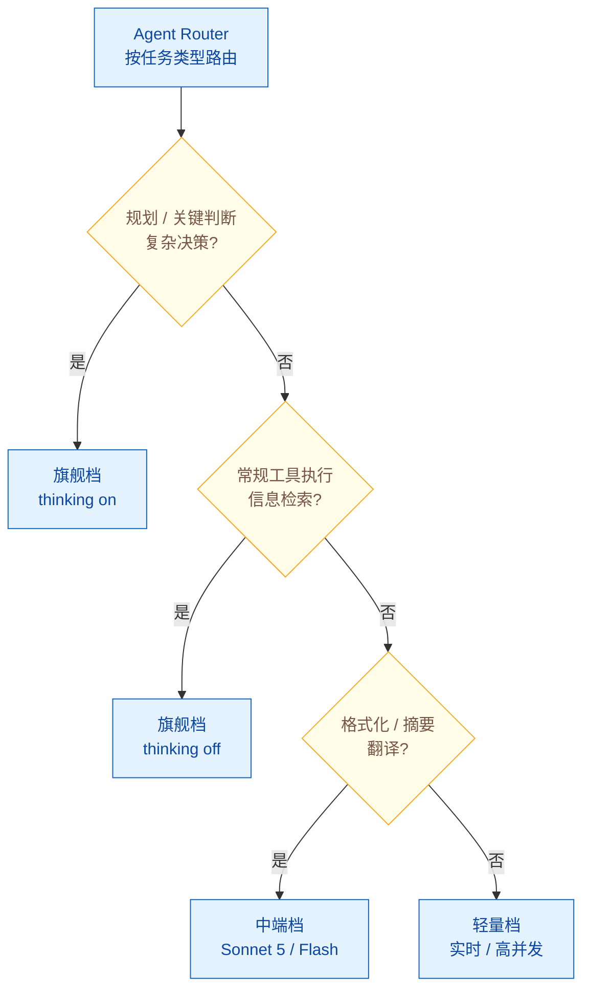

# 2026 推理 / Agent 模型版图：Claude / GPT / Gemini 三家旗舰对比与选型

> **难度**: 中级
> 🔄 2026.7 升级重写（原题只覆盖 o1/o3/DeepSeek-R1，已压缩为「历史脉络」一小段）

## 简短回答

2026 年模型版图最大的变化是：**「推理模型」与「通用模型」的边界正在消失**。2024-2025 年那种「o1 是专用推理模型、GPT-4o 是通用模型」的泾渭分明已经过时——如今三家旗舰通用模型都把推理能力做成**内置可调的 thinking 模式**：OpenAI 用显式 `thinking` 开关、Anthropic 用 `extended thinking` + `budget_tokens`、Google 用 Deep Think 与 Thought Signatures。选型问题从「该不该上推理模型」变成了「同一模型开不开 thinking、开多大预算」。

当前（2026.7）三大旗舰定位：**Claude Sonnet 5**（2026-06-30 发布，Anthropic 定位「最 agentic 的 Sonnet」，Sonnet 4.6 的 drop-in 升级，定价 $2/$10 per MTok，约为同档旗舰一半，主打 agentic coding 与自主任务执行）、**GPT-5.6**（代号旗舰 "Sol" + 均衡日常 "Terra"，已 GA，强调自然语言→前端 UI 生成与端到端自主工作流）、**Gemini 3 / 3.1**（3.1 解锁 Agent Mode，可自主编写/测试/部署桥接脚本，配合 Thought Signatures 让 agent 追踪自身推理，Google I/O 2026 把 Gemini 重新定位为「操作系统级 agent 平台」）。

2026-09 快照更新：**GPT-6 Astra**（09-03 发布，computer use / 浏览 / 软工 / 网安 / 科学方向 SOTA，FrontierMath Tier 4 98%、ARC-AGI-3 99.9%，$10/$50 per MTok，经 Azure / Bedrock 提供）；Anthropic 发布 **Claude Fable / Mythos 5.1**（09-01，同一模型配不同安全护栏，典型负载降价约 25%、agentic 任务最高约 45%）。代际更替在加速，「推理能力是旗舰内置模式」的合流判断进一步坐实。

**Cheat sheet**：
- **核心趋势**：推理能力从「独立品类」扩散为「旗舰通用模型的内置模式」，三家都在合流
- **选型三维**：agentic 能力（工具交错 / 长任务稳定性）× 成本 × harness 耦合度，不再只看推理分
- **Claude Sonnet 5**：最 agentic 的 Sonnet，$2/$10 per MTok，drop-in 替换 4.6，interleaved thinking
- **GPT-5.6 Sol/Terra**：NL→UI 生成 + 端到端工作流，thinking 显式开关，GPT-5.1 已于 2026.3 从 ChatGPT 退役
- **Gemini 3.1 + Agent Mode**：自主写/测/部署脚本，Thought Signatures 自追踪推理，3.5 Flash 专为 agentic workflow 设计
- **关键警示**：SWE-bench Verified 顶部已达 87-94% 但出现「gaming 信任危机」，高分≠生产可靠

## 详细解析

### 一、为什么 2026 要重写这张版图：推理与通用正在合流

上一版本题目的核心框架是「Reasoning Model vs 标准 LLM」二分法——o1/o3 在模型内部先生成上千 token 的推理链，标准模型直接逐 token 输出。这个二分法在 2024-2025 之交是准确的，但到 2026 已经失效：

```
2024-2025（旧版图）：
  专用推理模型（o1/o3、DeepSeek-R1）  ←→  通用模型（GPT-4o、Claude Sonnet 3.5）
  - 推理模型贵、慢、但难题强            - 通用模型快、便宜、但难题弱
  - 二者是不同模型、不同 API

2026（新图景）：推理能力成为「旗舰通用模型的内置模式」
  ┌─────────────────────────────────────────────────────┐
  │ 旗舰通用模型 = 通用能力 + 可调 thinking 模式          │
  │  · OpenAI:   thinking 显式开关                       │
  │  · Anthropic: extended thinking + budget_tokens      │
  │  · Google:   Deep Think / Thought Signatures         │
  │  简单任务 → 关 thinking（快、便宜）                   │
  │  复杂推理 → 开 thinking（慢、准）                     │
  └─────────────────────────────────────────────────────┘
```

驱动合流的两个力量：(1) **Test-Time Compute Scaling 被验证有效**——允许模型多想一会儿的收益，比单纯堆参数更划算，于是厂商都把这条做进通用旗舰；(2) **Agent 场景要求"会推理也会调工具"**——纯推理模型不擅工具交错，而 agent 需要思考→调工具→再思考的循环，迫使推理能力长到通用模型里。

所以 2026 的选型问题变了：

| 旧问题（2024-2025） | 新问题（2026） |
|------|------|
| 该不该用推理模型？ | 这个任务该不该开 thinking？开多大 budget？ |
| o1 vs GPT-4o 谁强？ | 同一旗舰在 thinking on/off 下的性价比曲线？ |
| 推理模型为什么这么贵？ | thinking token 怎么计费？怎么控预算？ |

### 二、2026 三大旗舰 Agent 模型横评

> 以下事实均回查自项目调研来源（`.work/research/03-recent-advances.md`），发布日期/定价/代号以官方公告为准。

| 维度 | Claude Sonnet 5 | GPT-5.6 | Gemini 3 / 3.1 |
|------|----------------|---------|----------------|
| **发布方** | Anthropic | OpenAI | Google |
| **发布时间** | 2026-06-30 | 2026（GA） | 2026（3.1 解锁 Agent Mode） |
| **定位** | 「最 agentic 的 Sonnet」 | 旗舰 "Sol" + 均衡 "Terra" | 「操作系统级 agent 平台」 |
| **思考机制** | extended thinking + interleaved thinking（思考与工具交错） | 显式 `thinking` 开关 | Deep Think + Thought Signatures（自追踪推理） |
| **agentic 特性** | agentic coding、自主任务执行、drop-in 替换 Sonnet 4.6 | NL→前端 UI 生成、交互式可视化、端到端工作流 | Agent Mode：自主编写/测试/部署桥接脚本（如 iOS）；3.5 Flash 专为复杂 agentic workflow 设计 |
| **定价** | $2 / $10 per MTok（输入/输出，约为同档旗舰一半） | 见 OpenAI 官方价目 | 见 Google 官方价目 |
| **上游谱系** | Sonnet 4.6（1M context + server-side compaction） | GPT-5（2025.07）→ GPT-5.1（2025.11，2026.3 从 ChatGPT 退役） | Gemini 2.5 Deep Think（2025.08，Google 首个公开多 agent 模型） |

**一句话区分**：
- **Claude Sonnet 5** =「便宜的 agentic 工兵」，定位是把 agent 场景的性价比拉下来，coding 与自主执行是主战场；
- **GPT-5.6** =「能生成可交互前端的通用旗舰」，差异化在 NL→UI 与端到端工作流自动化；
- **Gemini 3.1** =「想做操作系统的 agent 平台」，靠 Agent Mode + Thought Signatures 把"agent 追踪自己推理"做成一等公民。

#### Claude Sonnet 5：最 agentic 的 Sonnet

Anthropic 在 2026-06-30 发布 Sonnet 5，明确文案是"the most agentic Sonnet model yet"，是 Sonnet 4.6 的 **drop-in 升级**——API 行为兼容，换一行 model id 就能上手。入门定价 $2/MTok 输入、$10/MTok 输出，约为同档旗舰的一半，全面登陆 Anthropic API、GitHub Copilot 等平台。核心提升集中在 **agentic coding 和自主任务执行**。

为什么这对 Agent 选型重要：此前 agent 场景要么用顶级旗舰（贵），要么降级用小模型（容易在长任务里崩）。Sonnet 5 把"agentic 能力"做到中端价位，直接重塑了成本/性能曲线——很多原本要跑 Opus 的 agent 工作流，可以下放到 Sonnet 5。

#### GPT-5.6 "Sol" / "Terra"：从长链操作到端到端工作流

OpenAI 的 GPT-5.6 模型族旗舰代号 **"Sol"**（前沿智能），另有均衡日常模型代号 **"Terra"**，均已 GA。差异化能力在**自然语言到前端 UI 的生成**与**交互式可视化**。它体现了 OpenAI 2026 的加速迭代策略：GPT-5.1 于 2025.11 发布，2026.3 已从 ChatGPT 退役；agent 场景的定位从 GPT-5 时代的"执行长链操作"进化到"端到端自主完成复杂工作流"。thinking 模式作为显式开关保留，用户可按任务决定开/关。

#### Gemini 3 / 3.1 + Agent Mode：操作系统级 agent 平台

Google 在 2026 年把 Gemini 从聊天机器人重新定位为「操作系统级 agent 平台」（Forbes 对 Google I/O 2026 的总结），覆盖搜索、购物、工作全场景。关键技术：

- **Agent Mode**（3.1 解锁）：可自主编写、测试、部署连接外部生态系统的桥接脚本（例如连 iOS），让 Gemini 不只是"对话"，而是"动手改你的环境"。
- **Thought Signatures**：让 agent 追踪自身推理过程的机制，把"推理可观测"内建到模型层。
- **Gemini 3.5 Flash**：专为复杂 agentic workflow 设计的轻量档。
- 历史线：Gemini 2.5 Deep Think（2025.08）是 Google 首个公开的多 agent 模型，IMO 2025 拿到 Bronze 级，是 3.x 系列 agent 化的起点。

### 三、Agent 能力四维对比

横评 Agent 模型不能只看推理分。2026 业界收敛出四个真正决定 agent 表现的维度：

```
                    Agent 能力四维
   ┌───────────────────────────────────────────┐
   │ 1. 工具交错（Interleaved Thinking）        │  思考→调工具→再思考 循环
   │ 2. 长上下文（1M token）                     │  三家旗舰均已达到 1M
   │ 3. 长任务自主性                             │  能否稳定跑数十/上百步
   │ 4. harness 耦合度（Post-training Coupling）│  模型权重是否绑死某套工具签名
   └───────────────────────────────────────────┘
```

| 维度 | Claude Sonnet 5 | GPT-5.6 | Gemini 3.1 |
|------|----------------|---------|------------|
| **工具交错** | 原生支持（interleaved thinking） | 支持 | 支持 + Agent Mode 主动写脚本 |
| **长上下文** | 1M token（承自 Sonnet 4.6） | 1M token | 1M token（3.1 Pro） |
| **长任务自主性** | 强（Anthropic 同期发布长时科学计算 Agent） | 强（端到端工作流） | 强（Agent Mode 自主部署） |
| **harness 耦合** | 与 Claude Code 深度协同，权重倾向 Claude Code 工具签名 | Codex 系模型权重绑 `apply_patch` 签名 | 与 Google ADK / Agent Engine 深度绑定 |

**关键判断**：第 4 维（harness 耦合度）是 2026 新增的选型维度。研究表明，模型在 post-training 阶段会把对特定工具签名（如 `apply_patch`、某套 MCP 工具）的"偏好"冻进权重——脱离配套 harness 性能会掉。这意味着**选模型其实在选"模型 + harness"的组合**，详见 [#109 — Agent Harness 三层抽象](../01-agent-architecture/109-what-is-agent-harness.md)。

### 四、推理模型 vs 通用模型选型决策（2026 版）

合流之后，决策不再是"选哪个模型品类"，而是"任务该不该开 thinking、开多大预算"。

```python
def choose_model_and_thinking(task):
    """2026 版 Agent 选型决策（伪代码）"""
    complexity = assess_complexity(task)        # 简单 / 中等 / 复杂推理
    latency_sensitive = task.needs_realtime     # 对话/实时？
    cost_sensitive = task.batch_scale           # 批量？
    needs_tools = task.requires_tool_calls      # agent 工具循环？

    # 规则 1：实时对话、翻译、简单 QA → 关 thinking，用通用档
    if complexity == "simple" or latency_sensitive:
        return {"thinking": False, "tier": "standard"}

    # 规则 2：数学/算法/科学证明/复杂多步推理 → 开 thinking，给足 budget
    if complexity == "complex_reasoning":
        return {"thinking": True, "budget_tokens": 8000}

    # 规则 3：Agent 长任务 → 开 interleaved thinking + 工具交错
    if needs_tools and task.long_horizon:
        return {
            "thinking": True,
            "interleaved": True,          # 思考与工具调用交错
            "budget_tokens": "per_step",  # 每步单独预算
        }

    # 规则 4：成本敏感的批量 → 关 thinking，用 Sonnet/Flash 档兜底
    if cost_sensitive:
        return {"thinking": False, "tier": "mid"}  # 如 Sonnet 5 / Gemini 3.5 Flash
```

实战中的混合策略（Model Routing）：


*生产 Agent 按任务路由档位：关键判断开 thinking，常规执行关，格式化走中端，实时走轻量。*

Model Routing 已是生产 Agent 的核心组件，详见 [#089 — 模型路由](../10-production-and-deployment/089-model-routing.md)。

### 五、Test-Time Compute Scaling：底层范式仍然成立

合流不等于范式变了——Test-Time Compute Scaling（测试时计算扩展）反而被三家一致接受为常态。

```python
scaling_paradigms = {
    "Train-Time Scaling（旧）": {
        "方法": "加大参数量 + 堆训练数据",
        "代表": "GPT-3 → GPT-4",
        "局限": "边际收益递减（Scaling Law 放缓）",
    },
    "Test-Time Scaling（2026 主流）": {
        "方法": "允许模型思考更久（更长的推理 token）",
        "代表": "o1 → o3 → 旗舰通用模型内置 thinking",
        "优势": "按需分配——简单题少想，难题多想",
        "实现": "RL 训练模型学会自适应分配思考时间",
        "进化": "从'固定开关'演化为 budget_tokens / minimum_thinking_tokens 可控",
    },
}
```

RL 训练信号方面，可验证奖励（数学/代码可自动判对错）已成共识，偏好/Judge 奖励作补充；thinking 与工具调用交错（interleaved）三家都已支持。详见 [#103 — Agentic-RL 与 GRPO](103-agentic-rl-grpo.md)。

### 六、成本与延迟（2026 口径）

旗舰通用模型定价（输入/输出 per MTok，近似值，以官方为准）：

| 模型 | 输入 | 输出 | 备注 |
|------|------|------|------|
| Claude Sonnet 5 | $2 | $10 | 约同档旗舰一半 |
| Claude Opus 4.7 | （见官方） | （见官方） | 顶级档，含 thinking |
| GPT-5.6 Sol | （见官方） | （见官方） | 旗舰档 |
| Gemini 3.1 Pro | （见官方） | （见官方） | 旗舰档 |
| Gemini 3.5 Flash | （见官方） | （见官方） | 专为 agentic workflow |

注意：以上未标具体数字者请查官方价目，禁止照抄过期数字。

关键成本事实：

- thinking token 单独计费（计入输出），开 thinking 会显著拉高单次成本
- 一道复杂数学/agent 规划题可能产生 5k-20k 思考 token
- 延迟：thinking off → 1-5s；thinking on → 10-120s（随复杂度）

成本控制实战见 [#088 — 成本优化](../10-production-and-deployment/088-cost-optimization.md)，延迟优化（streaming/缓存/批处理）见 [#090 — 延迟优化](../10-production-and-deployment/090-latency-optimization.md)

### 七、高分≠可信：SWE-bench 信任危机

2026 选型还有一个必须知道的坑：**SWE-bench Verified 顶部分数已达 87-94%（Claude 系列领先），但同时出现「benchmark 可被 gaming」的信任危机**。研究揭示 harness 配置、retry 策略、reasoning effort 都会显著影响分数；同一模型换个 harness 排名能差出几十位。新基准 SWE-EVO 转向长周期软件演化任务，弥补 SWE-bench 只测单点 bug 修复的局限。

**对选型的含义**：选 Agent 模型不能只看 SWE-bench / 推理分，要看你自己的 harness + 你的真实任务分布。详见 [#076 — 静态 Benchmark 陷阱](../08-evaluation/076-static-benchmark-trap.md) 与 [#069 — 评估方法论](../08-evaluation/069-evaluation-methodology.md)。

### 八、历史脉络：从 o1 / o3 / DeepSeek-R1 说起（仍有效的概念）

理解 2026 版图，需要知道这条线是怎么来的。以下概念至今仍有效，只是载体从「专用推理模型」变成了「通用模型的 thinking 模式」：

```python
reasoning_model_history = {
    "OpenAI o 系列（开启者）": {
        "o1 / o1-pro":  "2024-09 / 12，闭源 RL CoT，首次提出 test-time compute scaling",
        "o3 / o3-mini": "2025-01，推理 + 工具调用，ARC-AGI 高计算配置下 87.5%",
        "后续":          "o3-pro / o4 / GPT-5 系列，逐步把推理做成通用模型的可开关模式",
    },
    "DeepSeek-R1（开源里程碑）": {
        "R1-Zero": "纯 GRPO 强化学习（不用 SFT），涌现 'Aha moment'——模型自学会说'等一下，让我重新检查'",
        "R1":      "Cold Start SFT + 大规模 RL，AIME 2024 达 79.8%（满血 671B）",
        "蒸馏":     "R1 蒸馏到 7B/14B/32B/70B，证明推理能力可迁移到小模型",
        "意义":     "证明推理能力可从纯 RL 自主涌现，不必依赖人工 CoT 示范",
    },
    "Anthropic extended thinking": {
        "起点":  "Sonnet 3.7（2025-02）首次支持，budget_tokens 控制思考深度",
        "进化":  "Sonnet 4/4.5 引入 interleaved thinking（思考与工具交错）",
        "现状":  "Sonnet 5 / Opus 4.7 系列继承，长思考链稳定性大幅提升",
    },
    "Google Deep Think": {
        "起点":  "Gemini 2.5 Deep Think（2025-08），Google 首个公开多 agent 模型，IMO 2025 Bronze",
        "进化":  "Gemini 3.x 演化为 Thought Signatures + Agent Mode",
    },
}

# 仍然有效、值得记住的概念：
still_valid_concepts = [
    "Test-Time Compute Scaling（训练时扩展 vs 推理时扩展）",
    "RL 训练推理能力（GRPO 等可验证奖励算法）",
    "Aha moment / 自我纠正 / 回溯（从 RL 涌现）",
    "蒸馏：把大模型推理能力迁移到小模型",
    "budget_tokens：从固定开关演化为可控预算",
    "Interleaved thinking：思考与工具调用交错",
]
```

DeepSeek-R1 的训练流程（GRPO + Cold Start SFT + Rejection Sampling + 二次 RL）和 R1-Zero 的涌现行为，依然是面试高频考点，详见 [#103 — Agentic-RL 与 GRPO](103-agentic-rl-grpo.md)。

## 常见误区 / 面试追问

1. **误区：「2026 年还该不该选专用推理模型？」** — 这个问题本身已经过时。推理能力已合流进通用旗舰，成为可开关的 thinking 模式。正确的问法是：**这个任务该不该开 thinking、开多大 budget**。o1/o3 那种"独立推理品类"的边界已经模糊，纯专用推理模型的份额在收缩。

2. **误区：「Agent 选型看 SWE-bench / 推理分就够了」** — SWE-bench Verified 顶部已达 87-94%，但出现 gaming 信任危机——harness 配置、retry 策略都能显著刷分。选型要看「agentic 能力 × 成本 × harness 耦合度」三维，并在自己的真实任务上验证。详见 [#076](../08-evaluation/076-static-benchmark-trap.md)。

3. **追问：「Sonnet 5 为什么敢叫『最 agentic 的 Sonnet』？」** — 三条依据：(1) drop-in 替换 Sonnet 4.6，API 兼容；(2) 主提升集中在 agentic coding 与自主任务执行；(3) 定价 $2/$10 per MTok，把 agentic 能力做到中端价位，让原本要跑顶级旗舰的 agent 工作流可以下放。

4. **追问：「post-training coupling 对选型意味着什么？」** — 模型在 post-training 阶段会把对特定工具签名（`apply_patch`、某套 MCP 工具）的偏好冻进权重。脱离配套 harness 性能会掉。所以**选模型其实在选"模型 + harness"组合**：Claude↔Claude Code、Codex↔`apply_patch`、Gemini↔ADK。详见 [#109 — Agent Harness 三层抽象](../01-agent-architecture/109-what-is-agent-harness.md)、[#110 — Coding Agent Harness 横评](../11-frameworks/110-coding-agent-harness-comparison.md)。

5. **追问：「Gemini 的 Thought Signatures 和 Claude 的 extended thinking 有什么区别？」** — 两者都是把"推理"做成可见/可控的一等公民，但侧重不同：Claude 的 extended thinking 是**可配预算的思考链**（`budget_tokens` 控制深度，interleaved 与工具交错）；Gemini 的 Thought Signatures 强调 **agent 对自身推理过程的追踪与可观测**，配合 Agent Mode 让 agent 能主动写脚本改环境。

6. **追问：「1M 上下文了，Agent 还需要 RAG 吗？」** — 单针检索（single-needle retrieval）在 1M token 下对顶级模型已基本解决，但多跳推理（multi-hop reasoning）超过 256K 后性能显著下降。所以长任务、大知识库仍需 RAG，1M 上下文解决的是"短期工作记忆"，不是"长期知识"。这条决策详见 [#102 — Context Engineering](../07-prompt-engineering/102-context-engineering.md) 的上下文工程体系。

7. **追问：「未来 Agent 会全面开 thinking 吗？」** — 更可能是**混合架构 + 模型路由**：规划/关键判断开 thinking，常规执行关 thinking。Thinking token 单独计费且显著拉高成本与延迟，无脑全开不划算。详见 [#089 — 模型路由](../10-production-and-deployment/089-model-routing.md)。

## 参考资料

- [Anthropic — Claude Sonnet 5 发布公告](https://www.anthropic.com/news/claude-sonnet-5) —「最 agentic 的 Sonnet」定位、$2/$10 定价与 drop-in 升级
- [Anthropic — Claude Sonnet 5 System Card](https://www.anthropic.com/claude-sonnet-5-system-card)
- [TechCrunch — Anthropic launches Claude Sonnet 5 as a cheaper way to run agents](https://techcrunch.com/2026/06/30/anthropic-launches-claude-sonnet-5-as-a-cheaper-way-to-run-agents/)
- [OpenAI — GPT-5.6 发布说明](https://openai.com/index/gpt-5-6/) — Sol/Terra 代号、NL→UI 与端到端工作流
- [OpenAI — Model Release Notes](https://help.openai.com/en/articles/9624314-model-release-notes) — GPT-5.1 于 2026.3 从 ChatGPT 退役
- [Google — Gemini 3 官方博客](https://blog.google/products-and-platforms/products/gemini/gemini-3/)
- [Google — Gemini 2.5 Deep Think](https://blog.google/products-and-platforms/products/gemini/gemini-2-5-deep-think/) — Google 首个公开多 agent 模型、IMO 2025 Bronze
- [Forbes — Google I/O 2026 turned Gemini into an Agent Platform](https://www.forbes.com/sites/janakirammsv/2026/05/21/google-io-2026-turned-gemini-into-an-agent-platform/)
- [Tom's Guide — Gemini 3.1 Agent Mode](https://www.tomsguide.com/ai/google-just-unlocked-agent-mode-for-gemini-3-1-here-are-7-things-it-can-now-do-for-you)
- [DeepSeek-R1: Incentivizing Reasoning Capability in LLMs via RL (arXiv)](https://arxiv.org/abs/2501.12948) — GRPO + Aha moment 涌现（历史脉络）
- [OpenAI — GPT-6 Astra: A new generation of intelligence](https://openai.com/index/gpt-6-astra/) — 2026-09-03 旗舰发布，agentic / computer use 方向 SOTA，$10/$50 per MTok
- [Anthropic — Introducing Claude Fable 5.1 and Claude Mythos 5.1](https://www.anthropic.com/claude-fable-and-mythos-5-1) — 2026-09-01，同一模型不同安全护栏，agentic 负载降价最高约 45%
- [Sebastian Raschka — Categories of Inference-Time Scaling](https://magazine.sebastianraschka.com/p/categories-of-inference-time-scaling) — Test-Time Compute Scaling 理论框架
- [SWE-bench 官方排行榜](https://www.swebench.com/) — 87-94% 顶部分数与信任危机实证
- [Benchmark 信任危机分析](https://moogician.github.io/blog/2026/trustworthy-benchmarks-cont/)

## 相关阅读

- [049 — 推理策略：Chain-of-Thought 与 Tree-of-Thought](049-cot-and-tot.md)：thinking 模式背后的 CoT 思想源头
- [052 — Plan-and-Solve 与动态重规划](052-plan-and-solve-replanning.md)：thinking 开启后规划能力的落地
- [056 — MCTS 在 Agent 规划中的应用](056-mcts-in-agent-planning.md)：搜索式推理与 test-time compute 的另一条路径
- [103 — Agentic-RL 与 GRPO](103-agentic-rl-grpo.md)：DeepSeek-R1 的训练算法详解（历史脉络的深入篇）
- [069 — 评估方法论](../08-evaluation/069-evaluation-methodology.md)：如何科学评估 thinking on/off 的收益
- [076 — 静态 Benchmark 陷阱](../08-evaluation/076-static-benchmark-trap.md)：SWE-bench 信任危机详解
- [088 — 成本优化](../10-production-and-deployment/088-cost-optimization.md)：thinking token 计费与预算控制
- [089 — 模型路由](../10-production-and-deployment/089-model-routing.md)：按任务复杂度路由 thinking on/off
- [090 — 延迟优化](../10-production-and-deployment/090-latency-optimization.md)：开 thinking 后的延迟治理
- [102 — Context Engineering](../07-prompt-engineering/102-context-engineering.md)：1M 上下文与 thinking 的协同
- [109 — Agent Harness 三层抽象](../01-agent-architecture/109-what-is-agent-harness.md)：post-training coupling 与模型+harness 组合选型
- [110 — Coding Agent Harness 横评](../11-frameworks/110-coding-agent-harness-comparison.md)：Claude Code / Cursor / Cline 等如何与模型耦合
