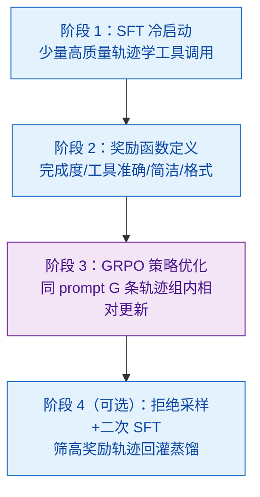

# Agentic-RL 是什么？如何用 GRPO 训练 Agent 的决策能力？

> 难度：高级
> 分类：Planning & Reasoning

## 简短回答

**Agentic-RL** 是指用强化学习训练 LLM Agent 的工具调用、多步规划和任务执行能力，区别于传统 **RLHF** 只对齐人类偏好——Agentic-RL 的奖励信号来自**任务完成度**而非人类评分。典型训练流程为 **SFT 冷启动 → Reward Model / 规则奖励 → RL 策略优化**，其中 **GRPO（Group Relative Policy Optimization）** 是 DeepSeek 提出的核心算法，与 PPO 的关键差异在于 GRPO **不需要 Critic Model**，而是对同一 prompt 采样一组响应，用组内相对排名计算 advantage，大幅降低了训练成本。奖励函数的设计是 Agentic-RL 的核心难点，通常包括**任务完成度、工具使用准确率、步骤简洁性和格式遵循度**四个维度。DeepSeek-R1 的训练范式证明，通过大规模 RL（GRPO）训练，模型可以自主涌现出复杂的推理和工具使用策略，无需人工逐步示范。环境供给是 Agentic-RL 的现实瓶颈——2026-09 的 Terminal-Universe（arXiv 2609.04148，224 upvotes）代表「环境生成」新路线：把已累积的终端 agent 轨迹反向转化为可反复执行、自带可验证任务的环境，缓解后训练环境稀缺。

## 详细解析

### Agentic-RL vs 传统 RLHF

```
传统 RLHF（对齐人类偏好）：
┌──────────┐    ┌──────────────┐    ┌──────────────┐
│  Prompt   │ →  │  LLM 生成     │ →  │ 人类标注偏好   │
└──────────┘    │  两个回答      │    │ A > B         │
                └──────────────┘    └──────┬───────┘
                                          ↓
                                   ┌──────────────┐
                                   │ Reward Model  │
                                   │ 学习偏好打分   │
                                   └──────┬───────┘
                                          ↓
                                   ┌──────────────┐
                                   │ PPO 优化策略   │
                                   │ 目标：讨人喜欢  │
                                   └──────────────┘

Agentic-RL（训练任务执行能力）：
┌──────────┐    ┌──────────────┐    ┌──────────────────┐
│ 任务指令   │ →  │  Agent 执行    │ →  │ 环境反馈 / 规则   │
└──────────┘    │  工具调用序列   │    │ 自动计算奖励      │
                └──────────────┘    └──────┬───────────┘
                                          ↓
                                   ┌──────────────────┐
                                   │ GRPO / PPO 优化    │
                                   │ 目标：完成任务      │
                                   └──────────────────┘
```

```python
# 两种 RL 范式的对比
rl_paradigms = {
    "传统 RLHF": {
        "目标": "对齐人类偏好（helpful, harmless, honest）",
        "奖励来源": "人类标注 → Reward Model 打分",
        "训练信号": "回答 A 比回答 B 更好",
        "典型场景": "聊天、创意写作、安全对齐",
    },
    "Agentic-RL": {
        "目标": "提升任务执行能力（工具调用、规划、推理）",
        "奖励来源": "任务环境自动评估（可验证奖励）",
        "训练信号": "任务是否完成、执行效率、步骤正确性",
        "典型场景": "Agent 工具调用、代码生成、多步推理",
    },
}
```

### 完整训练流程


*Agentic-RL 四段流水线：SFT 冷启动→奖励定义（四维）→GRPO 组内优化→拒绝采样回灌二次 SFT。*

### GRPO vs PPO：核心算法差异

```mermaid
flowchart TD
    subgraph PPOL["PPO —— 需要额外 Critic"]
        A1["Actor<br/>策略网络"] --> A2["生成响应"]
        A2 --> A3["Critic Model<br/>估计 V(s)"]
        A3 --> A4["Advantage<br/>= R - V(s)"]
        A4 --> A5["PPO Clipping<br/>更新 Actor"]
    end
    subgraph GRPOL["GRPO —— 无需 Critic"]
        B1["Policy<br/>策略网络"] --> B2["同一 prompt<br/>采样 G 个响应"]
        B2 --> B3["逐条计算奖励<br/>r1 … rG"]
        B3 --> B4["组内标准化<br/>A = (r - mean) / std"]
        B4 --> B5["带 KL 惩罚<br/>更新 Policy"]
    end
    classDef proc fill:#e3f2fd,stroke:#1565c0,color:#0d47a1
    classDef neutral fill:#eceff1,stroke:#546e7a,color:#37474f
    classDef agent fill:#f3e5f5,stroke:#6a1b9a,color:#4a148c
    class A2,A4,A5,B2,B3,B4,B5 proc
    class A1,B1 agent
    class A3 neutral
```


*PPO 要额外训练 Critic 估 V(s)，GRPO 用同 prompt G 条响应的组内相对排名替代 Critic。*

```python
import torch
import torch.nn.functional as F

class GRPOTrainer:
    """简化版 GRPO 训练循环"""

    def __init__(self, policy_model, ref_model, reward_fn,
                 group_size=8, kl_coeff=0.05, clip_eps=0.2, lr=1e-6):
        self.policy = policy_model       # 当前策略（要训练的 Agent）
        self.ref = ref_model             # 参考策略（SFT 后冻结的模型）
        self.reward_fn = reward_fn       # 奖励函数
        self.G = group_size              # 每组采样数量
        self.kl_coeff = kl_coeff         # KL 散度惩罚系数
        self.clip_eps = clip_eps         # PPO-style 裁剪范围
        self.optimizer = torch.optim.Adam(self.policy.parameters(), lr=lr)

    def compute_group_advantage(self, rewards: torch.Tensor) -> torch.Tensor:
        """
        GRPO 的核心：组内相对排名计算 advantage
        不需要 Critic Model，直接用组内统计量归一化
        """
        # rewards: shape (G,)，G 个响应的奖励值
        mean = rewards.mean()
        std = rewards.std() + 1e-8   # 避免除零
        advantages = (rewards - mean) / std  # 组内标准化
        return advantages

    def grpo_loss(self, prompt_tokens, response_tokens_group,
                  advantages, old_logprobs):
        """
        计算 GRPO 策略梯度损失
        """
        total_loss = 0.0
        for i in range(self.G):
            # 计算当前策略下的 log 概率
            new_logprob = self.policy.log_prob(
                prompt_tokens, response_tokens_group[i]
            )
            # 计算参考策略下的 log 概率（用于 KL 惩罚）
            with torch.no_grad():
                ref_logprob = self.ref.log_prob(
                    prompt_tokens, response_tokens_group[i]
                )

            # 重要性采样比率
            ratio = torch.exp(new_logprob - old_logprobs[i])

            # PPO-style 裁剪
            clipped_ratio = torch.clamp(ratio, 1 - self.clip_eps, 1 + self.clip_eps)
            policy_loss = -torch.min(
                ratio * advantages[i],
                clipped_ratio * advantages[i]
            )

            # KL 散度惩罚（K3 unbiased estimator）：防止策略偏离参考模型太远
            # 原论文 DeepSeekMath (arXiv:2402.03300) 使用的是 K3 无偏估计：
            #   KL ≈ exp(r-n) - (r-n) - 1，其中 r = ref_logprob, n = new_logprob
            # 这个估计始终 ≥ 0，期望值等于真 KL 散度，方差低于线性差分。
            log_ratio = ref_logprob - new_logprob
            kl_penalty = self.kl_coeff * (torch.exp(log_ratio) - log_ratio - 1)

            total_loss += (policy_loss + kl_penalty).mean()

        return total_loss / self.G

    def train_step(self, prompts_batch):
        """单步 GRPO 训练"""
        batch_loss = 0.0

        for prompt in prompts_batch:
            # Step 1: 对同一 prompt 采样 G 个完整轨迹
            responses = []
            old_logprobs = []
            for _ in range(self.G):
                with torch.no_grad():
                    response, logprob = self.policy.sample(prompt)
                    responses.append(response)
                    old_logprobs.append(logprob)

            # Step 2: 计算每个响应的奖励
            rewards = torch.tensor([
                self.reward_fn(prompt, resp) for resp in responses
            ])

            # Step 3: 组内相对排名 → advantage（GRPO 核心）
            advantages = self.compute_group_advantage(rewards)

            # Step 4: 计算 GRPO 损失并更新
            loss = self.grpo_loss(prompt, responses, advantages, old_logprobs)
            batch_loss += loss

        # 反向传播与参数更新
        self.optimizer.zero_grad()
        batch_loss.backward()
        self.optimizer.step()

        return batch_loss.item()
```

### GRPO vs PPO 对比表

| 维度 | PPO | GRPO |
|------|-----|------|
| Critic Model | 需要（额外训练开销大） | 不需要（节省 ~50% 显存） |
| Advantage 计算 | A = R - V(s)<br>依赖 Value Function | A = (r-mean)/std<br>依赖组内相对排名 |
| 采样方式 | 每个 prompt 1 个响应 | 每个 prompt G 个响应 |
| 训练稳定性 | 依赖 Critic 质量 | 依赖组大小 G |
| 显存占用 | Actor + Critic | 仅 Policy + Ref |
| 代表应用 | ChatGPT/InstructGPT | DeepSeek-R1 |
| 适合场景 | 通用 RLHF | 可验证奖励的任务 |

### 奖励函数设计：Agentic-RL 的核心难点

```python
def compute_agent_reward(prompt, trajectory, max_steps=20):
    """
    Agent 任务的多维度奖励函数
    trajectory: Agent 执行的完整轨迹（思考 + 工具调用 + 结果）
    """
    # 维度 1：任务完成度（权重最高，可验证任务直接判正误）
    completion = 1.0 if trajectory.final_answer == get_ground_truth(prompt) \
                 else partial_match_score(trajectory.final_answer, prompt)

    # 维度 2：工具使用准确率（调用了正确的工具和参数）
    tool_calls = trajectory.get_tool_calls()
    tool_acc = sum(tc.is_valid() for tc in tool_calls) / max(len(tool_calls), 1)

    # 维度 3：步骤简洁性（用更少步骤完成 → 更高奖励）
    efficiency = max(0, 1.0 - len(trajectory.steps) / max_steps)

    # 维度 4：格式遵循度（输出符合 JSON / 函数调用格式等）
    format_score = max(0, 1.0 - 0.2 * trajectory.count_format_violations())

    # 加权求和——任务完成度占主导，避免 reward hacking
    return 0.50 * completion + 0.20 * tool_acc + 0.15 * efficiency + 0.15 * format_score
```

### DeepSeek-R1 训练范式：Agentic-RL 的成功案例

```python
# DeepSeek-R1 五阶段训练流程
# Step 1 → 基座模型 DeepSeek-V3 (671B MoE)
# Step 2 → Cold Start SFT：数千条高质量长 CoT 数据，教模型"开始思考"
# Step 3 → 大规模 GRPO（核心阶段）
# Step 4 → Rejection Sampling + SFT（蒸馏 RL 策略）
# Step 5 → 第二轮 RL（加入 helpfulness / safety 奖励）

r1_grpo_config = {
    "group_size": 64,              # 每个 prompt 采样 64 个响应
    "sampling_temperature": 1.0,
    "kl_coefficient": 0.05,
    "clip_range": 0.2,
    "max_response_length": 32768,  # 支持超长推理链
    "reward_design": {
        "数学": "答案与 ground truth 精确匹配",
        "代码": "通过编译器 / 测试用例验证",
        "格式": "正则匹配 <think>...</think> 标签",
    },
}

# GRPO 训练中涌现的关键行为（无人工设计，纯 RL 自发习得）
emergent_behaviors = [
    "自发长思考链——模型自主学会生成数千 token 的推理过程",
    "Aha moment——模型学会说 'Wait, let me reconsider...' 并自我纠错",
    "多角度验证——用不同方法交叉检验同一结论",
    "思考时间自适应——简单题想得少，难题想得多",
]
```

### GRPO 之后：2025-2026 后续算法演进

GRPO 不是终点。2025 开始陆续出现一批"GRPO 后续"，主要解决 GRPO 在长 trajectory、稀疏奖励、训练稳定性上的痛点：

```python
post_grpo_algorithms = {
    "DAPO (ByteDance, 2025)": {
        "全称": "Dynamic Sampling Policy Optimization",
        "改进点": (
            "1. Clip-Higher：放宽正向 ratio 的裁剪上界，缓解 entropy collapse；"
            "2. Dynamic Sampling：剔除组内全对/全错样本（advantage 全 0 无梯度）；"
            "3. Token-level loss：长序列按 token 而非 sequence 平均；"
            "4. Overlong-shaping：长输出软惩罚而非硬截断"
        ),
        "效果": "AIME 2024 使用 Qwen2.5-32B 在 50% steps 内超过 R1-Zero",
        "开源": "ByteDance 公开了完整训练栈（含数据 + 代码）",
    },
    "GSPO (Qwen Team, 2025)": {
        "全称": "Group Sequence Policy Optimization",
        "改进点": "把 ratio/clipping 从 token 级别上升到 sequence 级别，解决长 CoT 训练不稳",
        "应用": "Qwen3 系列推理模型训练",
    },
    "REINFORCE++/RLOO 改进": {
        "思路": "把 GRPO 退化为更简单的 REINFORCE + baseline 估计",
        "代表": "RLOO（Removed-One-Out baseline）、Reinforce++（NousResearch）",
    },
    "VAPO / Loop-GRPO / DR-GRPO": {
        "方向": "Value-augmented、loop-aware、debiased GRPO 等多个支线",
        "共识": "GRPO 是 2025 后训练范式的事实基线，但需要针对具体任务大量改良",
    },
}
```

关键观察：**2026 工业界训练推理/Agent 模型时已经很少直接用 paper-version GRPO**，几乎都跑在 DAPO/GSPO 这一代改良算法上。面试中如果只能说出 "GRPO = DeepSeek-R1"，会显得知识停在 2025-01。

### 从 RLHF 到 Agentic-RL 的演进路线

```
┌─────────────┐   ┌──────────────┐   ┌──────────────────┐
│ RLHF        │ → │ RLAIF        │ → │ Agentic-RL       │
│ (2022-2023)  │   │ (2023-2024)  │   │ (2024-2025+)     │
├─────────────┤   ├──────────────┤   ├──────────────────┤
│ 人类偏好对齐  │   │ AI 反馈对齐   │   │ 任务环境反馈      │
│ 对话质量      │   │ 规模化标注    │   │ 工具调用 + 规划   │
│ PPO          │   │ PPO/DPO      │   │ GRPO / REINFORCE │
│ ChatGPT      │   │ Claude       │   │ DeepSeek-R1      │
│ 通用对话      │   │ 通用对话      │   │ Agent / 推理      │
└─────────────┘   └──────────────┘   └──────────────────┘
```

## 常见误区 / 面试追问

1. **误区："RLHF 和 Agentic-RL 是一回事"** — 两者都用强化学习优化 LLM，但目标截然不同。RLHF 优化的是人类偏好（"这个回答好不好"），依赖人类标注训练 Reward Model；Agentic-RL 优化的是任务执行能力（"任务完成了没有"），奖励信号来自环境的可验证反馈（代码是否通过测试、答案是否正确）。这导致 Agentic-RL 可以大规模自动化生成训练信号，不受人类标注瓶颈限制。

2. **误区："RL 训练 Agent 不需要 SFT 冷启动"** — DeepSeek 的实验（R1-Zero）表明，纯 RL 训练虽然能涌现推理能力，但存在两个严重问题：(1) 输出可读性差，常混合多种语言；(2) 训练初期的探索效率极低，模型可能长时间在无意义的行为空间中徘徊。Cold Start SFT 用少量高质量数据给模型一个"起跑点"，显著提升了训练效率和最终输出质量。

3. **追问："如何设计 Agent 任务的奖励函数？"** — 核心原则是"可验证 + 多维度"。对于可验证任务（数学、代码），直接用答案正确性作为主奖励信号；对于不可验证任务（开放式规划），需要 LLM-as-Judge 或人类评估。多维度设计很关键：除任务完成度外，还应奖励工具使用的准确性、执行效率（更少步骤）和格式规范性。权重分配上，任务完成度应占 50% 以上，避免模型学会"格式正确但不解决问题"的 reward hacking 行为。

4. **追问："Agentic-RL 的训练数据如何采集？"** — 分阶段采集。SFT 阶段需要少量高质量 Agent 轨迹（专家标注或强模型生成，通常几千到几万条）。RL 阶段的核心优势是数据可以自动生成：设定任务 prompt → Agent 自由探索 → 环境自动打分。关键挑战是任务分布的多样性——需要覆盖不同难度、不同工具组合、不同领域的任务，否则模型只会在训练分布内表现好。实践中常用课程学习（Curriculum Learning），从简单任务开始逐步增加难度。

## 参考资料

- [DeepSeek-R1: Incentivizing Reasoning Capability in LLMs via RL (DeepSeek)](https://arxiv.org/abs/2501.12948)
- [DeepSeekMath: Pushing the Limits of Mathematical Reasoning (GRPO 算法原始论文)](https://arxiv.org/abs/2402.03300)
- [Demystifying Reasoning Models (Cameron R. Wolfe)](https://cameronrwolfe.substack.com/p/demystifying-reasoning-models)
- [Search, Verify, and Feedback: Towards Next Generation Post-training Paradigm of Foundation Models (arXiv)](https://arxiv.org/abs/2411.11504)
- [Agent Q: Advanced Reasoning and Learning for Autonomous AI Agents (arXiv)](https://arxiv.org/abs/2408.07199)
- [Terminal-Universe: Turning Agent Trajectories into Scalable Terminal Environments (arXiv)](https://arxiv.org/abs/2609.04148) — 轨迹反向转化为可复执行环境，缓解 agent 后训练环境稀缺（224 upvotes，2026-09）
