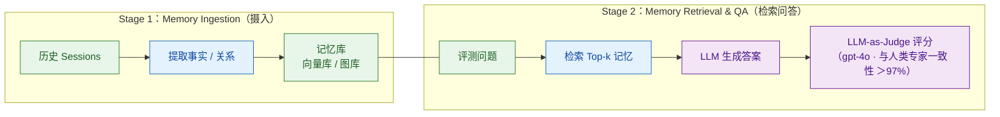

# Agent Benchmark：如何设计端到端的 Agent 测试？

> 难度：中级
> 分类：Evaluation

## 简短回答

Agent Benchmark 是用于端到端评估 AI Agent 在真实或模拟环境中完成任务能力的标准化测试。与传统 LLM 基准（如 MMLU 测知识）不同，Agent Benchmark 评估的是**完整的任务执行过程**——包括规划、工具使用、多步推理和错误恢复。代表性基准包括：**SWE-bench**（修复真实 GitHub Issue，代码 Agent 标杆）、**WebArena**（在真实网站完成复杂操作）、**GAIA**（通用助手的多步推理和工具组合任务）、**OSWorld**（操作系统级别的计算机使用任务）。设计 Agent Benchmark 的关键原则：(1) 使用真实任务而非人造题目；(2) 评估过程而非仅评估结果；(3) 包含多种难度层次；(4) 防止数据泄露和过拟合。当前面临的挑战：基准饱和（模型快速刷榜）、可游戏性（针对基准优化而非真实能力提升）。

## 详细解析

### 主要 Agent 基准全景

```
Agent 基准分类：
│
├── 代码 Agent
│   ├── SWE-bench：修复真实 GitHub Issue（最权威）
│   ├── SWE-bench Verified：人工验证的高质量子集
│   ├── Multi-SWE-bench：多语言扩展
│   └── HumanEval / MBPP：函数级代码生成
│
├── Web Agent
│   ├── WebArena：真实网站交互任务
│   ├── VisualWebArena：需要视觉理解的网页任务
│   └── Mind2Web：跨网站通用操作
│
├── 通用 Agent
│   ├── GAIA：多步推理 + 多工具组合
│   ├── ALFWorld：文本家庭环境任务
│   └── WebShop：模拟电商购物
│
├── 计算机使用
│   ├── OSWorld：操作系统级任务
│   └── Computer Use benchmarks
│
├── 工具使用
│   ├── ToolBench：API 工具选择和使用
│   ├── API-Bank：API 调用正确性
│   └── TaskBench：多工具组合
│
└── Memory（长期记忆）
    ├── LoCoMo：超长多模态对话的持久记忆（35 sessions / 9K tokens）
    ├── LongMemEval：500 题，5 大记忆能力（含知识更新与 abstention）
    ├── MemoryBank / DialSim / PerLTQA：早期记忆基准
    └── BEAM（1M/10M）：超长上下文 + 大规模事实检索
```

**新维度（2026-09）——会话内任务交错**：[MyriadBench](https://github.com/shyringo/myriad-bench) 专门测单 agent 会话内**交错 / 中断 / 相互依赖**任务下的能力保持（对照隔离执行同任务的基线，以单一指数 MI 排名）——补上了「多任务在同一会话里互相踩踏」这个此前无专属基准的维度。

### SWE-bench 详解

```python
# SWE-bench：代码 Agent 的标杆基准
swe_bench = {
    "任务": "给定一个真实的 GitHub Issue，修改代码库使相关测试通过",
    "来源": "12 个流行 Python 开源项目（Django 占比 ~37%，存在领域倾斜）",
    "规模": "2294 个 Issue 主集 + 多个家族变体",
    "家族变体": {
        "SWE-bench Verified": "500 题，OpenAI 联合 Anthropic 等人工验证子集",
        "SWE-bench Lite": "300 题，研究入门用",
        "SWE-bench Multimodal": "517 题，含 UI 截图（防纯文本作弊）",
        "SWE-bench Pro": "2026 抗污染版本，人工严格审查",
        "SWE-bench Live": "持续收集最新 Issue（不在训练集）",
        "Multi-SWE-bench": "扩展到 Go/Rust/TypeScript/Java 等 7 语言",
    },
    "评估": "自动化——运行项目测试套件",
    "难度": "非常高——需要理解大型代码库、定位 bug、编写修复",

    "评估指标": {
        "Resolved Rate": "成功修复的 Issue 比例",
        "当前 SOTA (2026-05)": (
            "≥90%（Claude Mythos Preview 93.9%, "
            "Claude Opus 4.7 87.6%, Claude Sonnet 4.5 80.9%）"
        ),
    },

    "为什么重要": [
        "使用真实世界的软件工程任务",
        "需要理解数千行代码的上下文",
        "修复必须通过真实的测试套件",
        "无法靠记忆训练数据作弊",
    ],
}
```

**⚠️ 2026 重要演进：SWE-bench Verified 已被官方判定"严重污染"**

```
OpenAI 2026-02 公开声明（详见 SWE-bench Pro 发布说明）：
- SWE-bench Verified "increasingly contaminated"
- 最难的 59.4% 子集存在测试缺陷（fail-to-pass 不严格、隐式依赖）
- OpenAI 已停止单独报告 SWE-bench Verified 成绩

抗污染替代基准：
├── SWE-bench Pro：人工严格审查，去除可游戏化任务（推荐主用）
├── SWE-bench Live：持续从最新 GitHub Issue 收集（永远不在训练集）
├── SWE-bench Multimodal：含 UI 截图，纯文本 Agent 无法作弊
└── Multi-SWE-bench：扩展到 Go/Rust/TypeScript 等 7 种语言

面试要点：
- 若候选人引用"SOTA 72%"或更低数字，说明知识停留在 2024
- 若候选人能说出"Verified 已污染、应看 SWE-bench Pro/Live"
  则在 2026 评测话题上属于一线水位
```

### GAIA 基准详解

```python
gaia_benchmark = {
    "任务": "回答需要多步推理和工具组合的复杂问题",
    "出处": "Meta-FAIR + HuggingFace + AutoGPT, NeurIPS 2024",
    "规模": "466 题（公开 165 题 dev + 301 题 private test）",
    "特点": "答案是确定性的（精确匹配评测，不需 LLM Judge）",

    "三个难度等级": {
        "Level 1": "约 5 步推理 + 1 个工具调用（146 题）",
        "Level 2": "5-10 步推理 + 多工具组合（245 题）",
        "Level 3": "最多约 50 步 + 复杂工具链 + 长上下文（75 题）",
    },

    "示例问题": (
        "'找到 2024 年诺贝尔物理学奖获得者的本科毕业院校，"
        "这所院校的现任校长是谁？'"
        "→ 需要：搜索→提取→再搜索→提取"
    ),

    "人机差距（原论文，2024）": {
        "人类志愿者": "92% 准确率",
        "GPT-4 + plugins": "15% 准确率",
        "启示": "GAIA 设计目标是'对人简单、对 Agent 极难'，差距 6x",
    },

    "2026 进展": (
        "Open Deep Research 类 Agent（OpenAI Deep Research、"
        "Manus、GPT Researcher 等）在 Level 1 已超 70%，"
        "Level 3 仍普遍 <40%——多步规划仍是瓶颈"
    ),
}
```

### Memory 专项基准：LoCoMo & LongMemEval

通用 Agent 基准（SWE-bench、GAIA）几乎不评估**跨会话记忆**能力。设计带 memory 的 Agent 时，必须使用记忆专项基准。

```python
# LoCoMo（Maharana et al., 2024，CMU + Snap Research）
locomo = {
    "对话规模": "50 段对话，每段 19-35 sessions / ~300 turns / 9K-26K tokens（非固定 9K）",
    "QA 规模": "约 1500-2000 个问答对",
    "5 类任务": {
        "single-hop":  "841 题——单步事实检索",
        "multi-hop":   "282 题——跨 session 串联多个事实",
        "open-domain": "96 题——结合外部世界知识",
        "temporal":    "321 题——时间顺序/优先级推理",
        "adversarial": "对抗性问题——抗误导/干扰",
    },
    "特色": "persona-grounded + 多模态对话",
    "局限": "话题偏个人闲聊（persona-grounded），缺乏 task-oriented 场景",
}

# LongMemEval（Wu et al., 2024，ICLR 2025）
longmemeval = {
    "QA 规模": "500 题人工构造（LongMemEval_S 标准集）",
    "context 长度": "4K~115K tokens（LongMemEval_S 标准集）",
    "context 扩展": "LongMemEval-M 可达 1.5M tokens / 500 sessions（M = Medium）",
    "6 大核心记忆能力": {
        "Single-Session-User":       "单 session 内用户事实提取",
        "Single-Session-Assistant":  "单 session 内助手输出的引用",
        "Multi-Session Reasoning":   "跨多个 session 的推理（30 题）",
        "Temporal Reasoning":        "时间相关推理（133 题）",
        "Knowledge Updates":         "用新信息覆盖旧信息（78 题）⭐ LoCoMo 缺失项",
        "Abstention":                "识别不可回答的问题，不要瞎编",
    },
    "为什么比 LoCoMo 难": "测的是 human-assistant 对话，更贴近真实使用",
    "残酷的事实": [
        "long-context LLM 直接喂全文，准确率掉 30%-60%",
        "商用系统在简化场景下也只有 30%-70% 准确率",
    ],
}
```

**典型评估流水线**（ReMe、Mem0、MemMachine 等都遵循）：


*记忆基准先摄入后评测：Stage 1 把历史会话写入记忆库，Stage 2 检索问答并由 LLM-as-Judge 打分。*

**2025 SOTA 参考**（用于面试时给出量化对比）：

| 系统 | LoCoMo | LongMemEval_S | 备注 |
|------|--------|---------------|------|
| Full-context LLM 直接喂 | 基线 | 基线 | 准确率掉 30-55% |
| LoCoMo-RAG / 向量基线 | 中 | 中 | 多会话场景明显劣化 |
| Mem0（2025 新算法） | **91.6** | **93.4** | 平均 <7K token/检索 |
| ENGRAM-R | — | +21.8pp | token 减 95.5% |
| MemMachine v0.2 | SOTA | 93.0 | 6 维优化消融 |

### 设计 Agent Benchmark 的原则

```python
benchmark_design_principles = {
    "真实性": {
        "原则": "使用真实任务而非人造题目",
        "方法": "从生产日志、GitHub Issue、真实网站中采集",
        "反例": "人工构造的'玩具问题'不能反映真实复杂度",
    },
    "可验证性": {
        "原则": "评估结果必须可自动化验证",
        "方法": "定义明确的成功标准（测试通过、精确匹配等）",
        "挑战": "开放式任务的评估需要 LLM Judge",
    },
    "防泄露": {
        "原则": "防止基准数据出现在训练集中",
        "方法": [
            "动态基准（定期更新题目）",
            "使用私有测试集",
            "基于时间的切分（只用模型训练后的数据）",
        ],
    },
    "多维度": {
        "原则": "评估多种能力，不只是最终结果",
        "维度": ["推理质量", "工具使用", "效率", "安全性"],
    },
    "抗游戏性": {
        "原则": "防止针对基准优化而非真实能力提升",
        "方法": "大规模多样化的测试集 + 动态更新",
    },
}
```

### 自定义 Agent 评估套件

```python
class CustomAgentBenchmark:
    """为自己的 Agent 设计评估套件"""

    def __init__(self):
        self.test_cases = []

    def add_test(self, task, expected_result, difficulty, category,
                 required_tools=None, max_steps=None):
        self.test_cases.append({
            "task": task,
            "expected": expected_result,
            "difficulty": difficulty,      # easy/medium/hard
            "category": category,          # coding/search/analysis
            "required_tools": required_tools,
            "max_steps": max_steps,
        })

    async def run(self, agent):
        results = []
        for case in self.test_cases:
            trajectory = await agent.execute_with_trace(case["task"])

            result = {
                "task_success": self.check_result(
                    trajectory.final_output, case["expected"]
                ),
                "steps_used": len(trajectory.steps),
                "tools_used": [s.tool for s in trajectory.steps if s.tool],
                "cost": trajectory.total_cost,
                "latency": trajectory.total_time,
                "correct_tools": self.check_tools(
                    trajectory, case["required_tools"]
                ),
            }
            results.append(result)

        return self.aggregate_results(results)

    def generate_report(self, results):
        """按维度和难度分组的评估报告"""
        return {
            "overall_success_rate": np.mean([r["task_success"] for r in results]),
            "by_difficulty": self.group_by("difficulty", results),
            "by_category": self.group_by("category", results),
            "avg_cost": np.mean([r["cost"] for r in results]),
            "avg_steps": np.mean([r["steps_used"] for r in results]),
        }
```

### 基准测试的挑战

```python
current_challenges = {
    "数据泄露": "基准题目可能出现在 LLM 的训练数据中",
    "基准饱和": "模型快速刷满分，基准失去区分能力",
    "过拟合基准": "针对基准优化 ≠ 真实能力提升",
    "评估成本": "端到端 Agent 测试需要真实环境，成本高",
    "非确定性": "Agent 每次运行路径不同，评估结果有方差",
}

# SWE-MERA 的解决方案：动态基准
swe_mera = {
    "创新": "持续从最新 GitHub Issue 中自动收集测试用例",
    "优势": "永远不会被训练数据污染",
    "挑战": "质量控制——自动收集的题目可能质量不一",
}
```

## 常见误区 / 面试追问

1. **误区："在基准上得分高就说明 Agent 好用"** — 基准测试是受控环境，生产场景更复杂（网络问题、意外输入、安全攻击等）。SWE-bench 上 70% 的模型在实际开发中可能远达不到这个表现。基准是必要但不充分的。

2. **误区："一个基准就够了"** — 不同基准测试不同能力。代码能力强（SWE-bench 高分）不代表网页操作好（WebArena）。需要根据 Agent 的实际使用场景选择或组合多个基准。

3. **追问："如何防止 Agent 针对基准过拟合？"** — (1) 使用动态更新的基准（如 SWE-MERA）；(2) 保留私有测试集不公开；(3) 评估时加入从未见过的新类型任务；(4) 关注轨迹质量而非仅结果。

4. **追问："小团队如何设计自己的 Agent 评估？"** — 从生产日志中采样 50-100 个典型任务，定义明确的成功标准（可自动验证的优先），标注难度和类别。每次 Agent 更新后运行这个测试套件作为回归测试。不需要从头建造大规模基准。

5. **追问："如何设计 Memory Benchmark？"** — 直接复用 LongMemEval（500 题，5 类能力）+ LoCoMo（多会话长对话）就能覆盖大部分场景。如果业务自建，要重点覆盖 4 个维度：(1) **Multi-session reasoning**——跨会话串联事实；(2) **Temporal reasoning**——时间顺序、"上次/最近"等时间约束；(3) **Knowledge update**——用户改了偏好后能否覆盖旧记忆而不并存（LoCoMo 缺这块，LongMemEval 加上的）；(4) **Abstention**——记忆里没有的事不要瞎编。评估流水线两阶段：摄入（写入记忆系统）+ 检索 QA（LLM-as-Judge 打分，与人类一致性可达 97%+）。

6. **追问："为什么 long-context LLM 直接喂全部历史不行？"** — LongMemEval 实测，把全部对话直接塞进 long-context 模型，准确率比带 memory 系统**掉 30%-60%**。原因有三：(1) **lost in the middle**——超过几万 token 后中间部分信息丢失；(2) **干扰信息**——大量无关历史稀释了相关信号；(3) **knowledge update 失效**——模型很难在长序列中识别"后面的信息覆盖前面的"。这就是为什么需要专门的记忆架构（提取+检索+rerank）而不是无脑加大 context。

## 参考资料

- [Agent Evaluation: Metrics, Benchmarks and Safety Standards](https://mbrenndoerfer.com/writing/agent-evaluation-metrics-benchmarks-safety)
- [AI Agent Benchmark Compendium (Phil Schmid, GitHub)](https://github.com/philschmid/ai-agent-benchmark-compendium)
- [SWE-bench Leaderboards](https://www.swebench.com/)
- [AI Agent Benchmarks are Broken (Daniel Kang)](https://medium.com/@danieldkang/ai-agent-benchmarks-are-broken-c1fedc9ea071)
- [SWE-MERA: A Dynamic Benchmark for Evaluating LLMs (arXiv)](https://arxiv.org/html/2507.11059v1)
- [LoCoMo: Evaluating Very Long-Term Conversational Memory (Snap Research)](https://snap-research.github.io/locomo/)
- [LongMemEval: Benchmarking Chat Assistants on Long-Term Memory (arXiv 2410.10813)](https://arxiv.org/pdf/2410.10813)
- [Mem0: Production-Ready Long-Term Memory (arXiv 2504.19413)](https://arxiv.org/abs/2504.19413)
- [Benchmarking Mem0 token-efficient memory algorithm](https://mem0.ai/research)
- [MemMachine v0.2 on LoCoMo](https://memmachine.ai/blog/2025/12/memmachine-v0.2-delivers-top-scores-and-efficiency-on-locomo-benchmark/)
