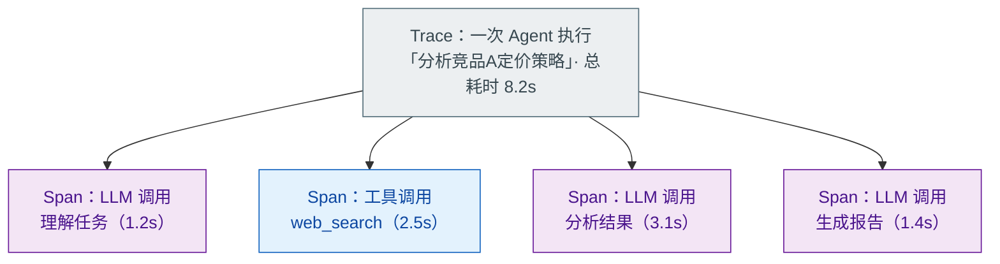

# Trace 和 Span：Agent 执行的可观测性

> 难度：中级
> 分类：Evaluation

## 简短回答

Trace 和 Span 是分布式追踪（Distributed Tracing）的核心概念，被引入 LLM/Agent 系统用于实现**执行可观测性**——理解 Agent "做了什么、花了多久、哪里出了问题"。**Trace** 代表一次完整的 Agent 执行（从接收任务到返回结果），**Span** 代表 Trace 中的一个操作单元（如一次 LLM 调用、一次工具调用、一次检索）。Span 之间有父子关系，形成树形结构，清晰展示 Agent 的决策链。**OpenTelemetry (OTel)** 是 LLM 可观测性的主流方向——OTel GenAI Special Interest Group 维护的 **Semantic Conventions for Generative AI** 截至 2026-05 仍处于 **Development 阶段（尚未 Stable）**，定义了 GenAI 相关的语义约定（`gen_ai.system`、`gen_ai.request.model` 等属性）。主流工具（Langfuse、LangSmith 2026-01 起 end-to-end native OTel、Arize Phoenix）都已支持，但 API 名字可能在 GA 前微调，生产接入建议固定到具体语义版本。

## 详细解析

### Trace 和 Span 的结构


*一个 Trace 就是一棵 Span 树：每次 LLM / 工具调用都是可独立计时、可标错的子节点。*

### OpenTelemetry 集成

```python
from opentelemetry import trace
from opentelemetry.sdk.trace import TracerProvider
from opentelemetry.sdk.trace.export import BatchSpanProcessor

# 初始化 OTel
provider = TracerProvider()
provider.add_span_processor(
    BatchSpanProcessor(OTLPSpanExporter(endpoint="http://collector:4318"))
)
trace.set_tracer_provider(provider)
tracer = trace.get_tracer("agent-service")

class ObservableAgent:
    """带完整可观测性的 Agent"""

    async def execute(self, task: str):
        # 创建 Trace（顶层 Span）
        with tracer.start_as_current_span("agent_execution") as root_span:
            root_span.set_attribute("task", task)
            root_span.set_attribute("agent.name", "research-agent")

            # Step 1: 规划
            plan = await self.plan(task)

            # Step 2: 执行每个步骤
            results = []
            for step in plan.steps:
                result = await self.execute_step(step)
                results.append(result)

            # 记录总体指标
            root_span.set_attribute("total_steps", len(results))
            root_span.set_attribute("task_success", True)

            return self.synthesize(results)

    async def plan(self, task):
        with tracer.start_as_current_span("llm_call") as span:
            span.set_attribute("gen_ai.system", "openai")
            span.set_attribute("gen_ai.request.model", "gpt-4o")
            span.set_attribute("gen_ai.operation.name", "planning")

            response = await self.llm.invoke(task)

            # 记录 token 使用
            span.set_attribute("gen_ai.usage.input_tokens", response.usage.prompt_tokens)
            span.set_attribute("gen_ai.usage.output_tokens", response.usage.completion_tokens)

            return response

    async def execute_step(self, step):
        with tracer.start_as_current_span("agent_step") as span:
            span.set_attribute("step.name", step.name)

            if step.requires_tool:
                # 工具调用子 Span
                with tracer.start_as_current_span("tool_call") as tool_span:
                    tool_span.set_attribute("tool.name", step.tool_name)
                    tool_span.set_attribute("tool.input", str(step.tool_params))

                    result = await self.call_tool(step.tool_name, step.tool_params)

                    tool_span.set_attribute("tool.output_size", len(str(result)))
                    if result.error:
                        tool_span.set_status(trace.Status(trace.StatusCode.ERROR))
                        tool_span.record_exception(result.error)

                    return result
```

### GenAI 语义约定（OTel 标准）

```python
# OTel 为 GenAI 定义的标准属性
otel_genai_attributes = {
    # 系统信息
    "gen_ai.system": "openai / anthropic / google",
    "gen_ai.request.model": "gpt-4o / claude-sonnet-4-5",

    # 请求参数
    "gen_ai.request.temperature": 0.7,
    "gen_ai.request.max_tokens": 4096,
    "gen_ai.request.top_p": 1.0,

    # 使用统计
    "gen_ai.usage.input_tokens": 150,
    "gen_ai.usage.output_tokens": 300,

    # Agent 特定
    "gen_ai.agent.name": "research-agent",
    "gen_ai.agent.step": "planning",

    # 工具调用
    "gen_ai.tool.name": "web_search",
    "gen_ai.tool.call_id": "call_abc123",
}
```

### 可观测性的三大支柱在 Agent 中的应用

```python
observability_pillars = {
    "Traces（追踪）": {
        "作用": "追踪 Agent 的完整执行路径",
        "回答": "Agent 做了什么？每步花了多久？",
        "工具": "Jaeger, Zipkin, Langfuse, LangSmith",
    },
    "Metrics（指标）": {
        "作用": "量化 Agent 的性能和健康状态",
        "关键指标": [
            "请求延迟（P50/P95/P99）",
            "Token 消耗量",
            "工具调用成功率",
            "任务完成率",
            "每次请求的成本",
        ],
        "工具": "Prometheus, Datadog, Grafana",
    },
    "Logs（日志）": {
        "作用": "记录详细的事件和错误",
        "内容": "LLM 的输入输出、工具参数和返回值、错误堆栈",
        "工具": "ELK Stack, CloudWatch",
    },
}
```

### 线上指标口径：每个数怎么算出来

指标名一样、口径不一样，两个团队的数字就没法比。每个指标都要写死三件事：分子、分母、数据从哪来。

| 指标 | 分子 | 分母 | 数据来源 | 已知偏差 |
| --- | --- | --- | --- | --- |
| 任务成功率 | 判定为成功的 run 数 | 进入执行的 run 数（用户主动中止单列） | 规则判定 + 隐式成功 + 抽样复核 | 不校准会虚高 |
| 工具选错率 | 命中代理信号的调用数 | 工具调用总数 | Trace 事件序列 | 代理信号会误报，只能看趋势 |
| 参数错误率 | JSON Schema 校验失败次数 | 工具调用总数 | 工具入口埋点 | 只覆盖结构错误，语义错误漏掉 |
| 单 run 成本 | token × 模型单价 + 外部 API 费用 | 进入执行的 run 数（另看 P50/P95 和长尾） | usage 字段 + 外部账单 | 缓存命中和折扣未计 |
| 耗时分解 | 模型 / 工具 / 排队 / 审批各段耗时 | 端到端耗时 | Span 起止时间 | 并发 Span 重叠，不能直接相加 |

成功率最容易算错。判定方式有三种：有明确成功标记的走规则判定；没有的用 LLM-as-judge，但必须先写 rubric；再叠加用户反馈。线上常用组合是：用户没重试、没报错，先记为隐式成功，再按固定比例抽样，用人工或 judge 复核校准。不校准，隐式成功会把数字抬高。分母按 run 算，不按请求算；超时算失败，用户主动中止不计入分母但单独报中止率。口径写进文档，不能指标难看就改。

工具选错率线上拿不到真值，只能用代理信号：同一意图连续重试、工具返回空结果后换工具、模型输出里出现自我纠正。代理信号误报多，线上只看趋势，准确值靠离线标注集。

耗时按 Span 分段记账，不分解就不知道该优化模型、工具还是等待。

```python
from dataclasses import dataclass
from enum import Enum


class Outcome(Enum):
    SUCCESS = "success"            # 规则判定成功
    FAILURE = "failure"            # 规则判定失败
    IMPLICIT_SUCCESS = "implicit"  # 无报错、无重试，待抽样复核
    TIMEOUT = "timeout"
    ABORTED = "aborted"            # 用户主动中止


@dataclass
class RunMetrics:
    run_id: str
    outcome: Outcome
    model_ms: float = 0.0
    tool_ms: float = 0.0
    queue_ms: float = 0.0          # 排队
    approval_ms: float = 0.0       # 人工审批等待
    token_cost_usd: float = 0.0    # 按各模型单价分别计算后汇总
    external_cost_usd: float = 0.0
    tool_calls: int = 0
    schema_failures: int = 0

    @property
    def cost_usd(self) -> float:
        return self.token_cost_usd + self.external_cost_usd

    @property
    def latency_ms(self) -> float:
        # 串行执行可以直接相加；并发 Span 应改用墙钟起止区间
        return self.model_ms + self.tool_ms + self.queue_ms + self.approval_ms


class RunMetricsAggregator:
    """成功率：分母按 run；超时算失败；中止单独报，不进分母"""

    def __init__(self) -> None:
        self._reviewed: dict[str, bool] = {}  # run_id -> 复核是否成功

    def review(self, run_id: str, is_success: bool) -> None:
        """按比例抽样人工或 LLM judge 复核，用来校准隐式成功"""
        self._reviewed[run_id] = is_success

    def success_rate(self, runs: list[RunMetrics]) -> float:
        denominator = [r for r in runs if r.outcome is not Outcome.ABORTED]
        if not denominator:
            return 0.0

        numerator = 0
        for run in denominator:
            if run.outcome is Outcome.SUCCESS:
                numerator += 1
            elif run.outcome is Outcome.IMPLICIT_SUCCESS:
                # 未复核先按成功计；复核为失败的扣回来
                numerator += int(self._reviewed.get(run.run_id, True))
        # TIMEOUT 和 FAILURE 留在分母里但不加分，等价于算失败
        return numerator / len(denominator)

    def abort_rate(self, runs: list[RunMetrics]) -> float:
        """中止率单独报，避免失败被藏进中止"""
        if not runs:
            return 0.0
        return sum(r.outcome is Outcome.ABORTED for r in runs) / len(runs)

    def param_error_rate(self, runs: list[RunMetrics]) -> float:
        total_calls = sum(r.tool_calls for r in runs)
        if total_calls == 0:
            return 0.0
        return sum(r.schema_failures for r in runs) / total_calls
```

### 实际调试场景

```python
# 场景：Agent 在某个任务上失败了，如何用 Trace 定位问题？

debug_workflow = """
1. 找到失败的 Trace
   → 根据 request_id 或 error 状态筛选

2. 查看 Span 树结构
   → 定位哪个 Span 出错（红色标记）

3. 检查出错 Span 的详情
   → LLM 调用：看输入 Prompt 和输出
   → 工具调用：看参数和返回值
   → 错误信息：看异常类型和堆栈

4. 分析上下文
   → 前序 Span 的输出是否正常
   → 传递给出错 Span 的输入是否合理

5. 复现和修复
   → 用相同的输入参数重放
   → 修复后重新运行验证
"""
```

### 主流工具对比

| 工具 | 开源/商业 | OTel 支持 | 特色 |
| --- | --- | --- | --- |
| Langfuse | 开源 | ✓ | 最流行的开源 |
| LangSmith | 商业 | 部分 | LangChain |
| Arize Phoenix | 开源 | ✓ | ML + LLM |
| Traceloop | 开源 | ✓ 原生 | OTel 原生 |
| Datadog | 商业 | ✓ | 企业级 |
| Arthur AI | 商业 | ✓ | Agent 专注 |

## 常见误区 / 面试追问

1. **误区："有日志就不需要 Trace"** — 日志是离散的事件记录，Trace 是结构化的因果链。日志告诉你"发生了什么"，Trace 告诉你"为什么发生"以及"事件之间的关系"。在多步 Agent 中，没有 Trace 几乎无法定位问题。

2. **误区："Trace 只在出问题时有用"** — Trace 在日常监控中同样重要：发现性能瓶颈（哪个 Span 最慢）、优化成本（哪个 LLM 调用 token 消耗最多）、理解用户行为（Agent 通常走什么路径）。

3. **追问："如何控制 Trace 数据的存储成本？"** — (1) 采样——不是每个请求都记录完整 Trace（如 10% 采样率）；(2) 按需详细度——正常请求只记录关键 Span，错误请求记录全部细节；(3) 数据保留策略——Trace 数据保留 7-30 天。

4. **追问："OpenTelemetry 的优势是什么？"** — 供应商无关性。用 OTel 标准化的数据可以发送到任何后端（Jaeger、Datadog、Langfuse）。换监控工具不需要改代码，只改 exporter 配置。这避免了供应商锁定。

## 参考资料

- [AI Agent Observability - Evolving Standards (OpenTelemetry Blog)](https://opentelemetry.io/blog/2025/ai-agent-observability/)
- [How to Trace AI Agent Execution Flows Using OpenTelemetry (OneUptime)](https://oneuptime.com/blog/post/2026-02-06-trace-ai-agent-execution-flows-opentelemetry/view)
- [The AI Engineer's Guide to LLM Observability with OpenTelemetry (Agenta)](https://agenta.ai/blog/the-ai-engineer-s-guide-to-llm-observability-with-opentelemetry)
- [Best Practices for Building Agents: Observability and Tracing (Arthur AI)](https://www.arthur.ai/blog/best-practices-for-building-agents-part-1-observability-and-tracing)
- [The Role of OpenTelemetry in LLM Observability (Arize AI)](https://arize.com/blog/the-role-of-opentelemetry-in-llm-observability/)
