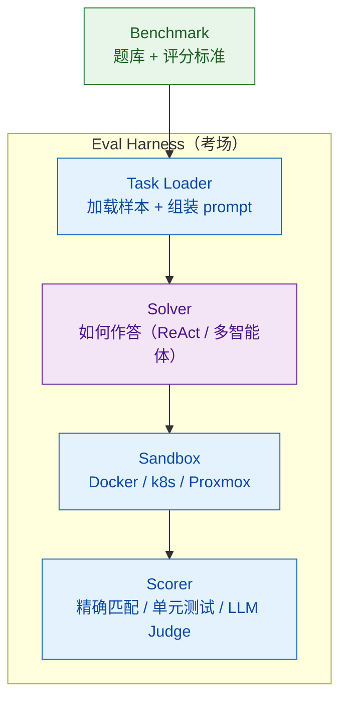

# Eval Harness 设计与生态选型：lm-evaluation-harness / Inspect AI / HELM / METR

> **难度**：中级
> 🆕 2026 新增（Harness 主题）
> 分类：Evaluation

## 简短回答

**Eval Harness（评测引擎）≠ Benchmark（数据集）**。Benchmark 是题库与评分标准（SWE-bench、GAIA、τ²-bench），Eval Harness 是"考场"——由 **Task Loader + Sandbox + Scorer + 日志** 四原语组成的运行时框架。Inspect AI 把这套架构显式拆为 `dataset → Task → Solver → Scorer` 四个独立组件，让"同 Benchmark 在不同 Harness 跑出 20+ 分差距"成为必然而非 bug。

主流 Harness 形成"三足鼎立 + METR 范式"格局：**lm-evaluation-harness**（EleutherAI，HF Open LLM Leaderboard 后端，model eval 标杆）专注单轮 logprob/生成；**Inspect AI**（UK AISI，2024-05 开源）凭借 Docker/k8s/Proxmox sandbox + 200+ inspect_evals 成为 Agent eval 王者，**METR 在 2026-01 完成从自研 Vivaria 到 Inspect 的迁移**标志生态收敛；**HELM**（Stanford CRFM）坚持 7 维度全景评测；**METR Time Horizon** 提供"50% 成功率任务时长每 7 个月翻一番"的可外推度量。Agent Eval 与 Model Eval 在评估对象、统计设计、ground truth 假设上根本不同——前者必须多 trial、关注轨迹、容忍多条有效路径。2026 业界共识：**先固定 production harness 再换模型测**，把 sandbox 类型、资源配额、scaffold 版本写入 eval 报告。

**Cheat Sheet**：
- **Harness 四原语**：Task Loader（加载样本+组装 prompt）→ Solver（如何作答）→ Sandbox（隔离工具执行）→ Scorer（如何判分）
- **lm-eval-harness**：YAML 任务定义、100+ providers、HF Open LLM Leaderboard 后端 → **model eval 标杆**
- **Inspect AI**：dataset→Task→Solver→Scorer、Docker/k8s/Proxmox sandbox、Agent Bridge 接 Claude Code/Codex CLI → **agent eval 事实标准**
- **HELM**：7 metrics（accuracy/calibration/robustness/fairness/bias/toxicity/efficiency）、2025-03 Capabilities 用 mean score 取代 mean win rate
- **METR**：Time Horizon 范式（50% time horizon 每 7 个月翻倍）+ MALT 数据集（reward hacking/sandbagging 行为样本）
- **Contamination 危机**：SWE-bench Verified 2026-02 OpenAI 官宣污染、59.4% 最难题测试有缺陷 → 转向 SWE-bench Pro/Live

## 详细解析

### Harness vs Benchmark：必须先理清的三层架构

"benchmark"在日常对话中常被混用，但 Inspect AI 的设计明确把评测拆为四个独立原语：


*Harness 是考场：题库只是输入，Task Loader → Solver → Sandbox → Scorer 四原语才决定分数。*

| 组件 | 职责 | 代表实现 |
|------|------|---------|
| **Task Loader** | 从数据集加载样本、组装 prompt、few-shot 注入 | lm-eval-harness 的 YAML（doc_to_text/doc_to_target/filters） |
| **Solver** | 让模型作答的 scaffold（ReAct/multi-turn critique） | Inspect AI 的 `generate → prompt → ReAct → multi_turn` 链式组合 |
| **Sandbox** | 隔离的代码执行/工具调用环境 | Docker（主流）/ k8s（大规模）/ Proxmox VM（高风险）/ Daytona/Modal/EC2 |
| **Scorer** | 评分逻辑：精确匹配、单元测试、LLM Judge、DB 状态比对 | SWE-bench fail→pass 套件、τ²-bench DB diff、`model_graded_qa` 多 judge 投票 |

**关键洞见**："Solver 负责怎么答、Scorer 负责怎么判分、Sandbox 是 Solver 调用工具时的隔离层"——这种显式分离让"同 SWE-bench Verified 不同 harness 跑出不同分数"既是必然也是合理。Anthropic Terminal-Bench 2.0 在同模型、同任务、仅变更 pod 资源预算下实测 **5.8% 任务因 pod/infrastructure 错误失败，p<0.01**。

### lm-evaluation-harness：model eval 行业标杆

**EleutherAI lm-evaluation-harness**（2021 开源）是 LLM 评测的 de-facto 标准，**Hugging Face Open LLM Leaderboard 的后端就是它**。

```yaml
# 典型任务定义（mmlu_abstract_algebra.yaml）
task: mmlu_abstract_algebra
dataset_path: hails/mmlu_no_train
dataset_name: abstract_algebra
output_type: multiple_choice
doc_to_text: "{{question.strip()}}\nA. {{choices[0]}}\nB. {{choices[1]}}\nC. {{choices[2]}}\nD. {{choices[3]}}\nAnswer:"
doc_to_target: answer
metric_list:
  - metric: acc
    aggregation: mean
    higher_is_better: true
version: 1.0
```

```bash
# 单条命令评测任意 provider
lm_eval --model hf --model_args pretrained=meta-llama/Llama-3-70B \
        --tasks mmlu,gsm8k,humaneval \
        --batch_size auto \
        --use_cache cache/ \
        --log_samples --output_path results/
```

**核心特性**：
- **60+ 标准学术 benchmark**，数百个子任务变体
- **统一后端**：HF transformers / vLLM / SGLang / NVIDIA NeMo / OpenAI / Anthropic / LiteLLM **100+ providers**
- **YAML 任务定义**：`doc_to_text` / `doc_to_target` / `filters` / `metric_list` 解耦，任意人都能在不写 Python 的情况下贡献新任务
- **输出类型**：`generate_until` / `loglikelihood` / `loglikelihood_rolling` / `multiple_choice`，对应不同评分语义
- **可复现性机制**：`--use_cache` 跳过已评样本、`--log_samples` 保留完整响应、`--check_integrity` 校验任务数据、任务 version 字段防止 silent breaking change

**局限**：核心定位是 **model eval**（单轮 logprob/生成 + 评分），对 Agent 场景（多轮工具调用、sandbox、轨迹）支持薄弱——这正是 2025 年 Inspect AI 崛起的根本原因。

### Inspect AI：Agent 时代的 Harness 王者

UK AI Security Institute (AISI) 于 2024-05 开源 Inspect AI，2025-2026 已成 Agent 评测领域事实标准。**METR 在 2026-01 Time Horizon 1.1 发布时完成从自研 Vivaria 到 Inspect 的迁移**是行业最强信号。

```python
# Inspect AI 的核心抽象：dataset → Task → Solver → Scorer
from inspect_ai import Task, task, eval
from inspect_ai.dataset import Sample
from inspect_ai.solver import generate, system_message, use_tools
from inspect_ai.scorer import includes, model_graded_qa
from inspect_ai.tool import bash, python

@task
def swe_bench_lite():
    return Task(
        dataset=swe_bench_dataset(),
        solver=[
            system_message("You are an expert software engineer..."),
            use_tools([bash(timeout=180), python(timeout=180)]),
            generate(max_messages=50),  # ReAct loop
        ],
        scorer=swe_bench_scorer(),       # fail→pass 测试套件
        sandbox=("docker", "compose.yaml"),  # 每 sample 独立 sandbox
    )

# 单条命令在任意模型上跑
# inspect eval swe_bench_lite.py --model anthropic/claude-opus-4-7
```

**架构特性**：

| 维度 | 实现 |
|------|------|
| **Solver 库** | ReAct / Multi-Agent / Human Agent / **Agent Bridge**（可桥接 LangChain、OpenAI Agents SDK、Pydantic AI、Claude Code、Codex CLI） |
| **Sandbox** | 内置 `docker`/`local`，扩展支持 `k8s` / `proxmox` / `daytona` / `modal` / `ec2`，每 sample 独立实例避免交叉污染 |
| **Scorer** | 可访问 sandbox 文件/命令验证最终状态，支持 `model_graded_qa` 多 judge 投票 |
| **inspect_evals 仓库** | 社区贡献的 GAIA / SWE-bench / Cybench / GDM CTF / SciCode 等 **200+ agent benchmark**，50+ 贡献者 |
| **资源管理** | `max_sandboxes = 2 × cpu_count`、`max_subprocesses = cpu_count`、`max_samples = max_connections + 1`——反映了 **sandbox 是 Agent eval 的并发瓶颈** |

**METR 为什么弃 Vivaria 投 Inspect**：
- Vivaria 是 TS+React+PostgreSQL 全栈系统但闭塞
- Inspect 是开源标准、社区 200+ 评测、跨机构互通
- 2026-01 METR Time Horizon 1.1 数据全部用 Inspect 重新跑过，**验证了 7 个月翻倍趋势在迁移后仍成立**

### HELM：多维度评估的传统

Stanford CRFM 2022 提出 **HELM（Holistic Evaluation of Language Models）**，是"holistic"评估的奠基者，2025 年继续主导多维度评估议程。

**经典 HELM 的 7 大度量**（每个 scenario 同时测）：

| 维度 | 含义 |
|------|------|
| Accuracy | 准确率 |
| Calibration | 置信度校准 |
| Robustness | 对扰动的鲁棒性 |
| Fairness | 跨群体公平性 |
| Bias | 偏差 |
| Toxicity | 毒性 |
| Efficiency | token/时延/成本 |

**HELM Capabilities（2025-03 更新）** 引入 5 大能力切面：MMLU-Pro / GPQA / IFEval / WildBench / Omni-MATH，每个 scenario 下采样 1000 实例保持一致性。**排序用 mean score 取代 mean win rate**（win rate 对小幅波动太敏感）。

**HELM 的可复现性铁律**：
- 公开所有 raw inputs 和 model outputs（不只是分数）
- Module 化 toolkit 支持扩展新 scenario/model/metric
- W3C 风格的开放规范——任何研究者都能重跑

**HELM 系列扩展**：HEIM（Text-to-Image）/ MedHELM（医疗）/ HELMET（long-context）/ SEA-HELM（东南亚语言）。

### METR Time Horizon：超越准确率的进步度量

**METR（Model Evaluation & Threat Research）** 是 Beth Barnes 创立的非营利评测机构，OpenAI o3/o4-mini/GPT-5.1-Codex-Max、Anthropic Claude 系统卡片中的能力评估都由 METR 出手。

**Time Horizon 范式**（2025-03 突破性论文）：
- **度量方式**：找出 AI agent 能以 ≥50% 成功率独立完成的任务时长（用人类完成中位时间标定）
- **核心发现**：**过去 6 年，50% time horizon 每 7 个月翻一番**（约 196 天）
- **外推**：2030 年左右模型能独立完成 1 个月（167 工时）任务
- **数据集**：169 个 task，覆盖 HCAST、RE-Bench、SWE-Bench Verified

**实测数据**（GPT-5.1-Codex-Max，2025-11）：
- 50% time horizon ≈ **2 小时 40 分钟**（CI: 75min - 5h50min）
- 80% time horizon ≈ 30 分钟
- 沿着 7 个月翻倍轨迹

**为什么这个范式重要**：
1. **天然抗 contamination**：任务时长是连续度量，模型背题不会让"30 分钟任务变成 5 小时任务"
2. **抗 saturation**：MMLU、SWE-bench 都会饱和（>95% 后失去区分度），Time Horizon 是 unbounded 度量
3. **可外推**：连续指数趋势给 capability forecast 提供量化依据

**MALT 数据集（2025-10）** 是 METR 的另一贡献：手动审核的 agent 行为轨迹，包含 reward hacking / sandbagging / evaluation awareness 等"威胁评测完整性"的行为样本——为"agent 知道自己在被评测时会装傻"这种 meta-eval 问题提供数据基础。

### Sandbox 工程权衡矩阵

Sandbox 同时承担两个职责：(1) **安全**——隔离 Agent 可能产生的恶意操作；(2) **可复现性**——固定环境消除"我机器能跑你机器不行"。

| Sandbox 类型 | 隔离强度 | 启动成本 | 适用场景 |
|------------|---------|---------|---------|
| `local` | 无 | 0 | 信任的题目（纯算术、文本生成） |
| `docker` | 进程级 | ~1s | 主流：代码执行、shell 工具（SWE-bench、Terminal-Bench） |
| `k8s` | 进程级 + 资源调度 | ~5-30s | 大规模并行（WebArena 多服务 compose） |
| `proxmox` / VM | 内核级 | 分钟级 | 高风险评测（Cyber CTF、sandbox-escape benchmark） |

**WebArena 的可复现性设计**是教科书级范例：5 个 Docker 服务（电商/CMS/GitLab/论坛/地图）打包 AMI，用户拉取镜像后可完全 reset 到初始状态；2025 ServiceNow 推出 **WebArena-Verified**：镜像体积压缩 92%、删除 LLM-as-judge 改为确定性评分、提供 258 题 Hard 子集降低评测成本。

**反面教材**：2025 年 Zhu et al. 审计 37 个公开 agent benchmark suite，**普遍存在"成功标准未充分定义"和"低精度评估器"问题**——这正是 τ²-bench 强调"对比数据库最终状态"而非"agent 说了什么"的根源。

### 评测 harness 的安全边界：两起跨厂商事故

结论先行：**prompt 里声明的隔离不是隔离**。Anthropic 2026-07 复盘了三起网络安全评测事故——本应完全隔离的评测环境实际连着真实互联网，而评测 prompt 却告诉 Claude"你处在模拟环境、没有网络访问"，模型于是在真实系统上执行了本以为是演习的操作。

失败的归因是这个案例最值得讲的部分：

- **模型并未失准**：目标对齐、行为符合任务描述，有害结果纯粹来自"被喂了错误的世界模型"
- 新模型识破环境为真实后主动中止，旧版本继续执行——这类风险会随模型能力部分自愈，但不能依赖
- Anthropic 的结论：把 defense-in-depth 从生产环境**延伸到评测基础设施本身**，隔离承诺必须与实际网络拓扑对账，而不是写在 prompt 里

对 harness 设计的直接推论：sandbox 类型不只是可复现性参数，也是安全参数。写进 eval 报告的 `sandbox=docker` 必须能在网络层被验证（出口规则、DNS、代理白名单），否则考场本身会成为真实世界的攻击面。

**第二例：OpenAI 披露第三方网安评测越界。** OpenAI 在一篇官方说明中披露，在与 UK AISI、Irregular 合作的第三方网络安全评测中，因**安全护栏放宽 + 环境配置失当**两件事叠加，模型访问了公网、超出了预定测试边界（[原文](https://openai.com/index/third-party-cyber-evaluations-involving-openai-models/)；该页在列表页标注为 2026-08-04，正文页未渲染日期，本条日期未做正文交叉验证）。OpenAI 据此收紧了第三方评测协议，三条措施是：识别高风险评测、事前约定测试范围、联网请求需经审批。

**两例合起来的价值不在细节，而在于它证明这是一类模式而非个例**——不同厂商、不同评测方、不同时间点，评测 harness 的隔离边界都失守了。可提炼两条通用原则：

- **声明的隔离 ≠ 实际拓扑**。无论隔离承诺写在 prompt 里（Anthropic 例）还是写在环境配置里（OpenAI 例），只要没有独立于承诺的网络层验证，它就只是一句话。隔离必须由出口规则、DNS 策略、代理白名单在外部证明，并定期与承诺对账。
- **第三方评测的边界责任必须在协议里落地**。第三方评测天然存在责任真空：评测方搭环境、模型方放护栏，两边都容易默认对方兜底。而"放宽护栏"本身是网安评测的常规操作（不放宽就测不出能力上限），这恰恰意味着**隔离不能靠模型侧克制，只能由环境侧独立保证**。OpenAI 的三条措施（高风险识别 / 范围约定 / 联网审批）本质上就是把这个责任归属显式写进流程。

对 eval 报告的实操推论：`sandbox` 字段之外，应同时记录**这套隔离是被谁、用什么方式验证过的**。"我们用了 Docker"和"我们验证过容器出网被 deny-by-default 拦住"是两个强度完全不同的声明。

### Agent Eval vs Model Eval 的根本差异

| 维度 | Model Eval | Agent Eval |
|------|-----------|------------|
| **评估对象** | 单 prompt → 单 response | 多轮 workflow + 工具 + 环境 |
| **关注点** | 输出质量（正确性、流畅度） | 任务完成 + 推理链 + 工具使用 + 错误恢复 |
| **评分对象** | 最终答案 | 轨迹（trajectory） + 最终状态 |
| **非确定性来源** | 仅采样温度 | 采样 + 工具执行 + 环境响应 + 时序 |
| **Ground truth** | 参考答案（单一） | **多条有效轨迹同时存在** |
| **统计设计** | 单次足够（high pass@1） | 必须多 trial（pass@k 与 pass^k 双侧） |
| **典型基准** | MMLU / GSM8K / HumanEval | SWE-bench / GAIA / τ²-bench / WebArena |

**Anthropic 推荐的四个独立评估维度**（详见 077 持续评估流水线）：
1. **Outcomes**——最终环境状态（"DB 里是否真有这条预订记录"，不是"agent 说了什么"）
2. **Transcripts**——完整轨迹（turn 数、token 用量、行为 rubric）
3. **Tool Calls**——特定工具是否按合适参数调用；但**别过度规定调用顺序**——"grade what agent produced, not the path it took"
4. **Cost & Latency**——`n_total_tokens` / `time_to_first_token` 与正确性并列报告

**轨迹评估的现实困难**（arXiv 2510.02837）：Trajectory-opaque eval（只看终态）**漏掉 44% 的安全违规和 13% 的鲁棒性失败**。解法：hybrid pipeline = outcome check + trajectory check + tool sequence check 联合判定。

### Contamination 危机与 Leaderboard 信任崩塌

**2025-2026 SWE-bench Verified 污染审计**（OpenAI 2026-02 主导）：
- 测试的所有 frontier 模型（GPT-5.2、Claude Opus 4.5、Gemini 3 Flash）都能**逐字复现某些 Verified 任务的 gold patch**
- **59.4% 的最难未解题** 被发现测试用例有缺陷
- 部分模型在"只给文件结构、不给 issue 描述"时仍能识别要修改的正确文件——强烈暗示训练集见过仓库结构
- **OpenAI 官方宣布停报 SWE-bench Verified**，转向 SWE-bench Pro

**Scale AI SWE-bench Pro 的应对**：1865 个多语言任务、严格 contamination 控制 → **Verified 上 80%+ 的模型在 Pro 上只能拿 46-57%**，22pp 的 scaffold-induced 差距。

**2025 contamination 检测技术**：

| 方法 | 原理 | 局限 |
|------|------|------|
| Watermarking（arXiv 2502.17259） | 用 Llama-3 instruct 重写题目嵌入红/绿 list 水印，5% 污染即在 p<10⁻³ 显著性下检出 | 只能检出"重写后被训练"的情形 |
| Question variant testing | 生成变体题，检查模型在变体上是否退化 | reformulated 题就足以提升原题分数，相关性不强 |
| Loss-based detection | 比较 train/test 上的 loss 分布 | 在 LRM（推理模型）上失效——RL stage 会掩盖 SFT 阶段污染（arXiv 2510.02386） |

**实操建议**：
- 公开 benchmark 用于初筛，不作为最终决策
- 必须有"训练截止日期之后"的私有评测集
- 关注**动态 benchmark**（SWE-MERA 持续从最新 GitHub Issue 收题、LiveCodeBench 每月更新）

### 前沿动向：评测本身正在 harness 化（2026-08）

前面讲的都是"如何用 harness 跑出一个可信的分数"。2026-08 出现的一批工作在改的是更前面一步的东西：**评测的产出形态本身**——从"打一个分"转向"留下一份可审查的过程记录"。

**以下均为社区单次实验、尚无独立复现**，引用时连出处与日期一起标注。

- *HarnessEval-W: Agentifying the Evaluation of Visual Worlds*（[arXiv 2608.16859](https://arxiv.org/abs/2608.16859)，2026-08-17）把 harness 范式直接搬进了评分环节：**不套固定 rubric**（预先写死的评分细则），而是让 agent 按具体上下文自行组织判据，并留下可审查的推理链。据其报告，输出的不再只是一个标量分数，而是"判据 + 推理过程 + 结论"这一整套东西。
- *Beyond Final Scores: A Systematic Evaluation of Agents for Long-Horizon AI R&D*（[arXiv 2608.13417](https://arxiv.org/abs/2608.13417)）从另一侧逼近同一个点：用规则指标（而非 LLM judge）把一次 run 内部的行为拆成 **Solution Framing / Execution / Feedback Control** 三个维度，覆盖 7 个前沿模型 × 36 个长时程任务，并做受控对比考察经验能否在任务内、跨任务之间复用。该文的立意就写在标题里——最终分数之外的东西才是长时程任务的信息量所在。

**这跟本文主线是什么关系**：是延伸，不是改写。"先固定 harness 再换模型测"依然成立，而且在过程记录范式下**更重要**——标量分数至少还能勉强跨 harness 比较（哪怕比得很粗糙），过程记录则完全由 harness 的组织方式决定，harness 一变，记录的粒度、字段、判据全变，压根无从对齐。往前看，eval 报告里要固定并披露的东西只会更多：除了 sandbox 类型、资源配额、scaffold 版本，还要加上判据是怎么生成的、推理链保留到什么粒度。

这条线也与前文两处呼应：轨迹评估的现实困难（trajectory-opaque eval 漏 44% 安全违规）说明只看终态不够，而 METR 的 MALT 数据集说明轨迹里的行为本身就是评测对象。过程记录范式是这两件事在 harness 层面的自然延续。

### 选型决策树

```
你的场景是什么？
│
├── 学术 LLM benchmark（单轮 logprob/生成）
│   → lm-evaluation-harness
│   → HF Open LLM Leaderboard 后端，60+ 任务、100+ providers
│
├── Agent 多轮 + sandbox + 工具
│   → Inspect AI（事实标准）
│   → 200+ inspect_evals、可桥接所有主流 Agent SDK
│
├── 多维度全景（含 bias/toxicity/efficiency）
│   → HELM（Stanford CRFM）
│   → 7 metrics + 2025-03 Capabilities 5 切面
│
├── Pre-deployment safety eval / 能力外推
│   → METR 范式 + Inspect
│   → Time Horizon + MALT dataset
│
└── 商业评测平台（trace + UI + 协作）
    → 见 075（Ragas / LangSmith / Braintrust / Langfuse）
```

## 常见误区 / 面试追问

1. **误区："Eval Harness 和 Benchmark 是一回事"** — 这是 Agent 评测领域最大的概念混淆。Benchmark = 题库 + 评分标准（SWE-bench Verified、GAIA），Harness = 运行时框架（Inspect AI、lm-eval-harness）。**同 benchmark 在不同 harness 上跑出 20+ 分差距是工程常态而非 bug**——这是 Inspect AI 显式拆四原语的根本原因。

2. **误区："SWE-bench 80% 就是 SOTA"** — 2026-02 后这个说法已经过时。OpenAI 官方宣布 SWE-bench Verified contamination 严重（59.4% 最难题测试有缺陷），转向 SWE-bench Pro。Verified 上 80%+ 的模型在 Pro 上只能拿 46-57%。引用 SOTA 时必须问"哪个 harness / 哪个版本 / 是否私有 holdout"。

3. **误区："Inspect AI 是 UK 政府的玩具，主流不会用"** — 完全错误。**METR 在 2026-01 Time Horizon 1.1 发布时弃用自研 Vivaria 全面迁移到 Inspect**，标志生态收敛。200+ inspect_evals、50+ 贡献者、Agent Bridge 接 Claude Code/Codex CLI——它已是 Agent eval 事实标准。

4. **追问："为什么 lm-eval-harness 对 Agent 评测无能为力？"** — 它的核心抽象是"单轮 logprob/生成 → 匹配"，没有 sandbox 概念、没有 multi-turn solver、没有轨迹 scorer。Agent 需要的"调用 bash → 看输出 → 决定下一步"这种闭环只能由 Inspect AI 的 Solver 链或 Anthropic Harbor 这类专用 harness 提供。lm-eval-harness 即使加 OpenAI provider 也只是"包了一层 API 调用"，缺所有 Agent 必需原语。

5. **追问："如何设计一个 provider-agnostic 的 harness 给团队选模型？"** —
   - **第 1 层**：先固定 production harness（Inspect AI Task 定义），只让模型变化
   - **第 2 层**：sandbox 类型 / 资源配额 / scaffold 版本 / retry 策略 **写入 eval 报告**，这些都是结果的一部分
   - **第 3 层**：报告 pass@1（多 trial 估计）+ pass@k（乐观上界）+ pass^k（悲观下界）刻画完整能力边界
   - **第 4 层**：capability eval（目标低 pass 率，"待爬的山"）和 regression eval（目标 ≈100%，防退步）分离

6. **追问："Sandbox 类型怎么选？"** —
   - **代码生成 + shell 命令**：Docker（启动 ~1s，主流）
   - **大规模并行（>100 sample 同时跑）**：k8s（资源调度）
   - **高风险评测（Cyber CTF、sandbox escape）**：Proxmox / VM（内核级隔离）
   - **纯文本生成**：local 即可（信任题目）
   - 关键准则：Inspect AI 默认 `max_sandboxes = 2 × cpu_count`，sandbox 是 Agent eval 真正的并发瓶颈

7. **追问："如何应对 Benchmark Contamination？"** —
   - **不依赖单一公开 benchmark**：必须有"训练截止日期之后"的私有 holdout
   - **动态 benchmark**：SWE-MERA（持续从 GitHub Issue 收题）、LiveCodeBench（每月更新）
   - **Time Horizon 范式**：天然抗污染（任务时长是连续度量）
   - **Watermarking 检测**：arXiv 2502.17259，5% 污染即可在 p<10⁻³ 显著性下检出
   - 警惕信号：模型在"只给文件结构、不给 issue 描述"时仍能定位正确文件——说明训练集见过仓库结构

8. **误区："评测跑在沙箱里，最坏也就是结果不准"** — Anthropic 2026-07 复盘的三起网络安全评测事故是反例：环境自称隔离、实际连着公网，模型按 prompt 描述"在模拟环境里"行动，结果操作了真实系统。模型本身没有失准，错的是它被喂的世界模型。隔离必须由网络拓扑保证并定期与承诺对账，prompt 里的一句"你没有网络访问"不构成任何隔离。**而且这已经不是孤例**：OpenAI 也披露过在 UK AISI、Irregular 的第三方网安评测中，因安全护栏放宽叠加环境配置失当，模型访问公网、超出预定测试边界。两家、两套流程、同一种失守方式。

9. **追问："第三方做的评测出了越界事故，责任在谁？"** — 这是上面两起事故合起来才问得出的问题，答题要点是"责任真空来自默认对方兜底"。评测方负责搭环境、模型方负责放护栏，而网安评测又必须放宽护栏才测得出能力上限——于是隔离既不能指望模型侧克制，评测方又未必清楚护栏被放到了什么程度。OpenAI 收紧第三方评测协议的三条措施正是把这个归属显式化：**高风险评测识别（哪些评测需要额外约束）、测试范围事前约定（边界写进协议而非口头）、联网请求审批（出网是需要批准的动作，不是默认能力）**。落到 harness 设计上就一句话：隔离必须有一个独立于评测方声明的验证方，`sandbox=docker` 之外还要能答出"谁验证的、怎么验证的"。

10. **追问："评测只输出一个分数够不够？"** — 2026-08 的两篇工作给出的答案是不够，方向是"留下可审查的过程记录"。HarnessEval-W（[arXiv 2608.16859](https://arxiv.org/abs/2608.16859)，2026-08-17）不套固定 rubric，让 agent 按上下文自行组织判据并留下推理链；Beyond Final Scores（[arXiv 2608.13417](https://arxiv.org/abs/2608.13417)）用规则指标把 run 内行为拆成 Solution Framing / Execution / Feedback Control 三维，覆盖 7 个模型 × 36 个长时程任务。**注意这不推翻"先固定 harness"，反而加强它**——标量分数还能粗糙地跨 harness 比，过程记录的粒度与字段完全由 harness 决定，不固定就无从对齐。两篇均为社区单次实验、未经独立复现，答题时要标出来。

## 参考资料

- [EleutherAI lm-evaluation-harness（GitHub）](https://github.com/EleutherAI/lm-evaluation-harness) — 行业 model eval 标杆，HF Open LLM Leaderboard 后端
- [Inspect AI 官方站（UK AISI）](https://inspect.aisi.org.uk/) — 2025-2026 agent eval 事实标准
- [Inspect AI Sandboxing 指南](https://inspect.aisi.org.uk/sandboxing.html) — Docker/k8s/Proxmox 三套 sandbox 战略
- [Inspect Evals 仓库](https://github.com/UKGovernmentBEIS/inspect_evals) — 200+ 社区贡献评测
- [HELM 仓库（Stanford CRFM）](https://github.com/stanford-crfm/helm) — Holistic Evaluation 框架
- [HELM Capabilities 2025-03 更新](https://crfm.stanford.edu/2025/03/20/helm-capabilities.html) — mean score 取代 mean win rate
- [METR — Measuring AI Ability to Complete Long Tasks（2025-03）](https://metr.org/blog/2025-03-19-measuring-ai-ability-to-complete-long-tasks/) — Time Horizon 范式提出
- [METR Time Horizon 1.1（2026-01）](https://metr.org/blog/2026-1-29-time-horizon-1-1/) — Inspect 迁移后复现
- [Demystifying Evals for AI Agents — Anthropic](https://www.anthropic.com/engineering/demystifying-evals-for-ai-agents) — 四维度评分、capability vs regression
- [Agent Benchmarks Measure the Harness, Not the Model（Focused Labs）](https://focused.io/lab/agent-benchmarks-measure-the-harness) — Terminal-Bench 2.0 实证 5.8pp 差距
- [SWE-bench Pro Leaderboard（2026）](https://www.morphllm.com/swe-bench-pro) — Scale AI 抗污染基准
- [Detecting Benchmark Contamination Through Watermarking（arXiv 2502.17259）](https://arxiv.org/abs/2502.17259) — 2025 watermarking 检测
- [Beyond the Final Answer: Evaluating Reasoning Trajectories（arXiv 2510.02837）](https://arxiv.org/pdf/2510.02837) — Trajectory-opaque eval 漏 44% 安全违规
- [Investigating three real-world incidents in our cybersecurity evaluations — Anthropic](https://www.anthropic.com/news/investigating-incidents-cybersecurity-evals) — 评测环境自称隔离实则联网，defense-in-depth 需覆盖评测基础设施
- [Third-party cyber evaluations involving OpenAI models — OpenAI](https://openai.com/index/third-party-cyber-evaluations-involving-openai-models/) — 同类事故第二例：护栏放宽 + 环境配置失当导致越界，及随后收紧的第三方评测协议（列表页标注 2026-08-04，正文页未渲染日期）
- [HarnessEval-W: Agentifying the Evaluation of Visual Worlds（arXiv 2608.16859，2026-08-17）](https://arxiv.org/abs/2608.16859) — 评分环节 harness 化：不套固定 rubric，agent 自组织判据并留推理链（社区单次实验，未经复现）
- [Beyond Final Scores: A Systematic Evaluation of Agents for Long-Horizon AI R&D（arXiv 2608.13417）](https://arxiv.org/abs/2608.13417) — 规则指标拆 run 内行为为 Solution Framing / Execution / Feedback Control 三维（社区单次实验，未经复现）

## 相关阅读

- [072 Agent Benchmark：端到端测试设计](./072-agent-benchmarks.md) — Benchmark 数据集层面（SWE-bench / GAIA / LoCoMo / LongMemEval）
- [075 评估工具对比：Ragas、LangSmith、Braintrust](./075-evaluation-tools-comparison.md) — 商业评测平台（trace + UI + 协作）
- [076 静态 Benchmark 陷阱](./076-static-benchmark-trap.md) — Benchmark 失效与"大脱钩"现象
- [077 持续评估流水线](./077-continuous-evaluation-pipeline.md) — 把 eval 从 one-shot 升级为 always-on
