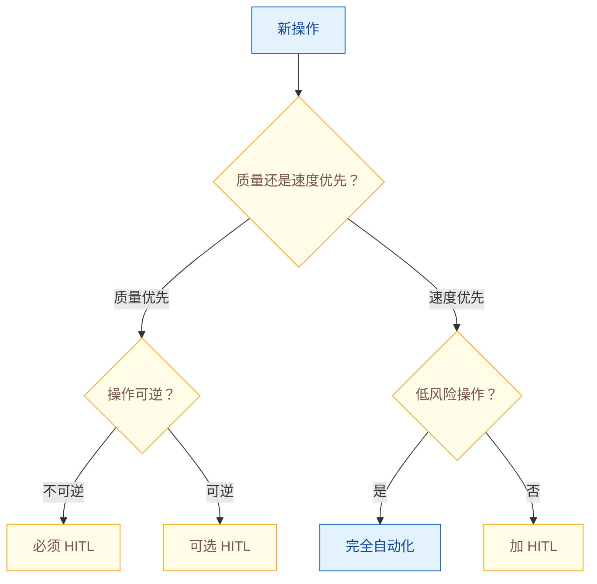

# Human-in-the-Loop：何时以及如何引入人工审核？

> 难度：中级
> 分类：Safety & Alignment

## 简短回答

Human-in-the-Loop (HITL) 是在 AI Agent 工作流中**战略性嵌入人类判断**的设计模式——不是所有决策都该自动化，也不是所有操作都需要人工审核，关键是找到**自动化效率和人类监督安全之间的最佳平衡点**。核心设计模式包括：(1) **审批/检查点模式**——在关键操作前暂停等待人类确认（如删除数据、发送邮件、支付）；(2) **置信度路由**——Agent 对自身置信度评分，低于阈值自动升级给人类；(3) **Human-as-a-Tool**——Agent 将"人类"视为可调用的工具，遇到不确定时主动提问；(4) **角色审批**——只有特定角色（审核员、管理员）才能批准敏感操作；(5) **异步升级**——非阻塞性地将决策路由到 Slack/邮件等异步审核渠道。何时使用的决策原则：**不可逆操作、合规监管要求、高风险领域（医疗/金融/法律）、需要同理心的场景**必须加人工介入。主流框架 LangGraph（`interrupt()`）、HumanLayer、Amazon Bedrock Agents 都提供了开箱即用的 HITL 支持。

## 详细解析

### 何时需要 Human-in-the-Loop

```
必须加 HITL 的场景：
│
├── 不可逆/破坏性操作
│   ├── 删除数据、文件、资源
│   ├── 发送外部通信（邮件、消息、通知）
│   ├── 金融交易（支付、转账）
│   └── 修改权限或配置
│
├── 合规监管要求
│   ├── 合同审核（法律）
│   ├── 医疗建议（医疗）
│   ├── 投资建议（金融）
│   └── 涉及隐私数据的操作
│
├── 高风险/高影响
│   ├── 影响客户的决策
│   ├── 影响业务指标的变更
│   └── 安全关键操作
│
└── 主观判断
    ├── 需要同理心的客服场景
    ├── 创意内容的最终审定
    └── 复杂的优先级权衡

可以完全自动化的场景：
├── 信息查询和检索
├── 数据格式转换
├── 日志分析和报告生成
├── 内部代码的 lint/格式化
└── 低风险的重复性操作
```

### 五种 HITL 设计模式

```python
# 模式 1：审批/检查点模式（最常用）
class ApprovalCheckpoint:
    """在关键操作前暂停等待人类确认"""

    async def execute_with_approval(self, agent, task):
        plan = await agent.plan(task)

        for step in plan.steps:
            if step.requires_approval:
                # 暂停执行，展示计划给人类
                approval = await self.request_approval(
                    action=step.action,
                    params=step.params,
                    context=step.reasoning,
                )
                if not approval.approved:
                    return self.handle_rejection(approval.feedback)

            await agent.execute_step(step)


# 模式 2：置信度路由
class ConfidenceBasedRouting:
    """Agent 置信度低时自动升级给人类"""

    def __init__(self, confidence_threshold=0.7):
        self.threshold = confidence_threshold

    async def route(self, agent_result):
        if agent_result.confidence >= self.threshold:
            return {"action": "auto_execute", "result": agent_result}
        elif agent_result.confidence >= 0.4:
            return {"action": "human_review", "result": agent_result}
        else:
            return {"action": "human_takeover", "result": agent_result}
        # 高置信度 → 自动执行
        # 中等置信度 → 人工审核 Agent 的建议
        # 低置信度 → 人工完全接管


# 模式 3：Human-as-a-Tool
class HumanTool:
    """Agent 将人类视为可调用的工具"""

    name = "ask_human"
    description = "当你不确定如何处理时，向人类提问"

    async def execute(self, question: str) -> str:
        """Agent 主动向人类提问"""
        response = await self.send_to_human(
            question=question,
            channel="slack",  # 或邮件、UI 弹窗
            timeout=300,      # 等待 5 分钟
        )
        return response.answer


# 模式 4：角色审批
class RoleBasedApproval:
    """根据操作类型要求不同角色审批"""

    approval_matrix = {
        "delete_data":     {"role": "admin",    "required": True},
        "send_email":      {"role": "reviewer", "required": True},
        "read_database":   {"role": "any",      "required": False},
        "modify_config":   {"role": "admin",    "required": True},
        "generate_report": {"role": "any",      "required": False},
    }

    async def check_approval(self, action, user):
        rule = self.approval_matrix.get(action)
        if not rule or not rule["required"]:
            return True
        return user.role == rule["role"] or user.role == "admin"


# 模式 5：异步升级
class AsyncEscalation:
    """非阻塞的异步人工审核"""

    async def escalate(self, issue, priority="normal"):
        if priority == "critical":
            # 关键问题：同步等待
            return await self.sync_review(issue)
        else:
            # 一般问题：异步通知，Agent 继续其他工作
            ticket = await self.create_review_ticket(issue)
            await self.notify_slack(issue, ticket)
            return {"status": "escalated", "ticket": ticket.id}
```

### LangGraph HITL 实现

```python
# 关键点：interrupt() 不是同步函数！它会抛出特殊异常暂停图执行，
# 必须配合 Checkpointer + Command(resume=...) 才能正常工作
from langgraph.graph import StateGraph
from langgraph.types import interrupt, Command
from langgraph.checkpoint.memory import MemorySaver

def agent_node(state):
    """Agent 决策节点"""
    result = llm.invoke(state["messages"])
    return {"messages": [result], "pending_action": result.tool_calls}

def human_review_node(state):
    """人工审核节点——interrupt() 暂停并把 value 透传给外部"""
    action = state["pending_action"]

    # interrupt 抛 GraphInterrupt 异常，invoke() 会立即返回
    # 外部拿到 interrupt value 后，由人决定，再用 Command(resume=...) 重新 invoke
    human_decision = interrupt({
        "action": action,
        "question": f"Agent 想要执行: {action}，是否批准？",
    })

    # 当 Command(resume=...) 注入后，interrupt 返回这个 value，继续往下执行
    if human_decision["approved"]:
        return {"approved": True}
    else:
        return {"approved": False, "feedback": human_decision["reason"]}

def should_review(state):
    """路由：是否需要人工审核"""
    action = state.get("pending_action")
    if action and action["tool"] in HIGH_RISK_TOOLS:
        return "human_review"
    return "execute"

# 必须配置 checkpointer，否则 interrupt 之后无法恢复
checkpointer = MemorySaver()
graph = StateGraph()
graph.add_node("agent", agent_node)
graph.add_node("human_review", human_review_node)
graph.add_node("execute", execute_node)
graph.add_conditional_edges("agent", should_review)
graph.add_edge("human_review", "execute")
app = graph.compile(checkpointer=checkpointer)

# 第一次 invoke——执行到 interrupt 处暂停
config = {"configurable": {"thread_id": "session-1"}}
result = app.invoke({"messages": [...]}, config=config)
# result 包含 __interrupt__ 字段，外部 UI 据此展示审批表单

# 人工审批后——用 Command(resume=...) 把决策注入回去
final = app.invoke(
    Command(resume={"approved": True}),  # 此 dict 即 interrupt() 的返回值
    config=config,  # 必须用同一 thread_id 让 checkpointer 恢复状态
)
```

### 超时策略：默认行为必须预先声明

审批不能无限等。发起审批时就要把超时后的默认动作写进配置并展示给审核人，不能等超时了再由系统猜。时长按风险分级：高危操作 5 分钟，低危 1 小时到 1 天（经验值，按业务响应能力调整）。

超时只有三种默认动作：默认通过，仅限低危且可回滚；默认拒绝，安全默认；挂起等人工，流程保持未完成，不自动推进。多数生产场景在后两者中选，涉及资金、权限、对外发送的操作应默认拒绝。

等待期间要释放资源：审批请求落库后，工作流结束当前轮次，不占连接和 worker。人工决定或超时扫描通过事件唤醒续跑。到 deadline 的 80% 发一次提醒，给审核人留出反应时间。

```python
from dataclasses import dataclass
from datetime import datetime, timedelta, timezone
from enum import Enum


class TimeoutAction(str, Enum):
    APPROVE = "approve"   # 仅限低危、可回滚
    DENY = "deny"         # 安全默认
    PENDING = "pending"   # 挂起，不自动推进


@dataclass
class ApprovalRequest:
    id: str
    action: str
    risk: str                       # "high" / "low"
    context: dict                   # 审批时的上下文快照，同时用于审计
    created_at: datetime
    deadline: datetime
    status: str = "pending"         # pending / approved / denied
    reminded: bool = False
    decided_by: str | None = None


class ApprovalGate:
    """提交审批、到期扫描、按配置执行超时分支"""

    def __init__(self, store, notifier):
        self.store = store
        self.notifier = notifier
        # 经验值：高危 5 分钟，低危 1 小时
        self.timeouts = {"high": timedelta(minutes=5), "low": timedelta(hours=1)}
        # 超时默认动作必须显式配置；低危才允许 APPROVE
        self.timeout_actions = {"high": TimeoutAction.DENY, "low": TimeoutAction.PENDING}

    async def submit(self, action: str, risk: str, context: dict) -> ApprovalRequest:
        now = datetime.now(timezone.utc)
        req = ApprovalRequest(
            id=f"apr-{now.timestamp()}",
            action=action,
            risk=risk,
            context=dict(context),      # 快照，避免后续修改影响审计
            created_at=now,
            deadline=now + self.timeouts[risk],
        )
        await self.store.save(req)          # 落库后工作流即可退出，不占连接
        await self.notifier.send(req)
        return req

    async def sweep(self) -> list[ApprovalRequest]:
        """定时任务调用：处理提醒和超时，不阻塞工作流"""
        handled = []
        for req in await self.store.list_pending():
            now = datetime.now(timezone.utc)
            # 到 deadline 的 80% 时提醒一次
            remind_at = req.created_at + (req.deadline - req.created_at) * 0.8
            if not req.reminded and now >= remind_at:
                await self.notifier.remind(req)
                req.reminded = True
                await self.store.save(req)
            if now >= req.deadline:
                action = self.timeout_actions[req.risk]
                if action == TimeoutAction.PENDING:
                    continue                # 挂起：保持 pending，等人回来
                req.status = "approved" if action == TimeoutAction.APPROVE else "denied"
                req.decided_by = "timeout"
                await self.store.save(req)
                await self.store.emit_resume(req)   # 唤醒续跑
                handled.append(req)
        return handled

    async def decide(self, req_id: str, approved: bool, reviewer: str, feedback: str = ""):
        """人工审批回调：写入决策并唤醒等待中的工作流"""
        req = await self.store.get(req_id)
        if req.status != "pending":
            return                    # 已超时或已处理，忽略迟到的决定
        req.status = "approved" if approved else "denied"
        req.decided_by = reviewer
        await self.store.save(req)
        await self.store.emit_resume(req, feedback=feedback)
```

### 驳回后的续跑与补偿兜底

驳回不是把错误原样抛回去。理由要收集并注入下一轮上下文：必填或至少引导填写，模型才知道哪里不对、该怎么改。回退位置取决于驳回对象：驳回单个动作，只重做该动作；驳回整体计划，退回计划生成阶段重新拆解，不要在错误计划上反复修补。

同一动作被驳回 2-3 次（经验值）就终止并上报，避免无限试探。部分批准要支持：批准 A、B，拒绝 C，被拒的子任务跳过或走替代路径，不能因为一个子任务否决整个计划。

高危动作配补偿事务（Saga）：正向执行成功后登记 undo，驳回、执行失败或后续步骤失败时按逆序回滚。不可回滚的操作（已发邮件、已转账）无法靠补偿兜底，只能在审批环节卡得更严，必要时双人复核。审计记录谁在何时批了什么、当时的上下文快照，这是事后追责的唯一依据。

```python
from collections import defaultdict
from dataclasses import dataclass
from typing import Awaitable, Callable


@dataclass
class CompensatingAction:
    name: str
    undo: Callable[[dict], Awaitable[None]]
    irreversible: bool = False


class Saga:
    """正向执行时登记补偿动作，失败或驳回时按逆序回滚"""

    def __init__(self):
        self._registry: dict[str, CompensatingAction] = {}
        self._done: list[tuple[str, dict]] = []

    def register(self, action: CompensatingAction):
        self._registry[action.name] = action

    async def run(self, name: str, params: dict, execute: Callable[..., Awaitable[dict]]):
        try:
            result = await execute(**params)
        except Exception:
            await self.rollback()               # 执行失败，回滚已完成的步骤
            raise
        self._done.append((name, result))       # 成功后登记，供回滚使用
        return result

    async def rollback(self):
        for name, result in reversed(self._done):
            action = self._registry[name]
            if action.irreversible:
                raise RuntimeError(f"{name} 不可回滚，必须在审批阶段拦截")
            await action.undo(result)
        self._done.clear()


class RejectionHandler:
    """驳回后的续跑：收集理由、限制次数、决定回退位置"""

    def __init__(self, max_rejections: int = 2):
        self.max_rejections = max_rejections       # 经验值：2-3 次
        self.counts: dict[str, int] = defaultdict(int)

    async def handle(self, step, decision, saga, replan):
        if not decision.feedback.strip():
            raise ValueError("驳回必须填写理由")
        self.counts[step.id] += 1
        if self.counts[step.id] > self.max_rejections:
            await saga.rollback()
            return {"status": "escalated", "reason": "同一动作被多次驳回"}
        if decision.scope == "plan":
            return await replan(feedback=decision.feedback)   # 退回计划生成
        return await replan(feedback=decision.feedback, step_id=step.id)  # 只重做该动作

    async def apply_partial(self, decisions, execute, fallback):
        """部分批准：批准的继续，被拒的跳过或走替代路径"""
        for d in decisions:
            if d.approved:
                await execute(d.step)
            else:
                await fallback(d.step, reason=d.feedback)
```

### 决策框架


*要不要人审，两次分叉就定：先问质量还是速度，再问可逆性与风险。*

```
推荐的渐进策略：
Phase 1: 所有操作都需人工确认（最安全）
Phase 2: 低风险操作自动化，高风险保留人工
Phase 3: 基于置信度动态路由
Phase 4: 只在异常/边界情况升级人工

关键指标：
├── 人工介入率（目标：逐步降低到 10-20%）
├── 人工审核响应时间（影响用户体验）
├── 人工否决率（反映 Agent 质量）
└── 自动化后的质量对比（确保质量不下降）
```

### HITL 工具生态

| 工具 | HITL 能力 |
| --- | --- |
| LangGraph | interrupt() 暂停图执行<br>完全控制路由和恢复 |
| HumanLayer | 框架无关的 HITL API/SDK<br>Slack/Email/UI 多渠道审批 |
| Amazon Bedrock Agents | 内置 user confirmation 功能<br>可配置哪些工具需要确认 |
| CrewAI | human_input=True 参数<br>Agent 级别的人工输入开关 |
| Permit.io | 基于 RBAC/ABAC 的细粒度审批<br>与 Agent 框架集成的权限管理 |

## 常见误区 / 面试追问

1. **误区："HITL 只是临时方案，最终目标是完全自动化"** — HITL 不是权宜之计，而是长期的架构模式。即使 AI 能力不断提升，高风险决策、合规审核和同理心判断仍然需要人类。随着 Agent 能力提升，人类的角色从"逐一审核"转向"战略监督和异常处理"。

2. **误区："加了 HITL 就安全了"** — HITL 本身也有失败模式：审核疲劳（人类不仔细看就点批准）、响应延迟（人类不在线导致 Agent 阻塞）、能力不匹配（审核者不理解技术细节）。需要配合良好的 UI 设计、轮值机制和明确的审核标准。SDK 侧的 fail-closed 语义也在持续收紧：Claude Agent SDK（TypeScript）v0.3.259（2026-09）提供 `permissionPrompts: 'none'`，无人值守会话中权限提示自动拒绝而非无限挂起；v0.3.269 起 plan mode 的写操作即使设置了 `allowDangerouslySkipPermissions` 也必须过 `canUseTool` 审查——「跳过权限」不再等于「跳过审查」。

3. **追问："如何降低 HITL 对用户体验的影响？"** — (1) 异步审核——非阻塞操作用异步通知；(2) 批量审核——收集多个待审项一次性处理；(3) 预审批——用户提前授权某类操作；(4) 置信度路由——只有低置信度的才需人工，大部分自动通过。

4. **追问："如何量化 HITL 的投入产出？"** — 跟踪三个指标：(1) 人工介入率及趋势（应该随 Agent 优化而下降）；(2) 人工否决后的实际影响（避免了多少潜在问题）；(3) HITL 引入的延迟对业务指标的影响。如果否决率 < 2% 且历史无重大事故，可以考虑降低该类操作的审核要求。

## 参考资料

- [Human-in-the-Loop for AI Agents: Best Practices, Frameworks, Use Cases (Permit.io)](https://www.permit.io/blog/human-in-the-loop-for-ai-agents-best-practices-frameworks-use-cases-and-demo)
- [Agents with Human in the Loop: Everything You Need to Know (CAMEL AI)](https://dev.to/camelai/agents-with-human-in-the-loop-everything-you-need-to-know-3fo5)
- [Human-in-the-Loop AI in 2025: Proven Design Patterns (Ideafloats)](https://blog.ideafloats.com/human-in-the-loop-ai-in-2025/)
- [Humans and Agents in Software Engineering Loops (Martin Fowler)](https://martinfowler.com/articles/exploring-gen-ai/humans-and-agents.html)
- [Implement Human-in-the-Loop Confirmation with Amazon Bedrock Agents (AWS)](https://aws.amazon.com/blogs/machine-learning/implement-human-in-the-loop-confirmation-with-amazon-bedrock-agents/)
- [Claude Agent SDK (TypeScript) Releases](https://github.com/anthropics/claude-agent-sdk-typescript/releases) — v0.3.259 `permissionPrompts: 'none'` 无人值守自动拒绝；v0.3.269 plan mode 写操作强过 allowDangerouslySkipPermissions，须经 canUseTool（2026-09）
