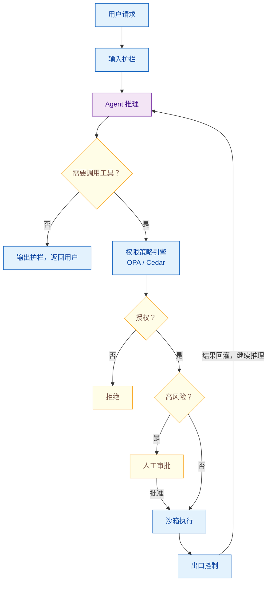

# Agent 的权限最小化原则与沙箱执行

> 难度：中级
> 分类：Safety & Alignment

## 简短回答

权限最小化（Least Privilege）和沙箱执行（Sandboxing）是 Agent 安全的两大核心工程实践。**权限最小化**要求 Agent 只拥有完成当前任务所需的最小权限集——不给数据库写权限给只需要读的 Agent，不给全网访问给只需要调特定 API 的 Agent。**沙箱执行**则是将 Agent 的代码执行、文件操作等高危行为隔离在受限环境中，即使 Agent 被攻击也无法影响宿主系统。2025 年的关键趋势：传统的静态权限模型不适合 Agent——因为 Agent 在运行时动态决定行为，需要**动态运行时权限管理**（如 AI Identity Gateway，为每次请求颁发最小权限令牌）。OWASP Agent 安全清单将"工具滥用与权限提升"列为核心威胁。实际案例：Devin AI Agent 被间接 Prompt Injection 攻击，泄露了环境变量和密钥（Johann Rehberger 在 "Month of AI Bugs" 系列中披露，2025-08）。防御架构：权限策略即代码（OPA）+ 临时性执行环境（gVisor/microVM）+ 出口白名单 + 人工审批高危操作。

## 详细解析

### 为什么传统最小权限不够

```
传统软件的最小权限：
├── 权限在部署时确定（静态）
├── 服务有固定的 API 调用模式
├── 可以预先定义完整的权限清单
└── 行为路径可预测

Agent 的挑战：
├── Agent 在运行时动态决定做什么（非确定性）
├── 可能调用的工具组合无法预先穷举
├── 同一 Agent 在不同任务中需要不同权限
├── 被 Prompt Injection 攻击后行为完全不可预测
└── 需要：动态、运行时、上下文感知的权限管理
```

### 权限最小化的实现模式

```python
class LeastPrivilegeAgent:
    """权限最小化的 Agent 架构"""

    def __init__(self):
        # 模式 1：基于角色的工具白名单
        self.tool_permissions = {
            "research_agent": {
                "allowed_tools": ["web_search", "read_document"],
                "denied_tools": ["write_file", "send_email", "database_write"],
            },
            "code_agent": {
                "allowed_tools": ["read_file", "write_file", "run_tests"],
                "denied_tools": ["send_email", "database_delete", "deploy"],
            },
        }

    # 模式 2：动态权限（按任务授权）
    def create_scoped_session(self, task, user_context):
        """为每个任务创建最小权限会话"""
        required_tools = self.analyze_required_tools(task)

        session = AgentSession(
            tools=required_tools,           # 只授予需要的工具
            api_keys=self.get_scoped_keys(  # 限制范围的 API Key
                scope=required_tools,
                ttl=300,                    # 5 分钟过期
            ),
            resource_limits={
                "max_api_calls": 20,
                "max_cost_usd": 1.0,
                "max_duration_sec": 120,
            },
        )
        return session

    # 模式 3：AI Identity Gateway（运行时策略执行）
    def request_with_dynamic_auth(self, action, context):
        """每次操作都经过身份网关验证"""
        # 1. 评估上下文和策略
        policy_result = self.policy_engine.evaluate(
            agent_id=self.id,
            action=action,
            context=context,
            user_permissions=context.user.permissions,
        )

        # 2. 颁发最小权限令牌
        if policy_result.allowed:
            token = self.issue_scoped_token(
                permissions=policy_result.granted_permissions,
                ttl=60,  # 单次操作，60 秒过期
            )
            return self.execute_with_token(action, token)
        else:
            return {"denied": True, "reason": policy_result.reason}
```

### 沙箱执行架构

```python
# 沙箱执行的层次

sandbox_layers = {
    "Level 1: 进程隔离": {
        "技术": "subprocess + 资源限制",
        "适用": "简单的代码执行",
        "示例": "Python subprocess + ulimit",
        "限制": "共享内核，隔离不完全",
    },
    "Level 2: 容器隔离": {
        "技术": "Docker / Podman",
        "适用": "工具执行、文件操作",
        "优势": "文件系统隔离、网络隔离、资源限制",
        "示例": "每次工具调用在独立容器中执行",
    },
    "Level 3: gVisor / microVM": {
        "技术": "gVisor（用户态内核）/ Firecracker（microVM）",
        "适用": "高安全要求的代码执行",
        "优势": "内核级隔离，即使容器逃逸也无法影响宿主",
        "示例": "AWS Lambda、Google Cloud Run 底层技术",
    },
    "Level 4: 临时性环境": {
        "技术": "每次执行创建全新环境，执行后销毁",
        "适用": "最高安全要求",
        "优势": "无状态残留，每次执行互不影响",
        "示例": "InfoQ 案例：ephemeral runner + 强制销毁",
    },
}

# 实践示例：安全的代码执行沙箱
class CodeSandbox:
    """Agent 代码执行的安全沙箱"""

    async def execute_code(self, code, language="python"):
        container = await self.create_container(
            image=f"sandbox-{language}:latest",
            network_mode="none",          # 禁止网络访问
            read_only=True,               # 只读文件系统
            mem_limit="256m",             # 内存限制
            cpu_quota=50000,              # CPU 限制
            timeout=30,                    # 超时限制
            volumes={
                "/tmp/workspace": {        # 只允许写临时目录
                    "bind": "/workspace",
                    "mode": "rw",
                },
            },
        )

        try:
            result = await container.exec(code, timeout=30)
            return {"output": result.stdout, "error": result.stderr}
        finally:
            await container.destroy()  # 执行后立即销毁
```

### 出口控制与数据防泄露

```python
class EgressControl:
    """出口控制——防止 Agent 将数据泄露到外部"""

    def __init__(self):
        # 域名白名单：Agent 只能访问这些外部服务
        self.allowed_domains = [
            "api.openai.com",
            "api.anthropic.com",
            "company-internal-api.com",
        ]

        # DLP（数据防泄露）规则
        self.dlp_rules = [
            {"type": "pii", "action": "redact"},
            {"type": "api_key", "action": "block"},
            {"type": "internal_url", "action": "block"},
        ]

    def check_egress(self, destination, payload):
        """检查出口请求"""
        # 1. 域名白名单检查
        if destination not in self.allowed_domains:
            return {"blocked": True, "reason": f"未授权的目标域: {destination}"}

        # 2. DLP 扫描：检查是否包含敏感数据
        for rule in self.dlp_rules:
            if self.detect(payload, rule["type"]):
                if rule["action"] == "block":
                    return {"blocked": True, "reason": f"检测到 {rule['type']}"}
                elif rule["action"] == "redact":
                    payload = self.redact(payload, rule["type"])

        return {"blocked": False, "payload": payload}
```

### 可逆脱敏：占位符映射与格式保留

DLP 常见的 `[REDACTED]` 是不可逆的，适合日志，不适合 Agent 工作流。模型可能在下一次工具调用里引用这个值，比如把手机号填进表单，抹掉后任务直接断掉；两个不同手机号都变成同一个 `[REDACTED]`，模型也无法区分。

可逆脱敏把真值换成占位符 `<PHONE_1>`，映射表只存在执行侧。进模型前替换，模型输出和工具参数里的占位符在执行前还原。模型看到的是符号，功能链路不受影响。

需要校验格式的场景（手机号位数、银行卡 Luhn 校验）用格式保留脱敏：保留前后几位，或生成同格式假值。前者不可逆，只用于展示；后者要登记回真值，校验通过后再换回来。

数据分级决定处理方式：公开和内部可以原文进模型；敏感级别先脱敏；机密级别既不进模型也不出网。

边界要讲清楚：脱敏降低泄露面，不替代权限控制。有权限的人误用数据，脱敏拦不住。

```python
import re
from enum import Enum


class SensitivityLevel(str, Enum):
    PUBLIC = "public"
    INTERNAL = "internal"
    SENSITIVE = "sensitive"
    CONFIDENTIAL = "confidential"


# 分级策略：决定数据能否进模型、能否出网
POLICY = {
    SensitivityLevel.PUBLIC:       {"to_model": "raw",    "egress": "allow"},
    SensitivityLevel.INTERNAL:     {"to_model": "raw",    "egress": "allowlist"},
    SensitivityLevel.SENSITIVE:    {"to_model": "redact", "egress": "redact"},
    SensitivityLevel.CONFIDENTIAL: {"to_model": "block",  "egress": "block"},
}


class ReversibleRedactor:
    """识别敏感值，替换成占位符；执行前按映射还原"""

    PATTERNS = {
        "PHONE": re.compile(r"(?<!\d)1[3-9]\d{9}(?!\d)"),
        "EMAIL": re.compile(r"[\w.+-]+@[\w-]+(?:\.[\w-]+)+"),
        "CARD": re.compile(r"(?<!\d)\d{16,19}(?!\d)"),
    }

    def __init__(self):
        # 映射表只存在执行侧，按会话隔离
        self._vault: dict[str, dict[str, str]] = {}      # 占位符 -> 真值
        self._aliases: dict[str, dict[str, str]] = {}    # 格式保留假值 -> 真值
        self._counters: dict[tuple[str, str], int] = {}

    def redact(self, text: str, session_id: str) -> str:
        vault = self._vault.setdefault(session_id, {})
        for kind, pattern in self.PATTERNS.items():
            def replace(match):
                value = match.group(0)
                # 同一真值复用同一占位符，两个不同值才能被模型区分
                for placeholder, real in vault.items():
                    if real == value:
                        return placeholder
                key = (session_id, kind)
                self._counters[key] = self._counters.get(key, 0) + 1
                placeholder = f"<{kind}_{self._counters[key]}>"
                vault[placeholder] = value
                return placeholder
            text = pattern.sub(replace, text)
        return text

    def redact_card(self, value: str, session_id: str) -> str:
        """银行卡换成 Luhn 合法的假卡号，并登记回真值"""
        fake = self.fake_card(value)
        self._aliases.setdefault(session_id, {})[fake] = value
        return fake

    def restore(self, text: str, session_id: str) -> str:
        for placeholder, real in self._vault.get(session_id, {}).items():
            text = text.replace(placeholder, real)
        for fake, real in self._aliases.get(session_id, {}).items():
            text = text.replace(fake, real)
        return text

    @staticmethod
    def mask_keep_ends(value: str, head: int = 3, tail: int = 4) -> str:
        """格式保留：长度不变，保留前后几位，适合位数校验"""
        if len(value) <= head + tail:
            return "*" * len(value)
        return value[:head] + "*" * (len(value) - head - tail) + value[-tail:]

    @staticmethod
    def fake_card(value: str) -> str:
        """生成同长度、能过 Luhn 校验的假卡号"""
        digits = list(value[:6] + "0" * (len(value) - 7) + "0")
        digits[-1] = str(ReversibleRedactor._luhn_check(digits[:-1]))
        return "".join(digits)

    @staticmethod
    def _luhn_check(digits: list[str]) -> int:
        total = 0
        for i, ch in enumerate(reversed(digits)):
            n = int(ch) * (2 if i % 2 == 0 else 1)
            total += n - 9 if n > 9 else n
        return (10 - total % 10) % 10


redactor = ReversibleRedactor()
prompt = "联系 13812345678，邮箱 alice@example.com"
safe = redactor.redact(prompt, "session-1")
# safe: "联系 <PHONE_1>，邮箱 <EMAIL_1>"
fake_card = redactor.redact_card("6222021234567890", "session-1")
# fake_card 能过 Luhn 校验，restore 时换回真卡号
args = redactor.restore("send_sms(to='<PHONE_1>')", "session-1")
```

### 完整的安全架构


*每一跳都设关卡：策略引擎授权、高危转人工审批、执行进沙箱、出网过出口控制，结果才回灌 Agent。*

## 常见误区 / 面试追问

1. **误区："给 Agent 全部权限，让它自己判断用哪些"** — 这是最危险的做法。Agent 被 Prompt Injection 攻击后，它的"判断"会被攻击者控制。权限必须在 Agent 外部强制执行（外部策略引擎），而非依赖 Agent 自身的安全判断。**Meta 的"Agents Rule of Two"（2025-10）**：在 prompt injection 检测尚不可靠之前，单个 Agent 会话不应同时具备 **[A] 处理不可信输入、[B] 访问敏感数据、[C] 能改变状态/对外通信** 这三个能力——最多同时具备其中两个。如果业务必须三者俱全（如 Coding Agent），应：(1) 拆分为两阶段会话（先采集→人工审批→再执行）；(2) 用沙箱完全阻断 [C]；(3) 加可信内容过滤器降低 [A] 风险。该原则源于 Simon Willison 的"致命三角"（详见 078 题），是当前业界最具可操作性的 Agent 安全设计准则。

2. **误区："沙箱会严重影响性能"** — 现代容器化和 microVM 技术（如 Firecracker）启动延迟已降到毫秒级。gVisor 的性能开销在大多数场景下 < 10%。对于 Agent 系统来说，LLM 调用本身的延迟（1-5 秒）远大于沙箱开销。

3. **追问："如何处理 Agent 需要临时提升权限的场景？"** — 使用 JIT（Just-In-Time）权限提升：Agent 请求临时权限 → 策略引擎评估 → 需要时触发人工审批 → 授予限时令牌（如 5 分钟后自动撤销）。避免永久性权限提升。

4. **追问："多 Agent 系统中如何防止权限提升链？"** — (1) Agent 间通信经过统一的策略网关；(2) 每个 Agent 有独立的权限域，不能继承其他 Agent 的权限；(3) 消息传递时剥离权限上下文；(4) 监控异常的 Agent 间调用模式。

## 参考资料

- [AI Agent Security Cheat Sheet (OWASP)](https://cheatsheetseries.owasp.org/cheatsheets/AI_Agent_Security_Cheat_Sheet.html)
- [Hardening Best Practices: Sandboxing, Least Privilege & Data Exfiltration Guards (Skywork AI)](https://skywork.ai/blog/ai-agent/hardening-best-practices-sandboxing-least-privilege-data-exfiltration/)
- [Why Agentic AI Forces a Rethink of Least Privilege (Strata.io)](https://www.strata.io/blog/why-agentic-ai-forces-a-rethink-of-least-privilege/)
- [Building a Least-Privilege AI Agent Gateway with MCP, OPA, and Ephemeral Runners (InfoQ)](https://www.infoq.com/articles/building-ai-agent-gateway-mcp/)
- [AI Agent Security Best Practices and Tutorial (IBM)](https://www.ibm.com/think/tutorials/ai-agent-security)
