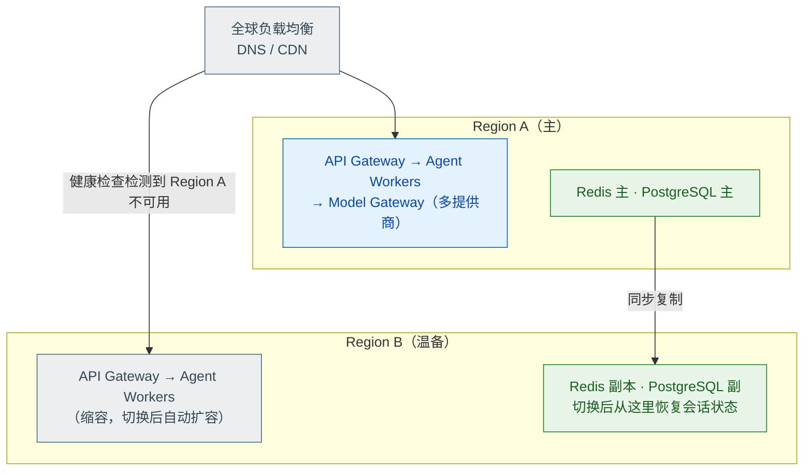

# Agent 系统的灾难恢复与高可用设计

> 难度：高级
> 分类：Production & Deployment

## 简短回答

Agent 系统的高可用（HA）和灾难恢复（DR）比传统服务更关键——因为 AI Agent 正从后台走向前台，直接面对客户。如果 Agent 背后的 LLM 服务或数据库宕机，用户立即感知。核心设计原则：(1) **多提供商冗余**——不依赖单一 LLM 提供商，主备切换延迟 < 1 秒；(2) **状态持久化与检查点**——每步保存 Agent 执行状态，支持从任意步骤恢复，跨越小时甚至天级别的长任务；(3) **多区域部署**——Active-Passive 架构，故障区域的流量自动切换到备用区域；(4) **优雅降级**——LLM 不可用时降级到规则引擎/缓存/人工接管，而非完全不可用；(5) **熔断器模式**——检测到异常时自动停止 Agent 执行，防止级联故障。Microsoft Foundry Agent Service 推荐 Active-Passive 配合 Gateway Routing 模式，备用区域保持温备。LangGraph 提供了内置的检查点和恢复机制。两个常被引用的对照案例（数据请以原始来源为准）：Wells Fargo 的 Fargo 虚拟助理 2024 报告披露年度互动达**亿级量级**且无人工介入；MD Anderson 与 IBM Watson 合作的肿瘤诊断项目（2013-2017）累计投入约 6200 万美元后被中止——前者展示正确架构的价值，后者警示架构决策的重要性。引用具体数字时请回查 Wells Fargo 年报与 The Texas Tribune（2017）原文。

## 详细解析

### 高可用架构设计


*Active-Passive 温备：数据同步复制到备区，健康检查失败切流量，用户感知的中断时间 < 30 秒。*

### 多提供商故障转移

```python
class LLMFailoverManager:
    """LLM 提供商级别的故障转移"""

    def __init__(self):
        self.providers = [
            {"name": "openai",    "priority": 1, "healthy": True},
            {"name": "anthropic", "priority": 2, "healthy": True},
            {"name": "google",    "priority": 3, "healthy": True},
        ]
        self.circuit_breakers = {}

    async def call_with_failover(self, request):
        """带故障转移的 LLM 调用"""
        for provider in sorted(self.providers, key=lambda p: p["priority"]):
            if not provider["healthy"]:
                continue

            breaker = self.circuit_breakers[provider["name"]]
            if breaker.is_open:
                continue  # 熔断器打开，跳过

            try:
                response = await self.call_provider(provider["name"], request)
                breaker.record_success()
                return response

            except RateLimitError:
                breaker.record_failure()
                continue  # 限流，尝试下一个

            except ServiceUnavailableError:
                breaker.record_failure()
                provider["healthy"] = False
                self.schedule_health_check(provider, delay=60)
                continue

        # 所有提供商都不可用 → 降级
        return await self.degrade(request)


class CircuitBreaker:
    """熔断器——防止故障级联"""

    def __init__(self, failure_threshold=5, recovery_timeout=60):
        self.failure_count = 0
        self.threshold = failure_threshold
        self.timeout = recovery_timeout
        self.state = "CLOSED"  # CLOSED → OPEN → HALF_OPEN

    @property
    def is_open(self):
        if self.state == "OPEN":
            if time.time() - self.opened_at > self.timeout:
                self.state = "HALF_OPEN"
                return False
            return True
        return False

    def record_failure(self):
        self.failure_count += 1
        if self.failure_count >= self.threshold:
            self.state = "OPEN"
            self.opened_at = time.time()

    def record_success(self):
        self.failure_count = 0
        self.state = "CLOSED"
```

### 状态持久化与检查点

```python
class AgentCheckpointing:
    """Agent 执行的检查点与恢复"""

    async def execute_with_checkpoints(self, task_id, task):
        """带检查点的 Agent 执行"""

        # 检查是否有未完成的执行（恢复场景）
        checkpoint = await self.load_checkpoint(task_id)
        if checkpoint:
            # 从上次中断的步骤恢复
            step_index = checkpoint["completed_steps"]
            plan = checkpoint["plan"]
            results = checkpoint["results"]
        else:
            # 全新执行
            plan = await self.agent.plan(task)
            step_index = 0
            results = []

        # 逐步执行，每步保存检查点
        for i in range(step_index, len(plan.steps)):
            step = plan.steps[i]

            result = await self.agent.execute_step(step)
            results.append(result)

            # 保存检查点
            await self.save_checkpoint(task_id, {
                "plan": plan,
                "completed_steps": i + 1,
                "results": results,
                "timestamp": datetime.utcnow(),
            })

        return self.agent.synthesize(results)

    # 检查点使能的能力：
    # 1. 服务重启后从断点恢复（不丢失已完成的步骤）
    # 2. 跨越小时/天的长任务
    # 3. 人工审核暂停后恢复
    # 4. Worker 迁移（从一个实例转到另一个）
```

### Checkpoint 存什么：完整状态清单

上面的检查点示例只存了 plan、completed_steps、results 和 timestamp。这些字段能回答"任务做到哪一步"，但回答不了"这一步已经对外部世界做了什么"。生产环境里，恢复事故往往出在后者。

| 类别 | 要存什么 | 缺失的后果 |
| --- | --- | --- |
| 对话状态 | messages（含 tool_calls 与工具结果）、system prompt 版本 | 恢复后接不上上下文，重复提问或重复执行 |
| 循环状态 | turn 序号、已用 token / 耗时 / 成本 | 预算和循环保护失效，可能无限续跑 |
| 任务状态 | 子任务 DAG、各节点状态与产出引用 | 无法判断哪些步骤该跳过、哪些该继续 |
| 外部副作用 | 不可逆操作及状态、幂等键、外部系统返回的引用 | 重复下单、重复发邮件、重复扣款 |
| 进行中的工具调用 | 哪个 tool_call 正在执行，或已执行但结果未回灌 | 恢复后既不敢重试，也不知道结果 |
| 版本信息 | prompt 版本、工具 schema 版本、模型版本 | 用新逻辑续跑旧状态，行为不一致 |

**外部副作用记录是最容易被漏掉的一类，也最致命。** 计划和中间结果丢了可以重算，已经发生的扣款不能靠重算撤销。凡是要调用外部写接口的步骤，必须在执行前落账，不能等成功后再补记录。进程恰好死在"请求已发出、响应没回来"的窗口里时，事后只能靠幂等键去外部系统对账。

### Checkpoint 放哪：分层存储与快照频率

| 存储 | 放什么 | 特点 |
| --- | --- | --- |
| Redis | 当前 run 的循环状态、最新 checkpoint 指针 | 读写快，适合热状态；配 AOF 和副本，允许秒级丢失 |
| 关系库（Postgres） | 按 run_id 的完整快照、副作用账本 | 事务可靠，作为恢复的权威来源 |
| 对象存储（S3 等） | 长工具输出、文件快照、完整消息归档 | 便宜、容量大，不适合高频小写入 |
| 事件日志 + 定期快照 | 每步追加事件，每 N 步或每 M 分钟做一次全量快照 | 恢复 = 快照 + 重放增量，成本和 RPO 可调 |

快照频率是在恢复速度和写入成本之间取平衡。每步全量快照恢复最快，但写入放大严重；事件日志加每 10 步一次快照，能把重放量控制在较小范围（经验值，实际间隔按单步耗时和可接受 RPO 实测决定）。

### Checkpoint 怎么恢复：五步流程与幂等前提

1. 加载最近快照，按事件日志重放到中断点。
2. 校验版本一致。prompt、工具 schema、模型版本对不上时，不要直接续跑，先迁移状态或转人工。
3. 核对副作用。pending 或 unknown 的操作去外部系统查真实结果，不能假设成功，也不能假设失败。
4. 从下一个未完成步骤续跑。已完成步骤直接跳过，不要从快照点整体重放。
5. 注入恢复提示。例如："系统刚从故障恢复，第 N 轮，已完成 A、B，未完成 C，副作用 D 已确认。不要重复执行已完成步骤。"

第三步能否成立，取决于外部写接口是否支持幂等键。没有幂等键，你既不能安全重试，也无法确认一次"结果未知"的调用到底生效没有——**没有幂等键的恢复就是赌博**。正确做法是调用前生成幂等键并落账，随请求发给外部系统；外部系统对同一个键只执行一次，重复请求返回第一次的结果。查询接口还要能区分"确定不存在"和"暂时查不到"，否则最终一致性下的 not_found 会被误判成失败。

```python
from dataclasses import dataclass, field
from enum import Enum
from typing import Literal
import time


class EffectStatus(str, Enum):
    PENDING = "pending"      # 已决定执行，结果未知
    SUCCEEDED = "succeeded"
    FAILED = "failed"
    UNKNOWN = "unknown"      # 进程崩溃等导致结果无法确认


@dataclass
class SideEffect:
    run_id: str
    step_id: str
    operation: str                       # 例如 "create_order"
    idempotency_key: str                 # run_id + step_id + 操作类型，全局唯一
    status: EffectStatus = EffectStatus.PENDING
    external_ref: str | None = None      # 外部系统返回的订单号、消息 id
    updated_at: float = field(default_factory=time.time)


@dataclass
class ProbeResult:
    state: Literal["found", "not_found", "unknown"]
    ref: str | None = None


class ProbeError(Exception):
    """外部系统暂时查不到结果，保持原状态，稍后重试"""


class SideEffectLedger:
    """副作用账本：先记账再执行，恢复时逐条对账"""

    def __init__(self, store):
        self.store = store  # 关系库，idempotency_key 上有唯一索引

    async def begin(self, effect: SideEffect) -> SideEffect:
        """执行前写入 PENDING；PENDING/UNKNOWN 的旧记录要先 reconcile"""
        existing = await self.store.get(effect.idempotency_key)
        if existing is None:
            await self.store.insert(effect)  # 并发重复由唯一索引兜底
            return effect
        if existing.status == EffectStatus.FAILED:
            # 外部确认没生效的失败可以安全重试：同键重发只生效一次
            await self.mark(existing.idempotency_key, EffectStatus.PENDING)
            existing.status = EffectStatus.PENDING
        elif existing.status in (EffectStatus.PENDING, EffectStatus.UNKNOWN):
            # 结果未知：必须先 reconcile，不能直接重试或当成已完成
            raise RuntimeError(f"unresolved side effect: {effect.idempotency_key}")
        return existing

    async def mark(self, key: str, status: EffectStatus,
                   external_ref: str | None = None) -> None:
        fields = {"status": status, "updated_at": time.time()}
        if external_ref is not None:
            fields["external_ref"] = external_ref
        await self.store.update(key, **fields)

    async def reconcile(self, run_id: str, probe) -> list[SideEffect]:
        """恢复时调用。probe(operation, key) 按幂等键查外部真实状态"""
        effects = await self.store.list_by_run(run_id)
        for effect in effects:
            if effect.status not in (EffectStatus.PENDING, EffectStatus.UNKNOWN):
                continue
            try:
                result: ProbeResult = await probe(effect.operation,
                                                  effect.idempotency_key)
            except ProbeError:
                continue  # 查询失败：保持原状态，稍后重试，绝不能当成失败
            if result.state == "found":
                await self.mark(effect.idempotency_key,
                                EffectStatus.SUCCEEDED, result.ref)
                effect.status, effect.external_ref = EffectStatus.SUCCEEDED, result.ref
            elif result.state == "not_found":
                # 只有外部系统明确保证查询已一致时，not_found 才能判失败
                await self.mark(effect.idempotency_key, EffectStatus.FAILED)
                effect.status = EffectStatus.FAILED
            # unknown：保持原状态，等下一次对账
        return effects
```

### 优雅降级策略

```python
class GracefulDegradation:
    """Agent 系统的优雅降级"""

    degradation_levels = {
        "Level 0: 完全正常": {
            "条件": "所有服务正常",
            "行为": "完整 Agent 功能",
        },
        "Level 1: LLM 部分降级": {
            "条件": "主 LLM 提供商限流或慢",
            "行为": [
                "切换到备用提供商",
                "降级到更小的模型",
                "增加缓存使用",
            ],
        },
        "Level 2: LLM 完全不可用": {
            "条件": "所有 LLM 提供商不可用",
            "行为": [
                "使用缓存回答高频问题",
                "切换到规则引擎处理简单请求",
                "复杂请求排队等待恢复",
                "显示'AI 助手暂时不可用，已转接人工'",
            ],
        },
        "Level 3: 数据库不可用": {
            "条件": "状态存储不可用",
            "行为": [
                "只处理无状态的单轮请求",
                "禁用多步 Agent 和工具调用",
                "内存中临时存储（不持久）",
            ],
        },
        "Level 4: 完全降级": {
            "条件": "核心服务全部不可用",
            "行为": [
                "静态降级页面",
                "联系方式和人工支持入口",
                "自动通知运维团队",
            ],
        },
    }
```

### RTO/RPO 设计

Agent 系统的 RTO/RPO 目标：

| 组件 | RTO（恢复时间） | RPO（数据丢失） | 策略 |
| --- | --- | --- | --- |
| LLM API 访问 | < 1s | 0 | 多提供商自动故障转移 |
| Agent 服务 | < 30s | 0 | 多实例 + 健康检查 + 自愈 |
| 会话状态(Redis) | < 5s | < 1s | Redis Cluster + 异步复制 |
| 持久存储(PG) | < 5min | 0 | 同步复制 + 自动故障转移 |
| 向量数据库(RAG) | < 10min | 可重建 | 定期快照 + 从源数据重建 |

## 常见误区 / 面试追问

1. **误区："LLM API 是云服务，不需要考虑可用性"** — LLM API 提供商也会宕机或限流。2024-2025 年 OpenAI 和 Anthropic 都有过多次服务中断。必须有多提供商故障转移策略，不能把鸡蛋放在一个篮子里。

2. **误区："Agent 没有状态，不需要灾难恢复"** — 多步 Agent 有大量状态：执行计划、已完成步骤的结果、对话历史、工具调用结果。丢失这些状态意味着任务从头开始，用户体验极差。检查点机制是必需的。

3. **追问："如何测试灾难恢复方案？"** — (1) **Chaos Engineering**——随机中断 LLM API 连接，验证故障转移；(2) **故障注入**——模拟数据库宕机、网络分区；(3) **DR 演练**——每季度进行一次完整的区域切换演练；(4) **恢复时间测量**——记录实际 RTO 并与目标对比。

4. **追问："优雅降级和完全不可用之间如何选择？"** — 原则：部分功能可用 > 完全不可用。用户宁可看到"AI 助手暂时简化模式运行"也不愿看到"服务不可用"。降级策略应该预先设计和测试，而不是在事故中临时决定。

5. **追问："Checkpoint 里最容易被忽略、后果最严重的是什么？"** — 外部副作用记录。计划丢了可以重算，已执行的不可逆操作（下单、发邮件、扣款）丢了就无法判断是否要重试。正确做法是执行前把操作、幂等键和状态写入账本，恢复时按幂等键去外部系统查询真实结果，再决定跳过还是重试。没有幂等键的恢复就是赌博。

## 参考资料

- [Foundry Agent Service Platform Outage Recovery (Microsoft)](https://learn.microsoft.com/en-us/azure/foundry/how-to/agent-service-platform-disaster-recovery)
- [Agentic AI in Production: 10 Patterns That Ship in 2025 (Medium)](https://medium.com/@ThinkingLoop/d3-1-agentic-ai-in-production-10-patterns-that-ship-in-2025-d9c367827e58)
- [5 Most Popular Agentic AI Design Patterns in 2025 (Azilen)](https://www.azilen.com/blog/agentic-ai-design-patterns/)
- [20 Agentic AI Workflow Patterns That Actually Work in 2025 (Skywork AI)](https://skywork.ai/blog/agentic-ai-examples-workflow-patterns-2025/)
- [How AI is Transforming IT Disaster Recovery (Cutover)](https://www.cutover.com/blog/how-ai-transforming-it-disaster-recovery)
