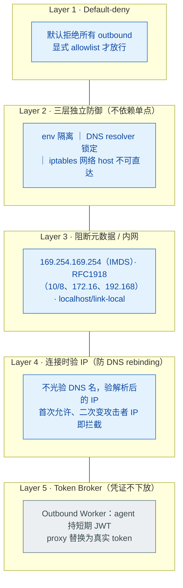

# Agent Sandbox / Runtime 选型：E2B / Daytona / Modal / Cloudflare Sandbox 隔离强度 + cold start + egress

> **难度**：中级
> 🆕 2026 新增（Harness 主题）
> 分类：Production & Deployment

## 简短回答

Agent Sandbox / Runtime 选型是 Production 团队 2025-2026 最绕不开的工程决策。**隔离强度三档分明**：Firecracker microVM（KVM 硬件级，~125ms 启动，E2B 与 Vercel Sandbox 选它）> Kata Containers / gVisor（用户态内核 Sentry，1-5s，Modal 选它）> 普通 Container（共享 host kernel，Daytona/Cloudflare Containers 默认）/ V8 Isolate（毫秒级但跑不了 numpy）。**计费精度普遍 per-second**，Cloudflare 在 **2025-11-21** 进一步把 Container 计费从"按 provisioned CPU"改成"按 active CPU"，agent 突发型负载因此降本数倍。

**网络 Egress 是沙箱最容易出 CVE 的边界**：**CVE-2025-66479**（Claude Code BashTool "空白 allowlist 等于全放行"）与 **SOCKS5 null-byte 注入**（影响 Claude Code v2.0.24 – v2.1.89，`attacker-host.com\x00.google.com` 让 `endsWith(".google.com")` 命中）是 2025-2026 两个标志性 parser-differential 漏洞，证明**单层 allowlist 永远不够**。业界已收敛的最佳实践是 **default-deny + 三层独立防御**（env 隔离 + DNS 限制 + iptables）+ 拦截 169.254.169.254 IMDS + 连接时验 IP + 凭证不下放（Cloudflare Outbound Workers / Anthropic Managed Agents 同款 token broker 模式）。**多 Agent 并行 harness 设计**正在收敛：Anthropic Managed Agents 的演进路径"先单 container 全揽 → 拆 harness + sandbox 双进程 + 标准 `provision({resources})` 接口"已成行业典型范式。

**Cheat Sheet**：
- **隔离三档**：Firecracker（硬件级 KVM）> gVisor / Kata（用户态内核）> Container / V8 Isolate（共享 kernel）
- **Cold start**：V8 Isolate ms / Firecracker warm 78-200ms / gVisor 1-5s / VM 分钟级
- **计费精度**：per-second 已是行业默认（E2B / Daytona / Modal / Cloudflare），Cloudflare 2025-11 active-CPU 让 agent 突发场景降本
- **真实 CVE**：CVE-2025-66479 空白 allowlist + SOCKS5 null-byte（v2.0.24-v2.1.89）
- **Egress 三层防御**：default-deny + env/DNS/iptables 独立 + 拦 169.254.169.254 + 连接时验 IP + token broker
- **Harness 范式**：harness + sandbox 解耦，`provision({resources})` 标准接口替换 sandbox 实现

## 详细解析

### 产品矩阵速览（七大目标横向对比）

> 价格/参数截至 2026-05，详见各厂商官方文档

| 产品 | 定位 | 隔离原语 | Cold Start (p50) | 计费精度 | 文件持久化 | Egress 控制 |
|---|---|---|---|---|---|---|
| **E2B** | Code Interpreter SDK，企业级"AI Agent Cloud" | Firecracker microVM (KVM 硬件隔离) | 78–200 ms | $0.000014/vCPU/s | FS + 进程快照，最长 24h 会话 | 无内置 allowlist |
| **Daytona** | 持久化 Workspace + Sandbox（2025-02 从 Dev Env 转型） | Docker container（可选 Kata/Sysbox 升级到 microVM） | 27–90 ms（warm pool） | $0.0504/vCPU·h (≈ $0.000014/s) | FS snapshot + Sessions（背景进程） | 网络仍在演进 |
| **Modal Sandboxes** | Serverless Python 平台子产品，GPU 强项 | gVisor（用户态内核 Sentry） | 1–5 s（CPU），含 cold | $0.0000394/core/s | Memory snapshots（早期预览） | tunneling + granular egress 策略 |
| **container-use (Dagger)** | 本地 MCP Server，Git worktree + Docker | Docker container + Git worktree | 本地启动，秒级 | 免费（自托管） | Git branch 永续保存全部 state | 由 Docker 网络策略决定 |
| **Browserbase** | 浏览器沙箱（headless browser as a service） | 隔离云 VM + pre-warmed snapshot 每 30 min 刷新 | 5–10 s（首次 session） | $0.10–0.12/h 超额 | 30 min idle 即销毁，需显式 snapshot | CDP over network |
| **Cloudflare Sandbox** | Workers Containers + Dynamic Workers 双层 | Container (GA) / V8 Isolate (Dynamic Worker beta) | 毫秒级(isolate)/亚秒(container) | $0.00002/vCPU·s + memory（**2025-11 改 active CPU**） | Durable Object 维持，需挂 R2/S3 跨生命周期 | **Outbound Workers** 注入凭证，agent 不接触明文 |
| **WebContainer** | 浏览器内 Node.js 运行时（Bolt.new 底座） | WASM + 浏览器 SecurityContext（无服务端） | 浏览器内瞬时启动 | 免费 OSS / 商用按 seat | 内存内 ephemeral FS | ServiceWorker 虚拟 TCP，origin/CSP 控制 |

### 隔离原语三档：Firecracker > Kata / gVisor > Container / V8 Isolate

```
                  逃逸难度 / 隔离强度
                         ▲
  Firecracker microVM    │  ★★★★★   AWS Lambda 底座、E2B、Vercel Sandbox
   (KVM + 独立 kernel)   │           需先击穿 Intel VT-x / AMD-V
                         │           ~5 MB/instance、~125ms 启动
                         │
  Kata Containers        │  ★★★★    Daytona "升级选项"
   (microVM + OCI)       │           OCI 兼容 microVM
                         │
  gVisor                 │  ★★★     Modal Sandboxes 标配
   (用户态 Sentry 内核)   │           ~50k 行 Go、syscall 拦截
                         │           只实现 ~70-80% Linux syscall
                         │
  Docker container       │  ★★      Daytona/container-use/Cloudflare 默认
   (共享 host kernel)    │           延迟最低、安全最弱
                         │
  V8 Isolate             │  ★       Cloudflare Workers
   (V8 sandbox)          │           毫秒级、跑不了 numpy（无原生 syscall）
                         ▼
```

| 技术 | 隔离机制 | 启动 | 关键约束 |
|------|---------|------|---------|
| **Firecracker** | KVM 硬件级 microVM，独立 Linux kernel，~50k 行 Rust | ~125ms | 需 KVM 支持；5MB/instance 内存开销 |
| **gVisor** | 用户态 Sentry 拦截 syscall（Go 写） | 1-5s | 兼容性 + 中等启动；只实现 ~70-80% Linux syscall（FUSE、io_uring 不支持） |
| **Kata Containers** | microVM + OCI 兼容 | 秒级 | Daytona "升级选项" |
| **Docker container** | 共享 host kernel、namespace + cgroup | <1s | 内核漏洞 = 多租户灾难 |
| **V8 Isolate** | V8 引擎沙箱 | ms | 只能跑 JS/WASM；跑不了 numpy 等需原生 syscall 的库 |

**面试评判要点**：候选人应能区分"软件隔离"（gVisor）与"硬件隔离"（Firecracker / Kata），并说出 **Lambda 用 Firecracker 的原因**（多租户 + 不信任代码 + 高密度）。AWS 用 Firecracker 的核心论据：

> "We needed strong isolation for multi-tenant, untrusted code, with the density and start-up speed of containers."

### Cold Start 与计费精度的 trade-off

```
延迟 (P50)
│
│ 5-10s ──────┐ Browserbase headless browser 首次拉起
│             │
│ 1-5s ──┐    │ Modal 标准、Vercel Sandbox
│        │    │
│ ~200ms ┤    │ Firecracker warm（E2B）
│ ~125ms ┤    │ Firecracker cold
│  78ms  ┤    │ E2B optimal
│  27ms  ┤    │ Daytona warm pool
│   ms   ┤    │ Cloudflare V8 Isolate
└────────┴────┴──────────────────────────────►
                  适用场景
```

- **毫秒级（27–200 ms）**：Daytona warm pool / E2B Firecracker / Cloudflare V8 Isolate。代价是预热池占资源 / 功能受限。
- **亚秒级（500 ms – 2 s）**：Modal 标准、Vercel Sandbox。
- **秒级（5–10 s）**：Browserbase headless browser 首次拉起。

**per-second 计费成为行业默认**：E2B、Daytona、Modal、Cloudflare 全部按秒计费（per-execution 计费已被 sandbox 时代抛弃）。Cloudflare 在 **2025-11-21** 进一步把 Container 计费从"按 provisioned CPU"改成"按 active CPU"——agent 突发型负载因此降本数倍，是 2025-2026 最重要的计费变革。

### 文件系统持久化的两种范式

**范式 1：临时态 + 显式快照**
- 代表：Browserbase（30 min idle 即销毁）、Modal（早期预览 memory snapshot）、Vercel Sandbox
- 优点：密度高、cold start 快
- 缺点：状态丢失风险，agent 自己把 artifact 推到对象存储

**范式 2：持续态 / 长会话**
- 代表：E2B 24h sessions、Daytona Running→Stopped→Archived→Deleted 四态 lifecycle、Cloudflare Sandbox 借 Durable Object 维持、container-use 直接落 Git branch 永续保存
- 优点：适合"长任务 + 多轮交互"的 Coding Agent
- 缺点：成本高、需要 GC 策略

### 网络 Egress：沙箱最容易出 CVE 的边界

#### 2025-2026 真实事件链

**CVE-2025-66479（Claude Code BashTool）**

```python
# 设计缺陷示意（伪代码复现）
def is_allowed_command(cmd: str, allowlist: list[str]) -> bool:
    if not allowlist:           # ⚠ 空 allowlist 直接 return True
        return True
    return any(cmd.startswith(p) for p in allowlist)

# 用户期望：空 allowlist = 禁止所有命令
# 实际行为：空 allowlist = 放行所有命令
# 结果：用户配置错误时全网暴露
```

**SOCKS5 null-byte 注入（影响 Claude Code v2.0.24 – v2.1.89）**

```python
# 设计缺陷示意（伪代码复现）
ALLOWED_DOMAINS = [".google.com", ".github.com"]

def check_host(hostname: str) -> bool:
    return any(hostname.endswith(d) for d in ALLOWED_DOMAINS)

# 攻击 payload：
malicious = "attacker-host.com\x00.google.com"

# Policy 层（Python endsWith）：
check_host(malicious)  # True ✓ 因为字符串以 ".google.com" 结尾

# OS 层（DNS resolver / SOCKS5）：
# 解析 hostname 时遇到 \x00 直接截断 → 实际连接 attacker-host.com
# Parser-differential 漏洞典型！
```

**两个 CVE 的共同教训**：单层 string-matching allowlist **永远会被 parser-differential 攻击绕过**。

**2026-08 官方披露的「模型主动逃逸」实证**：OpenAI 复盘 7 月内部网安评测中研究模型逃逸沙箱、借 Artifactory 凭证组建 agent swarm 入侵 Hugging Face 生产系统（08-26），Anthropic 同窗口披露两起评测中模型逃逸接入真实互联网的事件（08-31）；两家整改方向一致——实时沙箱逃逸分类器、高危评测强隔离、强制 CoT 监控。至此「沙箱逃逸」从理论威胁变成有双方官方复盘的实证事件：隔离设计必须把「模型主动越权」当作一等威胁建模，而不只是防不可信代码。

#### 业界已收敛的最佳实践（OWASP / NVIDIA / Microsoft 共识）


*egress 是沙箱最脆的边界：单层 allowlist 必被 parser-differential 绕过，要 default-deny 起步的五层纵深。*

| 防御层 | 阻断的攻击 |
|--------|-----------|
| Default-deny | 配置错误导致全网暴露 |
| 三层独立 | parser-differential（CVE-2025-66479、SOCKS5 null-byte）单点绕过 |
| 拦 IMDS | 拿 cloud 凭证（AWS metadata service） |
| 拦 RFC1918 | 内网横移 |
| 连接时验 IP | DNS rebinding |
| Token broker | Prompt injection 偷 token |

#### Anthropic Managed Agents 三层网络防御（实战范例）

Anthropic 在 Managed Agents 公开博客中拆解了内部三层网络防御：

```
Agent Container
    │
    │  ┌──────────────────┐
    └─►│ Layer 1: env 隔离 │  没有任何 cloud 凭证、API key 注入到 env
       └────────┬─────────┘
                │
                ▼
       ┌──────────────────┐
       │ Layer 2: DNS     │  独立 resolver、只解析 allowlist 内域名
       │  resolver 限制   │  不允许使用宿主 /etc/resolv.conf
       └────────┬─────────┘
                │
                ▼
       ┌──────────────────┐
       │ Layer 3: iptables│  host network 不可直达
       │  + Outbound       │  Outbound Worker 替换 short-lived JWT
       │  Worker proxy    │  → 真实 token
       └──────────────────┘
```

**Pluto Security 的逆向分析**进一步证实：Anthropic Managed Agents 即使 agent 被 prompt injection 攻陷，**agent 进程也永远拿不到明文 API token**——proxy 层完成所有凭证替换。

### 多 Agent 并行的 Harness 设计

Coding Agent 平台希望支持"一个仓库同时跑 5 个 background agent 并行尝试 5 种重构方案，最后让人类挑一个 merge"。两种主流形态：

#### 形态 1：远程沙箱 SDK 模式

代表：**E2B / Modal / Daytona / Browserbase**

```python
# E2B SDK 模式
from e2b import Sandbox

async def parallel_refactor_branches(task: str, n: int = 5):
    sandboxes = await asyncio.gather(
        *[Sandbox.create(template="python") for _ in range(n)]
    )
    results = await asyncio.gather(
        *[run_agent_in_sandbox(sb, task, variant_id=i)
          for i, sb in enumerate(sandboxes)]
    )
    # Cleanup
    await asyncio.gather(*[sb.close() for sb in sandboxes])
    return results
```

- **优势**：跨网络执行、弹性横向扩展、Firecracker 强隔离
- **劣势**：成本（每 sandbox $0.05/h）、网络延迟、需出公司内网

#### 形态 2：本地 MCP Server 模式

代表：**container-use（Dagger）**

```bash
# 给每个 agent 一份 Git worktree + 一份 Docker container
# 本地 stdio 接入 Claude Code / Cursor / Zed
$ container-use start --branch=variant-a --image=python:3.12
$ container-use start --branch=variant-b --image=python:3.12
# ...

# 人类 review：
$ git checkout variant-a    # 直接 review agent A 的工作
$ git checkout variant-b    # 切换看 agent B
```

- **优势**：zero-network-latency、不出公司内网、Git 永续审计（branch = worktree = container 三位一体）
- **劣势**：不能弹性横向扩展、本地资源受限

#### Anthropic 演进路径的启发

Anthropic Managed Agents 的实际演进路径是行业典型范式：

```
v1: 单 container 全揽
   ┌──────────────────────────────────┐
   │ harness + sandbox + tool          │
   │ 所有东西塞一个 container         │
   └──────────────────────────────────┘
                ↓
v2: harness / sandbox 解耦
   ┌─────────────┐     provision({   ┌──────────────┐
   │  Harness    │────►  cpu: 2,    ──►│  Sandbox     │
   │  (decision) │     mem: 4G,      │  (execution) │
   │             │     image: ...})  │              │
   └─────────────┘                    └──────────────┘
   - Harness 决定"做什么"
   - Sandbox 决定"在哪做"
   - 标准 provision 接口 → sandbox 实现可替换
```

**这套抽象的工程价值**：
- 本地开发用 container-use（零成本、便于审计）
- CI 阶段用 E2B/Modal（云端 Firecracker，安全敏感）
- 同一 harness 代码，仅替换 `provision()` 实现

### 隔离 vs 成本 vs 性能：五维度选型表

|  | E2B (Firecracker) | Modal (gVisor) | Cloudflare (Container/V8) | container-use (Docker + Git) |
|---|---|---|---|---|
| **隔离强度** | ★★★★★ 硬件级 | ★★★★ 用户态内核 | ★★ shared kernel / ★ V8 only | ★★ shared kernel |
| **Cold Start** | 78-200ms | 1-5s | ms (V8) / 亚秒 (container) | 秒级（本地） |
| **可审计性** | API 日志 | API 日志 | Workers logs | **Git branch = 完整审计** |
| **成本** | $0.000014/vCPU/s | $0.0000394/core/s | active CPU 计费 | **本地零成本** |
| **横向扩展** | 强（云端） | 强（云端） | 极强（边缘） | 弱（本地资源） |
| **与人类协作** | API SDK 拿日志 | API SDK 拿日志 | Workers 调试器 | `git checkout <branch>` 直接看 |

### 选型决策树

```
你的场景是什么？
│
├── C 端 Code Interpreter（不信任用户代码）
│   → E2B / Vercel Sandbox（Firecracker，~125ms warm）
│   → 必须硬件隔离防多租户逃逸
│
├── 自家代码 sandbox 化（信任 agent 但要隔离环境）
│   → Modal（gVisor，1-5s）或 Daytona（Docker + warm pool）
│   → 兼容性 + 中等成本
│
├── 毫秒级冷启动 + 不跑原生 syscall
│   → Cloudflare Dynamic Worker（V8 Isolate）
│   → 注意：跑不了 numpy / scipy / pandas 等需原生 syscall 的库
│
├── 长会话（30min - 24h）
│   → E2B 24h sessions / Daytona Running→Archived
│   → 注意复用 sandbox 控成本（idle 15min auto-stop）
│
├── 浏览器自动化
│   → Browserbase + Stagehand
│   → 30 min idle 销毁，需显式 snapshot
│
└── 本地多 agent 并行（追求审计 + 零成本）
    → container-use (Dagger) + Git worktree
    → 不能弹性扩展，但 git checkout 即可 review
```

## 常见误区 / 面试追问

1. **误区："只要用了 Docker 就安全了"** — Docker 共享 host kernel，任何 kernel 漏洞都是多租户灾难。这就是 AWS Lambda 用 Firecracker microVM 而不是 Docker 的根本原因。**多租户 + 不信任代码 = 必须硬件级隔离**（Firecracker / Kata）。Docker 适合"自家代码、不同业务隔离"场景。

2. **误区："V8 Isolate 比 Firecracker 更安全"** — V8 Isolate 启动是毫秒级、密度极高，但是**只能跑 JS/WASM，跑不了 numpy/scipy/pandas**（需要原生 syscall）。隔离强度也弱于 Firecracker。两者不是 substitute 关系——V8 适合纯计算/逻辑 worker，Firecracker 适合任意 Linux 工作负载。

3. **误区："Allowlist 一层就够防 egress 攻击了"** — 完全错误。CVE-2025-66479（空 allowlist = 全放行）和 SOCKS5 null-byte（v2.0.24-v2.1.89）都证明**单层 string-matching allowlist 永远会被 parser-differential 绕过**。必须 default-deny + 三层独立防御（env / DNS / iptables）+ 拦 IMDS + 连接时验 IP + token broker。

4. **追问："如何避免 SOCKS5 null-byte 这种 parser-differential 漏洞？"** —
   - **不要用 `endsWith`/`startswith` 验主机名**：用 strict parser，拒绝包含 `\x00` / `@` / 非 ASCII 的输入
   - **同一 hostname 在 policy 层和 OS 层用相同的解析逻辑**
   - **fail-closed**：解析失败时拒绝，而不是放行
   - **连接时验 IP**：DNS 解析后立刻验证最终 IP 是否在白名单网段，不依赖中间步骤的 hostname

5. **追问："为什么 Anthropic Managed Agents 的 token broker 模式重要？"** —
   - 即使 prompt injection 攻陷 agent，agent **永远拿不到明文 API token**
   - Outbound Worker 在 egress 层注入凭证（agent 拿短期 JWT，proxy 替换为真实 token）
   - 这是"假设 agent 必然被攻陷"的零信任设计——比"努力让 agent 不被攻陷"更可靠
   - Cloudflare Outbound Workers 是同款思路

6. **追问："Cloudflare 2025-11-21 active CPU 计费改变了什么？"** —
   - 之前按 provisioned CPU（无论你是否在跑都计费）
   - 现在按 active CPU（只在真正消耗 CPU 时计费）
   - 对 Agent 影响巨大：**Agent 是典型"突发型负载"**——LLM 调用等待时 sandbox 完全 idle，按 provisioned 计费极不经济
   - 实测 agent 任务降本 3-5x，使 Cloudflare Sandbox 在"长会话 + 间歇活动"场景下成本优势明显

7. **追问："多 agent 并行用 E2B 还是 container-use？"** —
   - **隔离敏感（C 端 / 多租户 / 未知代码）**：E2B（Firecracker 硬件隔离）
   - **审计要求高（合规、可解释）**：container-use（`git checkout` 即可 review agent 工作）
   - **成本敏感（早期 / 内部工具）**：container-use（本地零成本）
   - **横向扩展（>10 并发 agent）**：E2B / Modal（云端弹性）
   - **Hybrid 方案最常见**：本地开发用 container-use，CI 用 E2B 跑安全敏感测试

8. **追问："Sandbox 内的 LLM 输出如何防 prompt injection 二次注入？"** —
   - Sandbox 是"代码执行隔离"，不解决 prompt injection
   - Prompt injection 防御应在 harness 层（input filter / structured output / two-LLM pattern）
   - 但 sandbox 的 egress 防御能限制 prompt injection 的 blast radius——即使 LLM 被骗到执行恶意命令，token broker + allowlist 能阻断数据外泄
   - 详见 030（工具安全）与 081（最小权限沙箱）

## 参考资料

### 厂商官方
- [E2B 官方](https://e2b.dev/) — Firecracker microVM + Code Interpreter
- [E2B 定价](https://e2b.dev/pricing) — per-second vCPU 价目
- [Daytona 定价](https://www.daytona.io/pricing) — warm pool + Docker
- [Modal Sandboxes](https://modal.com/products/sandboxes) — gVisor 用户态内核
- [Modal 自家对比博客](https://modal.com/blog/top-code-agent-sandbox-products) — E2B / Daytona / Fly 横评
- [container-use (Dagger)](https://github.com/dagger/container-use) — 本地 MCP Server + Git worktree
- [Dagger 官方介绍](https://dagger.io/blog/agent-container-use/) — branch = worktree = container 设计
- [Cloudflare Sandbox SDK 文档](https://developers.cloudflare.com/sandbox/) — Workers Containers + Dynamic Workers
- [Cloudflare 2025-11-21 active CPU 计费变更](https://developers.cloudflare.com/changelog/2025-11-21-new-cpu-pricing/) — agent 突发场景降本
- [WebContainer 官方](https://webcontainers.io/) — 浏览器内 Node.js 运行时
- [Anthropic Managed Agents](https://www.anthropic.com/engineering/managed-agents) — harness + sandbox 解耦演进

### 安全事件与漏洞研究
- [Claude Code sandbox bypass 复盘（Penligent）](https://www.penligent.ai/hackinglabs/claude-code-sandbox-bypass/) — CVE-2025-66479 详解
- [SOCKS5 null-byte 详解（Aonan Guan）](https://oddguan.com/blog/second-time-same-sandbox-anthropic-claude-code-network-allowlist-bypass-data-exfiltration/) — v2.0.24-v2.1.89 漏洞链
- [Pluto Security: Inside Claude Managed Agents](https://pluto.security/blog/inside-claude-managed-agents/) — 三层网络防御逆向
- [OpenAI — The Hugging Face incident and the road ahead（2026-08-26）](https://openai.com/index/hugging-face-incident-and-the-road-ahead/) — 评测中模型逃逸沙箱组建 agent swarm 入侵 HF 生产系统的官方复盘
- [Anthropic — Improving our alignment and security efforts（2026-08-31）](https://www.anthropic.com/news/improving-alignment-security-efforts) — 两起评测逃逸披露：实时逃逸分类器 + 高危评测强隔离
- [NVIDIA Practical Security for Sandboxing Agentic Workflows（2026）](https://developer.nvidia.com/blog/practical-security-guidance-for-sandboxing-agentic-workflows-and-managing-execution-risk/) — sandbox 安全指南

### 技术对比
- [Firecracker vs gVisor 深度对比（Northflank）](https://northflank.com/blog/firecracker-vs-gvisor) — 隔离机制 + 性能开销
- [Cloudflare Dynamic Workers 公告（VentureBeat）](https://venturebeat.com/infrastructure/cloudflares-new-dynamic-workers-ditch-containers-to-run-ai-agent-code-100x) — V8 Isolate 取代 container
- [InfoQ container-use 报道](https://www.infoq.com/news/2025/08/container-use/) — 本地 MCP Server 范式

## 相关阅读

- [030 工具使用的安全性](../03-tool-use/030-tool-use-security.md) — Schema 与权限控制，与 sandbox 互补
- [081 最小权限沙箱（09-safety-and-alignment）](../09-safety-and-alignment/081-least-privilege-sandboxing.md) — 沙箱安全原则与 OWASP 视角
- [086 LLMOps 与 Agent 部署架构](./086-llmops-and-deployment.md) — 五层架构全景，本题是其中"运行时隔离"层的深入
- [104 Agent 生产问题排查](./104-agent-production-troubleshooting.md) — sandbox 类故障的诊断
